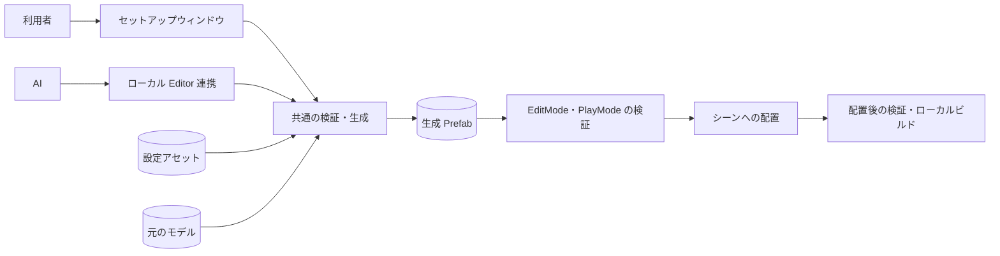

# 仕様書 0.1.0：セットアップと開発ワールド自動更新

- 日付：2026-11-13
- 状態：承認済み（2026-11-13。ユーザーが推奨方針の採用と着手を指示した。作業指示に沿った具体化を含む。**6 節は承認待ち**）
- 関連 Issue：なし（チャットの指示が入口）
- 対になる仕様書：[SPEC_2026-11-13_Editor連携とAI開発運用.md](SPEC_2026-11-13_Editor連携とAI開発運用.md)

## 0. バージョンと制約

- 版：0.1.0（0.0.1 から。初期仕様の 1.0.0 の一部を先に作る）
- データ版：設定アセットの `schemaVersion: 1`
- ライセンス：MIT（ADR 0005）
- 制約：
  - Unity 2022.3 / VRChat Worlds SDK 3.10.0 以降 / UdonSharp。開発と確認は 2022.3.22f1・3.10.6
  - 最初のビルド対象は Windows PC（StandaloneWindows64）。Android は別の課題
  - Runtime は UdonSharp が対応する C# の機能だけを使う（付録 U）
- 関係する ADR：0001・0005、新しく [0008](../05_Decisions/project/0008-settings-as-source-shared-generation.md)

## 1. 内容

戦車モデルと設定アセットから、走行できる車両の Prefab を作る共通の処理を作る。セットアップウィンドウと AI の連携は、同じ処理を呼ぶ。開発環境では、生成した車両を開発用のワールドに置き、アップロードせずにローカルでビルドするまでを自動で行う。

### 1.1 設定アセット（正本）

`ScriptableObject`。生成物から逆算しない。

| 区分 | 項目 | 反映 |
|---|---|---|
| モデル | 元の Model Prefab、モデルの向きの補正（オイラー角） | 生成 |
| 対応 | 車体・左の転輪（複数）・右の転輪（複数）・砲塔・砲身。モデルのアセットの中の Transform を指す | 生成 |
| 走行 | 質量・駆動トルク（全輪の合計）・ブレーキトルク・停止中のブレーキトルク・前進と後退の最高速度・旋回の最高角速度・旋回の角加速度・重心の補正 | Play 中に反映できる |
| 足回り | 転輪の半径（0 で自動）・転輪の質量・サスペンションの長さ・ばね（0 で自動）・減衰（0 で自動）・前後と横の摩擦の強さ | 生成 |
| 出力 | 生成 Prefab のパス（利用者の `Assets/` の下） | 生成 |
| 配置 | 配置 ID・配置済みか・位置・向き | 配置 |

- シーンのインスタンスへの参照は、設定に入れない。モデルの対応は、元のモデルのアセットの中のオブジェクトを指し、生成した Prefab の中の入れ子のインスタンスへは「元のアセットの同じオブジェクトに対応するもの」で解決する（名前では照合しない）。
- AI が設定を書くときは、モデルの中の階層パスで対応を指定する。同じ階層に同じ名前が並ぶときは `名前[番号]` で区別し、区別できなければ書かずに候補を返す。名前の中の `\` `/` `[` `]` には前に `\` を付け、パスから必ず同じ Transform に戻るようにする。
- 初期の物理値は仮の調整値。実車の値や完成した操作感ではない。

### 1.2 検証

生成の前に行う。Error が 1 つでもあれば生成しない。

| 重さ | 例 |
|---|---|
| Error | 元のモデルがない・モデルのアセットでない、車体や左右の転輪がない、対応がモデルの外を指す、同じ転輪が左右に重なる、値が範囲外（質量 0 以下など）、出力先が `Assets/` の外・拡張子が `.prefab` でない、半径を自動にした転輪にメッシュがない |
| Warning | 砲塔・砲身の対応は記録するが、操作は未実装。左右の転輪の数が違う |

### 1.3 生成

- 生成 Prefab の構成：

| オブジェクト | 中身 |
|---|---|
| ルート | Rigidbody、車両の Udon（`YakimaTankVehicle`） |
| `Model` | 元のモデルの入れ子の Prefab。向きの補正をここに掛ける |
| `Colliders/Body` | 車体の BoxCollider。底は転輪の中心より下げない（地面に擦らないため） |
| `Wheels/L0`…・`Wheels/R0`… | WheelCollider。位置と半径は、対応した転輪のメッシュの範囲から求める |

- 元の FBX・Importer・マテリアル・元の Prefab は変えない。
- 初回と 2 回目以降は同じ処理。同じ出力 Prefab を、その場で更新する。
  - コンポーネントを重ねない。GUID と、中のオブジェクト（転輪の数が変わらない範囲）を保つ。シーンに置いたインスタンスと、そこへの参照も保つ。
  - 元のモデルを差し替えたときは `Model` を置き換える（中のオブジェクトは新しくなる）。
- 手順は「検証 → 前の成果物を控える → 作る → 生成物を検査する → 保存」。途中で失敗したら、控えから前の成果物に戻す（Undo には頼らない）。
- 返すもの：作った・変えたアセットの一覧と、検証の結果。

### 1.4 車両の Udon（最小の走行）

- 入力：`SetDriveInput(throttle, steer, brake)`（-1〜1・-1〜1・0〜1 に丸める）。乗車と、VR・Desktop の入力の割り当ては、まだ作らない。
- 前後進：駆動トルクを全輪に等しく配る。進む向きの最高速度に達したら駆動を 0 にする。
- 制動：ブレーキ入力でブレーキトルクを掛ける。入力がない間は停止中のブレーキトルクを掛ける。進行方向と逆の入力では、まず止める。
- 旋回：車体の上向きの角速度を、`steer × 旋回の最高角速度` へ、旋回の角加速度で近づける。カジュアルな操作感を優先し、左右の転輪の回転差では曲げない。転輪が 1 つも接地していないときは手を出さない。
- `_ApplySettingsAndReset`：世代番号を進め、入力を 0、速度と角速度を 0、最初の位置と向きに戻し、質量と重心を設定から入れ直す。設定が足りなければ動き出さず、何が足りないかを Console に出す。Start に頼らない（Start で呼ぶかは切り替えられる）。
- 同期はしない（同期の方式は後の仕様書で決める）。

### 1.5 Play 中の調整

| 変更 | 方法 |
|---|---|
| 「走行」の値 | 再適用：今の車両に値を書き（`SetProgramVariable`）、`_ApplySettingsAndReset` を送る |
| 同じ構造の車両を出し直す | 出し直し：非アクティブの親の下に複製 → 全 UdonBehaviour を登録 → 値を書く（Start での適用を止める） → 親から外す → 同じフレームで `_ApplySettingsAndReset` |
| 対応・足回り・出力など、構造に関わる値 | Play を抜けて生成し直し、Play に入り直す |

- Play 中に変えた値は作業値で、設定アセットには自動で保存しない。明示的に「設定に保存」したときだけ書く。

### 1.6 シーンへの配置

- シーンのルートに管理用の `YakimaTank_Automation` を置き、その下に配置 ID ごとの入れ物 `YakimaTankPlacement_<配置ID>`、その中に生成 Prefab のインスタンスを 1 つ置く。配置 ID は設定ごとに一度だけ作る GUID。
- 初回の位置：シーンの最初の Spawn の前方に、車両の長さと余白の分だけ離し、真下の床に転輪が接する高さにする。床は Spawn の高さ + 2 m から下へ探し、それより高い面（天井・屋根・上の階）は床にしない。ほかのコライダーと重なるか、車両の下の四隅と真ん中の床の高さが 0.3 m より違えば（台の上や段差）、さらに前へずらす。決めた位置と向きを設定に保存する。2 回目からは保存した値を使う。
- 2 回目以降は、配置 ID で同じ車両を探して更新する。同じ要求を 2 回しても 1 台のまま。名前だけで探して消すことはしない。
- 次の場合は変えずに止め、違いを返す：入れ物の位置・向きが設定と違う、入れ物の大きさが 1 倍でない、インスタンスに手で加えた変更（上書き・大きさ・足したり消したりしたコンポーネントやオブジェクト）がある、生成 Prefab のインスタンスでない、管理用のルートが 2 つある。
- 管理用のルートの外・Spawn・照明・カメラ・ワールドの設定・Blueprint ID は変えない。シーンの保存は呼び出し側が行う（ウィンドウでは利用者、開発環境では連携）。

### 1.7 セットアップウィンドウ

- メニュー：`Tools/YakimaTank/Setup`。
- 設定アセットの選択・新規作成、元のモデル、対応（モデルの階層から選ぶ）、走行・足回りの値、出力先。
- 「検証」「生成」「今のシーンに配置・更新」。結果の一覧（Error・Warning・作ったもの）を出す。
- Play 中は「再適用」「出し直し」「作業値を設定に保存」。
- 未実装の機能（砲塔の操作・射撃・同期・乗車）は、未実装と表示する。

### 1.8 開発ワールドの更新（ローカルの開発環境だけ）

公開しない連携の操作として行う。対象のモデル・設定・シーンは、Git の対象外の `Assets/YakimaTankDev/` に置く。

1. 対象シーンを GUID とパスで照らす。開いているシーンを黙って対象にしない。
2. 初回だけ、ひな型のシーン（`Assets/Scenes/VRCDefaultWorldScene.unity`。変えない）から作る。ひな型の Blueprint ID が空でなければ作らずに止める。作ったシーンの Blueprint ID は、自動の処理から変えない。
3. 1.6 の配置を行い、対象シーンだけを保存する。作業の前からあった未保存の変更は、まとめて保存しない。
4. 最終の生成 Prefab のテストと、対象シーンの参照・配置・起動の確認を行う。Play で生じた状態はシーンに保存しない。
5. SDK の `IVRCSdkWorldBuilderApi.Build()` で、SDK の検証とローカルビルドを行う。`BuildAndUpload`・`UploadLastBuild`・`BuildAndTest` は呼ばない。SDK のログインなど、連携ではできない操作は、利用者に頼む。
6. ビルドの成功、成果物があること、対象シーン・設定・コード・プラットフォームとの対応を確かめる。前回の成功したビルドのパスを使い回さない。SDK が変える ProjectSettings は、前後の差分を記録する。

### やらないこと（この版）

- 砲塔の操作・射撃・戦闘・演出・同期・乗車と入力の割り当て（初期仕様の残り。後の版で同じ生成と検証の流れに足す）
- 任意のモデルに通用する、対応の自動推測
- Play 中に構造を変える再生成
- Android 向けのビルド、アップロード

## 2. 仕組みへの影響

- `Docs/03_Architecture/architecture.md`：全体構成（ウィンドウ・連携 → 共通の検証と生成 → 生成 Prefab・シーン）と、主要な流れ（設定 → 生成 → 検証 → 配置 → ビルド）。共通の部品の表に、検証・生成・配置・Play 中の調整を足す。
- `Docs/03_Architecture/diagrams/`：生成 Prefab のデータ構造を 1 図。

## 3. テスト

公開するテストは、権利上公開できる単純な形（立方体と円柱）のモデルで行う。参考モデルでのテストは、開発環境（非公開）で行う。

| 種類 | 何を保証するか |
|---|---|
| EditMode（TDD） | 駆動・制動・旋回の計算、サスペンションの自動の値 |
| EditMode | 検証：必須の参照の不足・範囲外の値・モデルの外を指す対応・曖昧な階層パスを、生成の前に見つける |
| EditMode | 生成：元のアセットが変わらない。2 回生成しても重ならない。GUID・中のオブジェクト・シーンのインスタンスの参照が保たれる。失敗したら前の成果物が残る |
| EditMode | 保存と再現：作業値と保存値を区別し、保存してから生成し直すと値が再現する |
| EditMode | 配置：2 回更新しても 1 台。配置 ID・位置・外からの参照が保たれる。管理の外のオブジェクトと Blueprint ID が変わらない。手で変えた所があれば止める |
| PlayMode（ClientSim・Udon VM） | 生成した車両の前後進・旋回・制動・接地・再適用・リセット・出し直し（下の数値で判定） |
| 開発環境 | 参考モデルの最終の生成 Prefab で上の PlayMode を流す。開発シーンの更新を 2 回して 1 台。アップロード用の UdonSharp コンパイル。ローカルビルドの成功 |

PlayMode の判定（平らな床、静止して接地した状態から。浮動小数点の完全一致では判定しない）：

| 挙動 | 条件 |
|---|---|
| 接地 | 1 秒待つと、全部の WheelCollider が接地し、車体の傾きが 5 度未満 |
| 前進 | `throttle = 1` で 2 秒、前へ 0.5 m 以上進み、横へのずれは進んだ距離の 20% 未満 |
| 後退 | `throttle = -1` で 2 秒、後ろへ 0.5 m 以上進む |
| 最高速度 | `throttle = 1` で 6 秒、前進の速度が最高速度の 110% 以下 |
| 旋回 | `steer = 1` だけで 2 秒、右へ 20 度以上回り、位置のずれは 1 m 未満 |
| 制動 | 前進で速度を出してから `brake = 1`、2 秒以内に 0.2 m/s 未満になる |
| 再適用・リセット | 走った後に値を変えて再適用すると、位置が最初から 0.01 m 以内、速度 0.01 m/s 未満、入力 0、質量が新しい値（1e-3 以内）、世代番号が増える |
| 出し直し | 車両が 1 台のまま、新しい値で動き、部品の参照が新しい車両の中で閉じる |

## 4. 文書に書くこと

- README（ルートとパッケージ）：セットアップウィンドウの使い方、「最近の更新」に 0.1.0
- CHANGELOG：`0.1.0` の節
- AGENTS.md：なし（対の仕様書で直す）
- Docs/：architecture.md と図

## 5. ユーザーに確認してもらうこと

- 参考モデルの左右・回転軸・ピボットのうち、AI が決めきれなかった対応
- 走行の体感（今の値は仮）。Desktop / VR での操作は、入力の割り当てを作る版で確かめる
- VRChat のクライアントでの見た目と挙動（ローカルビルドは自動で行うが、アップロードとクライアントでの確認は人が行う）
- ClientSim での合格は、実機の同期の合格ではない

## 6. 承認待ちの項目

作業指示にない判断。PR で確認する。

| 項目 | 案 | 理由 |
|---|---|---|
| 旋回の方式 | 車体の角速度を目標へ近づける（1.4） | 転輪の回転差だけでは、WheelCollider の横の摩擦で超信地旋回がほとんど回らない。カジュアルな操作感を優先する（初期仕様 1.1） |
| 入力の割り当て | この版は `SetDriveInput` まで。乗車と VR・Desktop の操作は後の版 | 作業指示の範囲は走行の最小の実装まで |
| PlayMode の判定の数値 | 3 節の表 | 作業指示が「条件と許容差を仕様書で定める」としている |
| 初期の物理値 | 質量 20000 kg、駆動トルク 12000 N·m、ブレーキトルク 60000 N·m、停止中 20000 N·m、前進 10 m/s、後退 4 m/s、旋回 30 度/秒・90 度/秒²、サスペンション 0.2 m | 仮の調整値。体感で直す |
| 初回の配置の余白 | Spawn から「車両の長さの半分 + 3 m」前方 | 来た人の目の前で、重ならない距離 |
| 床を探す高さ | Spawn の高さ + 2 m から下へ探す（それより高い面は床にしない） | 屋内で天井や屋根の上に置かないため（PR #1 のレビュー）。人の背より低い天井はない前提。Spawn から 2 m を越えて上る坂の先には置けない |
