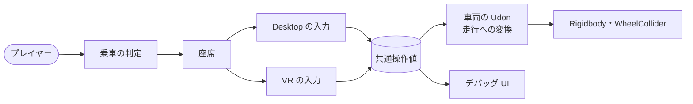
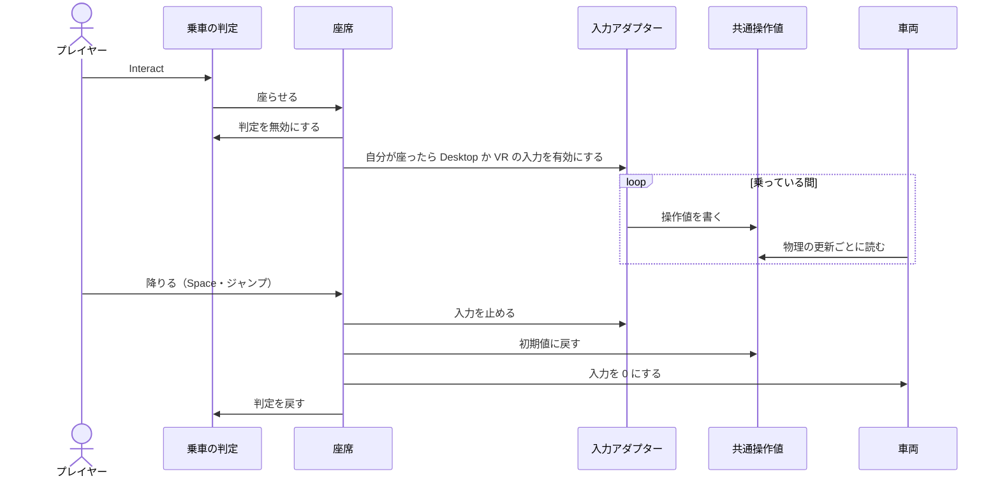

# 仕様書 0.2.0：1 人での乗降と走行の操作

- 日付：2026-11-13
- 状態：下書き
- 承認：（未承認。チャットで決めた方針を 1 節に、指示にない判断と仮の値を 6 節に書いた）
- 関連 Issue：なし（チャットの指示が入口）

## 0. バージョンと制約

- 版：0.2.0（0.1.0 から。初期仕様の 1.0.0 の一部を先に作る）
- データ版：設定アセットの `schemaVersion` は 1 のまま。項目を足すだけで、足した項目のない古い設定は既定値で読む
- プロトコル版：なし（この版は同期しない）
- ライセンス：MIT（ADR 0005）
- 制約：
  - Unity 2022.3 / VRChat Worlds SDK 3.10.0 以降 / UdonSharp。開発と確認は 2022.3.22f1・3.10.6
  - ビルドとアップロードは Windows PC 向け。VR は PC VR（Quest のコントローラーを想定）で確かめる。Quest 単体（Android）は別の課題
  - Runtime は UdonSharp が対応する C# の機能だけを使う（付録 U）
  - 戦車とプレイヤーの当たり判定を外すのに、VRChat の標準のレイヤー `Walkthrough` を使う。プロジェクトのレイヤーと衝突の設定は変えない

- 関係する ADR：0005・0008・0009（0009 の同期はこの版では実装しない。1.7）

## 1. 内容

1 人が戦車の座席に乗り、Desktop と VR で前進・後退・旋回・制動をして、降りられるようにする。入力は、いったん共通の操作値に変換してから車両へ渡す。操作値はデバッグ UI で確かめる。

確かめる順番：実装 → Unity の Play（ClientSim）で Desktop の操作 → ユーザーが VRChat にアップロードし、Desktop と VR で確かめる。

### 1.1 乗車と降車

- 乗る：戦車と同じ大きさの乗車の判定（トリガーの BoxCollider）を Interact すると、座席に座る。大きさは、生成のときにモデル全体（車体と砲塔）の範囲から決める。
- 誰かが座っている間は、乗車の判定を無効にする。座席の出入りの通知は全員に届くので、全員の画面で同じになる。座っていた人が降りたとき・インスタンスから抜けたときに戻す。
- 座席：VRCStation。座った姿勢で、プレイヤーの移動は乗り物用に止める（`ImmobilizeForVehicle`）。
- 座席は砲塔の子に置く（車長のキューポラ）。砲塔の対応がなければ車体の子に置き、Warning を出す。この版では砲塔は回らない。
- 座席の位置：砲塔の範囲の上面の中央を自動の位置とし、設定の「ずらし」を足す。ずらしは Play 中に再適用で動かせる。
- 降りる：VRCStation の標準の降り方（Desktop は Space、VR はジャンプ）。降りる位置は座席の場所（その場）。戦車はプレイヤーと当たらないので、車両を通り抜けて下へ降りる。
- 降りたとき：入力を止め、共通操作値を初期値（1.2 の表）に戻し、車両の入力を 0 にする。車両は停止中のブレーキで止まる。
- 戦車とプレイヤーの当たり判定：車体のコライダーと WheelCollider を `Walkthrough` レイヤーに置く。プレイヤーは戦車をすり抜け、戦車はプレイヤーに乗り上げない。壁・地面とは今までどおり当たる。乗車の判定だけは、Interact できるように `Default` レイヤーのトリガーにする。

### 1.2 共通操作値

入力の方法（Desktop・VR・将来の物理レバーなど）と車両の動きを分けるための値。入力アダプターが書き、車両とデバッグ UI が読む。

| 操作値 | 型・範囲 | 内容 | この版で書く入力 | 初期値 |
|---|---|---|---|---|
| ハンドル `Steering` | float −1〜1 | 正で右 | Desktop・VR | 0 |
| 左右レバー `LeftLever`・`RightLever` | float 0〜1 | 左右の旋回レバー | なし（値と表示だけ） | 0 |
| アクセル `Throttle` | float 0〜1 | 踏んだ量 | Desktop・VR | 0 |
| 前進後退入力 `DriveAxis` | float −1〜1 | 前後の操作そのもの。正で前 | Desktop・VR | 0 |
| ギア `Gear` | int | 1 前進・−1 後退 | Desktop・VR | 1 |
| ブレーキ `Brake` | float 0〜1 | 踏んだ量 | なし（値だけ） | 0 |
| 砲の左右入力 `TurretYawInput` | float −1〜1 | 正で右 | Desktop・VR（表示だけ） | 0 |
| 砲の上下入力 `GunPitchInput` | float −1〜1 | 正で上 | Desktop・VR（表示だけ） | 0 |
| 射撃 `Fire` | bool | 押している間 ON | Desktop・VR（表示だけ） | OFF |

- 走行への変換（カジュアル）：乗っている間、車両は物理の更新ごとに共通操作値を読み、0.1.0 の `SetDriveInput(Throttle × Gear, Steering, Brake)` と同じ入力にする。逆向きの入力ではまず止める、入力がなければ停止中のブレーキを掛ける、は 0.1.0 のまま。
- 誰も乗っていない間、車両は共通操作値を読まない。`SetDriveInput` を直接呼べる（0.1.0 のテストのため）。
- 砲の値はメモの「目標角」ではなく、入力の量（−1〜1）として持つ。目標角への変換は砲塔を動かす版で決める。

### 1.3 Desktop の操作

| 入力 | 操作値 |
|---|---|
| W | 前進後退入力 +1、ギア 前進、アクセル 1 |
| S | 前進後退入力 −1、ギア 後退、アクセル 1。押している間だけ後退。前進中に押すと、まず止まってから後退する |
| W と S を同時・どちらも押さない | 前進後退入力 0、ギア 前進、アクセル 0 |
| A / D | ハンドル −1 / +1 |
| 視点（マウス） | 車体から見た頭の向き。左右 ±180 度・上下 ±90 度を −1〜1 にして、砲の左右・上下入力にする |
| 左クリック | 射撃 |
| Space | 降車（VRCStation の標準） |

- キーは押した・離したの 2 値で、操作値はすぐ変わる。旋回の滑らかさは、車両の旋回の角加速度で付く（0.1.0）。

### 1.4 VR の操作

左手で走行、右手で砲と射撃。手の位置と向きは、車体から見た値で扱う。

| 入力 | 操作値 |
|---|---|
| 左グリップを握る | 握った瞬間の手の位置と向きを基準にする |
| 左グリップ＋左右のねじり | ハンドル。手首を左にひねると左旋回。基準からの角度を「ねじりの最大角」で −1〜1 にする |
| 左グリップ＋前後 | 前進後退入力。基準から前後に動かした距離を「前後の最大距離」で −1〜1 にする。手前に引いて「後退のしきい値」を越えている間はギア 後退、それ以外は前進 |
| 左トリガー | アクセル（アナログ 0〜1）。ギアの向きに進む。手前に引いたままトリガーを引くと後退する |
| 左グリップを離す | ハンドル 0、前進後退入力 0、ギア 前進。アクセルはトリガーのまま |
| 右グリップ＋左右のねじり | 砲の左右入力 |
| 右グリップ＋前後 | 砲の上下入力 |
| 右トリガー | 射撃 |
| ジャンプ | 降車（VRCStation の標準） |

- 前後は手の位置（基準からの距離）で取る。
- 明示のブレーキ入力はこの版にない。トリガーを離すと停止中のブレーキが掛かり、進行と逆のギアでトリガーを引くとまず止まる。
- グリップを握ったとみなす値・ねじりの最大角・前後の最大距離・後退のしきい値・不感帯は、設定の調整値（1.6）。

### 1.5 デバッグ UI

- 車両とは別の Prefab としてパッケージに入れる。利用者がシーンに置き、表示する車両を指定する。
- 表示は箱（Cube）の大きさの変化で行う。float は、−1〜1 の枠と 0 の目盛りを置き、値の分だけ中央から箱を伸ばす。範囲を越えた値は端で止める。0〜1 の値も同じ −1〜1 の枠で出す。
- 項目：ハンドル、左レバー、右レバー、アクセル、前進後退入力、ギア（テキスト）、砲の左右入力、砲の上下入力、射撃（ON の間だけ箱を出す）。
- 文字：ギア（`FWD`・`REV`）と項目名は英字にする。日本語のフォントを同梱しないため。
- 置き方：車両に付いて行く（車体から見た位置と向きを指定）か、置いた場所に留まるかを選べる。既定は付いて行く。
- 表示は各自の画面だけ（同期しない）。乗っていない人の画面では初期値のまま。
- 開発ワールドの更新では、配置 ID ごとの入れ物に、車両と並べてパネルを 1 枚置き、その車両を指定する。利用者のウィンドウの「配置」では置かない。

### 1.6 設定とセットアップ

足す設定：

| 区分 | 項目 | 反映 |
|---|---|---|
| 座席 | 自動の位置からのずらし | Play 中に反映できる |
| 操作（VR） | グリップを握ったとみなす値、ねじりの最大角、前後の最大距離、後退のしきい値、不感帯 | Play 中に反映できる |

- 生成：乗車の判定、座席（VRCStation と座席の Udon）、Desktop と VR の入力、共通操作値を足す。車体のコライダーと WheelCollider を `Walkthrough` レイヤーにする。2 回目以降も重ねない。GUID と中のオブジェクトを保つ（0.1.0 と同じ）。
- 検証：`Walkthrough` レイヤーがない（VRChat のレイヤーの設定がされていない）と Error。砲塔の対応がないと Warning（座席を車体に置く）。
- Play 中の再適用：車両に加えて、座席と入力の Udon にも値を書く。
- ウィンドウ：未実装の表示から「乗車」を外す。

### 1.7 同期

- この版は同期しない。0.1.0 と同じく、物理は各自の画面で計算する。乗った人の画面でだけ車両が動き、他の人の画面では止まったまま。
- 所有権・車体の同期・車両同士の衝突は、ADR 0009 と [SPEC_2026-11-13_車両物理同期と簡易衝突.md](SPEC_2026-11-13_車両物理同期と簡易衝突.md) の実装で入れる。

### やらないこと（この版）

- 車体の同期・所有権・車両同士の衝突
- 砲塔・砲身の動きと射撃（入力の表示まで）
- 物理レバー・ハンドル、ギアの段と弾種の切り替え（Q/E・R/F）、ラジコン、複数人の乗車
- 乗車の判定の形の作り込み（この版は戦車と同じ大きさ）、ひっくり返ったときの戻し
- Quest 単体（Android）
- 初期仕様 1.2 の VR の表（右トリガーでアクセルなど）は、この仕様の 1.4 で置き換える

## 2. 仕組みへの影響

- `Docs/03_Architecture/architecture.md`：全体構成に乗車・入力・共通操作値・デバッグ UI を足す。主要な流れに「乗車から降車まで」を足す。共通の部品の表に新しい部品を足す。
- `Docs/03_Architecture/diagrams/generated-prefab.md`：座席・乗車の判定・入力・レイヤーを足す。

部品（名前は仮）：

| 部品 | 場所 | 用途 |
|---|---|---|
| `YakimaTankControlState` | Runtime | 共通操作値 |
| `YakimaTankSeat` | Runtime | 座席の出入り、入力の切り替え、降りたときのリセット |
| `YakimaTankBoarding` | Runtime | 乗車の判定の Interact |
| `YakimaTankDesktopInput` | Runtime | Desktop の入力アダプター |
| `YakimaTankVRInput` | Runtime | VR の入力アダプター |
| `YakimaTankDebugPanel` | Runtime | デバッグ UI（別 Prefab） |
| 走行への変換 | `YakimaTankVehicle` の中 | 共通操作値から走行の入力へ |

## 3. テスト

| 種類 | 何を保証するか |
|---|---|
| EditMode（TDD） | Desktop の変換：W・S・A・D の組み合わせから操作値。VR の変換：ねじり・前後・トリガーから操作値（不感帯、最大値で止める、後退のしきい値、グリップを離したとき）。視点から砲の入力。走行への変換（アクセル × ギア）。降りたときの初期値。ゲージの箱の大きさと位置（範囲外は端） |
| EditMode | 生成：座席が砲塔の子（砲塔がなければ車体の子で Warning）。乗車の判定がモデル全体の範囲のトリガー。車体のコライダーと WheelCollider が `Walkthrough`。2 回生成しても重ならず、GUID と中のオブジェクトを保つ。検証：`Walkthrough` がなければ Error。設定：足した項目のない古い設定を既定値で読み、保存してから生成し直すと値が再現する |
| EditMode | 開発ワールドの更新を 2 回してもパネルは 1 枚で、同じ入れ物の車両を指す |
| PlayMode（ClientSim・Udon VM） | 乗る → 自分の入力が有効になり、乗車の判定が無効になる。入力アダプターを止めて操作値を直接書き、前進・後退・旋回・制動（判定の数値は 0.1.0 の 3 節と同じ）。降りる → 入力が止まり、操作値が初期値に戻り、5 秒以内に 0.2 m/s 未満、乗車の判定が戻る。乗っていない間は `SetDriveInput` がそのまま効く（0.1.0 の PlayMode が通る） |
| 開発環境 | 開発用のモデルの最終の生成 Prefab で上の PlayMode。開発ワールドの更新 2 回で車両 1 台・パネル 1 枚。アップロード用の UdonSharp コンパイル。ローカルビルド |

- PR までに通す検証：C#・UdonSharp のコンパイル、EditMode・PlayMode、生成、開発ワールドの更新、ローカルビルド。最終の入力に対応する要求 ID と結果を残す。
- 除外・未確認：キー・マウス・VR コントローラーの実際の入力は、自動では確かめられない（5 節）。ClientSim の合格は、VRChat のクライアントでの合格ではない。

## 4. 文書に書くこと

- README（ルートとパッケージ）：乗り方・降り方、Desktop と VR の操作、デバッグ UI の置き方。「最近の更新」に 0.2.0
- CHANGELOG：`0.2.0` の節
- AGENTS.md：なし
- Docs/：architecture.md と図。初期仕様の 1.2 に「（注: VR の操作は 0.2.0 の仕様書の 1.4 で置き換えた）」

## 5. ユーザーに確認してもらうこと

- Unity の Play（ClientSim、Desktop）：判定を Interact して乗る、W・S・A・D で前進・後退・旋回、前進中の S で止まってから後退、Space で降りる、デバッグ UI の値の動き
- VRChat（アップロード後、Desktop と PC VR）：上と同じこと。VR は左グリップのねじりで旋回、手前に引いてトリガーで後退、トリガーを離すと止まる。右手の入力と射撃の表示
- VR のトリガーとグリップのアナログ値が取れているか（デバッグ UI で見る）
- 座っている間に、VRChat 本来の「掴む・使う」（グリップ・トリガー）と操作がぶつからないか
- 座席の高さと視点（アバターの大きさで変わる。ずらしで合わせる）
- プレイヤーが戦車をすり抜けること、降りたときに地面へ降りられること
- 動く車両の上での VR の見え方（揺れ・酔い）
- 調整値の体感（今の値は仮）

## 6. 承認待ちの項目

指示にない判断と仮の値。

| 項目 | 案 | 理由 |
|---|---|---|
| 同期 | この版は同期しない（1.7） | 1 人で乗降と走行を確かめるのが目的。同期は ADR 0009 の実装で、所有権と一緒に入れる |
| 後退中の旋回の向き | A・D とねじりの向きに車体が回る。後退中も反転しない | 0.1.0 の動きのまま |
| 明示のブレーキ入力 | この版はなし（1.4） | 後退の入力と停止中のブレーキで止められる。ブレーキの値は持つので、後から足せる |
| VR の前後の取り方 | 手の位置（基準からの距離） | 手前に「引く」動きとそろう。メモでは実装時に決めるとしていた |
| VR の砲の上下 | 右グリップ＋前後 | メモに割り当てがない。左手と同じ動きにそろえる |
| Desktop の砲の入力 | 車体から見た頭の向きを −1〜1 に（1.3） | メモの「マウスで狙った方向」を、砲塔を作る前に値として見るため |
| 左右レバーとブレーキ | 値と表示だけ持ち、書く入力はない | 表示の項目に入っている。物理レバーの版で使う |
| ギア | 前進と後退の 2 つ。後退は S を押している間・左手を手前に引いている間だけ | 指示の「手前に引いているときは後退」を Desktop にもそろえた |
| デバッグ UI の文字 | 英字 | 日本語のフォントを同梱しない |
| デバッグ UI の置き方 | 車両に付いて行くのが既定。開発ワールドの更新では自動で置く | 走っている間も運転手から見えるように |
| デバッグ UI の項目 | 指示の項目だけ。メモにある「入力方式・乗車状態・速度」は入れない | 指示の範囲 |
| 乗車の判定 | 誰かが座っている間は無効にする | 乗っている間、戦車全体が Interact の対象として光り続けないように |
| 座席の自動の位置 | 砲塔の範囲の上面の中央にずらしを足す | 0 のずらしで、たいていのモデルでキューポラの近くになる |
| 調整値の初期値 | グリップ 0.5、ねじりの最大角 45 度、前後の最大距離 0.15 m、後退のしきい値 0.5、不感帯 0.1 | 仮の値。動かして決める |
| PlayMode の判定の数値 | 3 節（降りてから 5 秒以内に 0.2 m/s 未満など） | 0.1.0 の判定にそろえた |
