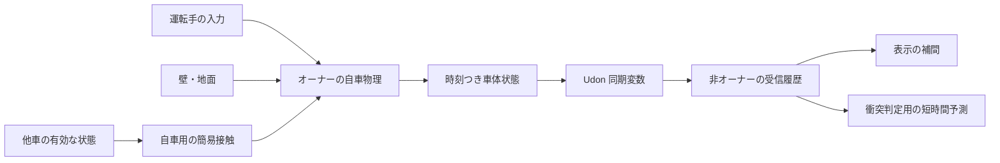
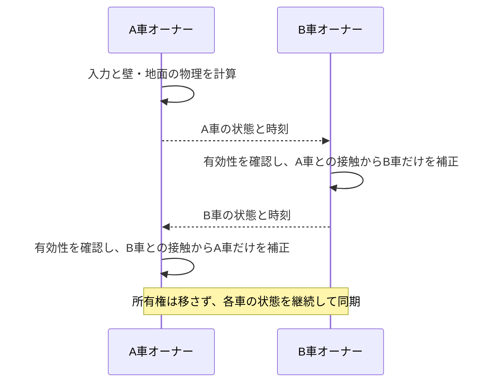

# 仕様書（対象版未定）：車両物理の独自同期と簡易衝突

- 日付：2026-11-13
- 状態：下書き（方式と挙動の方針は承認済み。実装着手の指示はまだない）
- 承認：2026-11-13、ユーザーが「推奨の通りで決めてください」と指示。運転手をオーナーにする独自同期、短いめり込みを許容する安定性優先の簡易衝突、無人車の低速での押し移動、有人車のブレーキ抵抗を採用する。実装前に確定する項目は 6 節。
- 関連 Issue：なし（チャットの指示が入口）

（注: 1.1・1.2 と 1.4 の同期の部分は、[SPEC_2026-11-13_車体の同期と所有権.md](SPEC_2026-11-13_車体の同期と所有権.md)（0.3.0）で具体化した。車両同士を外す方法も、0.3.0 ではそこで決めた（6 節の 3 つめ）。1.3 の車両同士の衝突は、その次の版の仕様書で具体化する。）

## 0. バージョンと制約

- 対象の製品版：実装着手時に決める。文書の追加だけでは製品の版を上げない。
- プロトコル版 / 設定データ版：実装仕様で確定する。相手の同期形式を識別できるようにし、未対応の形式から衝突反力を作らない。設定の移行が必要なら ADR 0008 の規則に従う。
- ライセンス：MIT（ADR 0005）。
- 制約：
  - 確認環境は Unity 2022.3.22f1 / VRChat Worlds SDK 3.10.6 / UdonSharp、Windows PC。
  - 同時に走行する戦車は 4 台程度を想定して検証する。4 台を製品の強制上限にはしない。
  - Runtime は UdonSharp 対応範囲内とし、新しい外部依存は前提にしない。

- 関係する ADR：0005・0008、新しく [0009](../05_Decisions/project/0009-driver-owned-custom-vehicle-sync.md)

## 1. 内容

### 1.1 物理計算と所有権

- 乗車中は運転手が車両オーナーとなり、自車の Rigidbody と WheelCollider を動かす。操作入力の反映を通信往復待ちにしない。
- 所有権取得を確認するまでは運転入力を有効にしない。衝突で所有権を移さない。
- 非オーナーは Rigidbody を kinematic にし、WheelCollider による走行の物理計算を止める。自車の権威状態を書き換えない。
- 降車したら運転入力を解除し、直前の運転手が所有を続ける。通常は停止を保つが、他車に低速で押されれば動ける。
- 有人車はブレーキ操作で押されにくくする。駐車保持と押し移動のバランスは実機で調整する。
- オーナー退出による所有者交代では、最後の有効な位置・姿勢・速度から引き継ぎ、前の運転手の入力を残さない。無人でもオーナーが接触と必要な物理計算を担当する。
- 同時乗車要求、乗車失敗、所有者交代と乗員状態の食い違いを扱う具体的な手順は実装仕様で確定する。操作系全体の割り当ては別の検討とする。

### 1.2 独自同期

- VRCObjectSync と独自処理が同じ車体の位置・姿勢を書き合う構成にしない。
- 同期変数で、位置・姿勢・速度・角速度・計測時刻・停止状態・所有者交代とリセットの識別情報を送る。
- Manual 同期を第一候補とする。走行中の毎秒 10〜15 回は試験開始値であり、送信保証や確定した制限ではない。
- 送信直前に最新の物理状態を採取する。停止中は送信を減らし、発進・衝突・所有者交代・リセット時に更新を要求する。停止した最終姿勢は途中参加にも復元できるよう残す。
- RequestSerialization の要求頻度と、実際の送信間隔は分けて測る。輻輳時に古い状態を延々と再送する設計にしない。
- 受信した複数の状態から表示を補間する。補間に使う時間軸と、衝突判定用に現在へ近づける短時間予測を分ける。
- 予測を続ける時間には調整可能な上限を設ける。古い・無効な状態を根拠に押す力を加え続けない。欠落時の停止・復帰・接触の扱いは実装仕様で具体化する。
- 所有者交代・リセットでは補間履歴と接触履歴を切り替える。旧所有者やリセット前の状態、重複・逆順の更新を混ぜない。
- 受信値の有限性、時刻、所有者、同期形式、世代を検証する。共有時刻の折り返しを考慮する。
- 砲塔・履帯などの演出は、車体物理の同期と責務を分ける。射撃・ダメージの同期仕様はこの文書では決めない。

### 1.3 壁・地面と車両間の衝突

- 壁・地面とは、オーナー側の通常の Unity 物理で接触する。
- 戦車同士の通常の Rigidbody 衝突は外し、単純な車体形状による専用判定を使う。同じプレイヤーが複数台を所有するときも同じ規則にする。
- WheelCollider が他車を地面として扱って乗り上げる経路も除外する。既存ワールドの無関係なレイヤー設定を上書きしない。
- 各オーナーが、自車の状態と相手の最新の有効状態から、自車だけの減速・押し移動を決める。相手の Rigidbody を直接動かさない。
- 正面衝突は接近速度を減らし、反発を弱くする。横からの接触は主に横移動で受け、跳ね上がり・乗り上げ・激しい回転を抑える。
- 継続接触は状態から再評価し、毎フレームの「押す」ネットワークイベントに依存しない。
- 短いめり込みは許容し、少しずつ解消する。反力・位置補正・複数接触を合計した補正に調整可能な上限を設ける。具体的な数値は 6 節の未確定項目とする。
- 壁との接触を優先する。めり込みを直す補正先も確認し、壁を抜ける位置へ押し出さない。
- 高さの違う車両を誤って押さず、高速接近でのすり抜けも検証する。検出形状と連続判定の手段は実装仕様で確定する。
- 全員の衝突時刻や厳密な運動量の一致は保証しない。遅延差があっても反動が増幅しないことを優先する。

### 1.4 セットアップ

- 同期・衝突の設定は設定アセットを正本とし、共通の生成処理で車両へ反映する。
- 所有権、非オーナーの物理停止、判定形状、レイヤー・衝突除外の整合を生成時に確認する。
- 既存の車両の走行設定・参照・生成物の GUID を保つ。

## 2. 仕組みへの影響

次の図は採用予定の設計。現行実装の図（`Docs/03_Architecture/architecture.md`）は、実装した PR で更新する。

## 3. テスト

実装時に次を保証する。文書だけの今回の作業では実行済みと扱わない。

- 純粋な計算は TDD：接近時の減速、離反時に不要な反力を出さないこと、めり込み補正・合計補正の上限、古い状態・無効値・形式不一致の扱い。
- 同期の計算：補間、短時間予測と打ち切り、時刻の折り返し、重複・逆順・所有者交代・リセット・途中参加。
- 生成とローカル物理：所有者だけが駆動すること、非オーナーの物理停止、無人車の停止と押し移動、ブレーキ抵抗、壁を越えない補正、通常衝突との二重適用がないこと。
- 既存走行の回帰確認：前後進・制動・旋回・再適用と設定保存。

- PR までに通す検証：実装 PR では、C#・UdonSharp コンパイル、生成、EditMode・PlayMode、開発シーンへの配置とローカルビルド。最終入力に対応する要求 ID・結果を残す。今回の文書追加では、相対リンク、索引、承認範囲、ADR との整合、独立レビュー。
- 除外・未確認：実機でのみ確かめられる同期・体感は 5 節に分ける。ClientSim の成功を複数クライアント同期の成功とは扱わない。今回の文書追加では Unity の検証は対象外。

## 4. 文書に書くこと

- README・CHANGELOG：今回は変更しない。実装・リリース時に反映する。
- AGENTS.md：変更なし。
- Docs/：SPEC と ADR 0009 を追加し、両方の一覧を更新する。ADR 0008 の同期方式の未決事項には決定への注記を足す。
- architecture.md：実装時に、所有権・同期・簡易接触と既存の走行処理の関係を反映する。

## 5. ユーザーに確認してもらうこと

- PCVR・Desktop での運転入力への反応と、他車の見た目。
- 4 台での正面衝突・横擦り・壁への押し付け・密集・斜面での接触。
- 無人車が通常停止し、ゆっくり押せること。有人車はブレーキで抵抗できること。
- 通信遅延・更新欠落時に跳ね上がりや振動が増幅しないこと。
- 接触中の乗り換え・降車・退出・途中参加・リセット。
- 実際の送信間隔・通信量と、送信頻度や補間・予測の調整結果。

## 6. 承認待ちの項目（実装前に確定する）

方式と挙動の方針は承認済み。次は今回の判断で確定したと扱わない。

- 対象の製品版、同期のプロトコル版、設定の移行。
- 所有権取得と乗員状態を整合させる手順、欠落時の接触処理、判定形状。
- 車両同士の通常衝突と WheelCollider の乗り上げを外す手段。レイヤーの衝突行列はワールド（プロジェクト）側の設定で、パッケージの Prefab だけでは変えられない。専用レイヤー・コライダー単位の除外・生成時の検証と案内のどれで実現するか。0.2.0 では、戦車とプレイヤーの当たりを外すのに `Walkthrough` レイヤーを使う（[SPEC_2026-11-13_乗降と走行操作.md](SPEC_2026-11-13_乗降と走行操作.md)）。
- 実際の送信頻度、補間時間、予測の打ち切り時間、押す力・補正量の上限、駐車保持の強さ、体感の合格基準。
- 実装の着手。着手の指示後、確定した仕様に沿って TASKS を作り、実装と検証へ進む。
