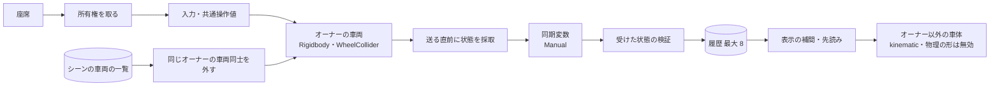
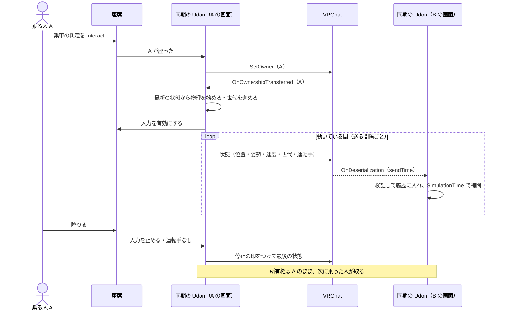
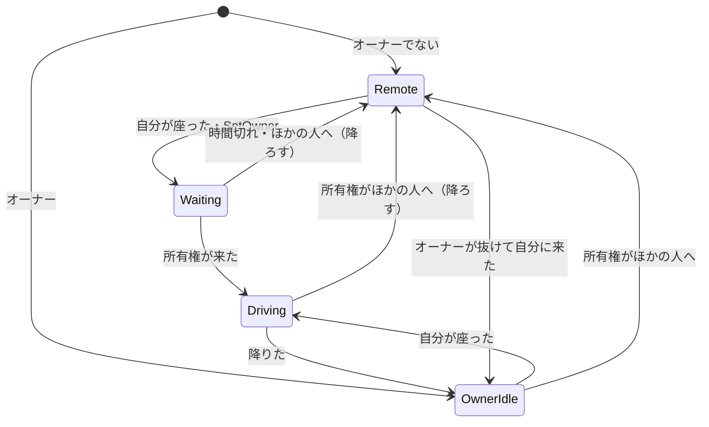

# 仕様書 0.3.0：車体の同期と所有権

- 日付：2026-11-13
- 状態：承認済み（2026-11-14。実装の着手はまだ指示されていない。0.2.0 の実装の後に始める）
- 承認：方式の方針は [ADR 0009](../05_Decisions/project/0009-driver-owned-custom-vehicle-sync.md) と [SPEC_2026-11-13_車両物理同期と簡易衝突.md](SPEC_2026-11-13_車両物理同期と簡易衝突.md) で承認済み。この仕様書はその同期の部分を、実装できる形にしたもの。
  - 2026-11-13、ユーザーがチャットで「案はおすすめの通りに」と指示し、下書きの 6 節にあった次の判断と仮の値を承認した。
  - 2026-11-14、ユーザーが 1〜5 節の本文の要約を読んで、チャットで「承認」と指示した。1.10 の「実装の最初に確かめること」と、その「違ったとき」の扱いも含む。
  - 2026-11-14、PR #2 のレビューの指摘を受けたユーザーの指示で、次を直した。保留を送った人ごとにし、今のオーナーの状態では消さない（1.5）。代わりの表示時刻を、今の時刻から求める（1.5・1.10）。
  - 2026-11-14、実装の前のレビューの指摘で次を直し、ユーザーがチャットで「進めてください」と指示して承認した。止まった後に位置・姿勢がずれたら送る（1.4。仮の値 0.05 m・1 度）。所有権が移ったときに消す保留を新しいオーナーの分だけにし、捨てる条件を決める（1.5。仮の値 5 秒）。合わせたテスト（3 節）。
  - 0.3.0 は同期まで。車両同士はすり抜け、簡易衝突は次の版（1 節）
  - 車両同士を外す方法：オーナー以外の画面では物理の形を無効、同じオーナーの車両同士は `Physics.IgnoreCollision`。プロジェクトのレイヤー設定は変えない（1.6）
  - 仮の値：送る間隔 0.1 秒、先読みの上限 0.25 秒、止まったとみなす速さと時間、有効とみなす速さの上限、所有権を待つ時間（1.2・1.4・1.5・1.9）
  - 表示する時刻に `Networking.SimulationTime` を使い、使えなければ遅らせた時刻にする（1.5・1.10）。ビルドの前の一覧の確かめ（1.8）。デバッグ UI の項目（1.7）
- 関連 Issue：なし（チャットの指示が入口）

## 0. バージョンと制約

- 版：0.3.0（0.2.0 の乗降と操作を前提にする）
- プロトコル版：同期の形式 1（同期変数 `syncFormat`）。この版で初めて同期する
- データ版：設定アセットの `schemaVersion` を 3 に上げる。版 2 の設定は、値と参照を保ったまま、足した項目を既定値で補って版 3 に移す（ADR 0008）
- ライセンス：MIT（ADR 0005）
- 制約：
  - Unity 2022.3 / VRChat Worlds SDK 3.10.0 以降 / UdonSharp。開発と確認は 2022.3.22f1・3.10.6、Windows PC
  - 同時に走る戦車は 4 台程度で確かめる。台数の上限は設けない
  - プロジェクトのレイヤーと衝突の設定は変えない（0.2.0 と同じ）
  - Runtime は UdonSharp が対応する機能だけを使う（付録 U）

- 関係する ADR：0005・0008・0009

## 1. 内容

複数人のインスタンスで、運転手の画面で動かした車体を、ほかの人の画面でも同じ場所に見せる。運転手が車両のオーナーになり、自車の物理だけを計算して、状態を同期変数で送る（ADR 0009）。ほかの人の画面では、受け取った状態を補間して表示する。

この版では、車両同士は当たらない（すり抜ける）。ぶつかって止まる・押す簡易衝突は、次の版で入れる（[SPEC_2026-11-13_車両物理同期と簡易衝突.md](SPEC_2026-11-13_車両物理同期と簡易衝突.md) の 1.3）。VRChat で同期を確かめるまでを先に通すため。衝突の調整は、同期が動いてからでないとできない。

確かめる順番：実装 → Unity の Play（ClientSim。リモートのプレイヤーを足して、所有者の切り替えまで）→ VRChat のローカルテスト（1 台の PC で 2 つのクライアント）→ アップロードして、別の PC・回線と PC VR で。

### 1.1 所有者と、物理を計算する人

| 画面 | 車体 | 物理の形（車体のコライダー・WheelCollider） | 入力 |
|---|---|---|---|
| オーナー | Rigidbody で計算する（0.1.0 のまま） | 有効 | 自分が座っていれば有効 |
| オーナー以外 | kinematic。受け取った状態を補間して置く | 無効 | 無効 |

- 最初のオーナーは VRChat の既定（インスタンスのマスター）。無人の車両は、オーナーの画面で停止中のブレーキで止まる。
- 所有権は、車両のルート（Rigidbody と車両の Udon がある GameObject）の単位。
- Start のときと、所有権が移ったとき（`OnOwnershipTransferred`）に `Networking.IsOwner` で表の状態へ切り替える。状態を受け取ったら（1.5）、オーナーでないことが確かなので、オーナー以外の状態にする。
- オーナー以外の画面では、車両の物理の形を無効にする。遅れて届いた位置の車両が、自分の車両やワールドの物を押さないようにするため（ADR 0009 の「kinematic でも他の Rigidbody を動かす」）。乗車の判定（トリガー）は有効のまま。
- オーナー以外では、`SetDriveInput` と共通操作値で車両は動かない。テストや外から呼べる入口も、オーナーの確認を迂回しない。
- Play 中の再適用（`_ApplySettingsAndReset`）は、オーナーでは今までどおり値を入れて最初の位置に戻し、世代（1.3）を進めて送る。オーナー以外では値だけを入れ、位置は同期に従う。

### 1.2 乗る・降りる・抜けるときの所有権

0.2.0 の乗降に、次を足す。

1. 乗る：座席に座った人は、オーナーでなければ所有権を取る（`Networking.SetOwner`）。オーナーになったと分かるまで、入力を有効にしない。
2. オーナーになったら：最新の有効な状態（1.5）の位置・姿勢・速度から物理を始める。入力を有効にし、運転手を自分にして、すぐに送る。
3. 座ってから 3 秒（仮の値。所有権の移動を待つには十分で、乗れないまま長く待たせない長さ）たってもオーナーになれないとき、座ったまま所有権がほかの人に移ったとき：座席から降ろし、入力を止める。
4. 降りる：0.2.0 のとおり入力を止め、共通操作値を初期値に戻す。所有権はそのまま持ち、運転手を「なし」にして送る。車両は停止中のブレーキで止まる。
5. オーナーがインスタンスから抜けた：VRChat が決めた新しいオーナーが、最新の有効な状態から物理を引き継ぐ。前のオーナーの入力は残らない（入力は同期しない）。運転手がもういなければ「なし」にする。
6. 衝突で所有権を移さない（ADR 0009）。

- 運転手（座っている人のプレイヤー ID）を同期する。乗車の判定は、同期した運転手がいる間と、座席の出入りの通知で人が座っている間は無効にする。途中で入った人の画面でも、同期した運転手で無効になる（0.2.0 の 1.1 で残した確認を、ここで扱う）。
- 運転手の ID がインスタンスにいない人を指していたら、「なし」として扱う。
- 所有権の要求を断る仕組み（`OnOwnershipRequest`）は使わない。座席が空いているときだけ乗れるので、取り合いは座席の出入りの短い間に限られる。取り合ったら、3. で所有権を取れなかった側が降りる。

### 1.3 送る状態

同期は Manual。車両のルートに、同期を受け持つ Udon（`YakimaTankVehicleSync`、名前は仮）を足す。

| 同期変数 | 型 | 内容 |
|---|---|---|
| 形式 `syncFormat` | byte | 1。違う値の状態は使わない |
| 世代 `syncEpoch` | int | オーナーが、所有権を取ったとき・最初の位置に戻したときに 1 進める。変わったら、受ける側は補間の履歴を捨てて、その状態にすぐ置く |
| 位置・姿勢 | Vector3・Quaternion | Rigidbody の位置と回転 |
| 速度・角速度 | Vector3・Vector3 | Rigidbody の値。補間と先読みに使う |
| 停止 | bool | 止まったと判断して送った最後の状態 |
| 運転手 | int | 座っている人のプレイヤー ID。いなければ −1 |
| 送った人 | int | 送ったオーナーのプレイヤー ID。受ける側は、今のオーナーと合うものだけを使う（1.5） |

- 時刻は同期変数で送らない。受ける側は `OnDeserialization` の `DeserializationResult.sendTime` を、送った時刻として使う。送る側は、送る直前（`OnPreSerialization`）に Rigidbody から値を取る。
- 共有時刻（`Networking.GetServerTimeInMilliseconds` の int のミリ秒）を送る案は採らない。折り返しの扱いが要り、受ける側の時間軸に直す処理も自分で書くことになるため。`sendTime` は受ける側の起動からの秒（float）で、折り返さない。精度は起動から長くなるほど落ちる（1 日で約 8 ミリ秒）が、送る間隔 0.1 秒に対しては足りる。
- 1 回の大きさは 100 バイト未満の見込み。実際の量は VRChat で測る（5 節）。

### 1.4 送る間隔

- 動いている間：設定の「送る間隔」ごとに `RequestSerialization` を呼ぶ。
- 動いているとみなす：速さが 0.05 m/s 以上か、旋回の速さが 2 度/秒以上、または運転の入力がある。どちらの値も、見た目でほとんど分からない動きを「止まっている」に入れるための仮の値。
- 止まった：動いていない状態が 0.5 秒（送る間隔の 5 回分。止まりかけの小さな揺れで、送り始めと停止を繰り返さないための仮の値）続いたら、停止の印を付けて 1 回送り、送るのをやめる。最後の状態は、VRChat が途中で入った人に渡す。
- 止まった後のずれ：送るのをやめた後も、オーナーの物理は動く。動いているとみなす値より遅く滑り続けると（0.04 m/s なら 30 秒で 1.2 m）、ほかの人の画面と位置がずれていく。
  - 最後に送れた状態（`OnPostSerialization` で成功した状態）の位置・姿勢を基準にする。送るのをやめている間に、位置が 0.05 m 以上か、向きが 1 度以上ずれたら、最新の状態に停止の印を付けて 1 回送る。どちらも見た目でほとんど分からず、止まった車両の小さな揺れでは送らない大きさ（仮の値）。
  - ずれで送った後も止まったままとし、定期の送信は始めない。基準は、送れた状態に置き換える。動いているとみなす値を超えたら、今までどおり動き出したとしてすぐに送る。
  - 詰まっている間は、下の詰まりの扱いに従う。
- すぐに送る：乗った・降りた・所有権を取った・最初の位置に戻した・止まった状態から動き出した。
- 送れる量が詰まっている間（`Networking.IsClogged`）は要求を控える。詰まりが解けたら、最新の状態を 1 回送る（停止の印を落とさない）。
- 古い状態をためて送り直さない。送る直前に最新の値を取るので、要求が重なっても送るのは最新の 1 つ。
- 要求した回数と、実際に送った回数（`OnPostSerialization`）は分けて数える（1.7）。

### 1.5 受け取って表示する

- 有効な状態だけを使う。使わなかった状態は数える（1.7）。オーナー以外から届いた値は信じない（付録 A-1・U）。
  - 形式が 1。
  - 送った人が、受けたときのオーナー（`Networking.GetOwner`）と同じ。所有権が移った直後に前のオーナーから届いた状態を使わない。
  - 値がすべて有限。回転の大きさが 1 に近い（正規化して使う）。
  - 位置の各成分の絶対値が 100000 m 以下、速さが 100 m/s 以下、角速度が 20 rad/s 以下。どれもワールドの大きさと戦車の動き（Unity の角速度の既定の上限は 7 rad/s）より十分に大きく、壊れた値だけを弾くための値。
  - 送った時刻が、前に使った状態より新しい（重複と逆順を使わない）。
- ほかの判定はすべて通り、送った人だけが今のオーナーと合わない状態は、捨てずに保留する。新しいオーナーの状態が所有権の移動の通知より先に届くことがあり、止まった車両は停止の印の状態を 1 回しか送らない（1.4）ので、捨てると古い位置に残るため。途中で入った人の最初の状態も同じに扱う。
  - 保留は、送った人ごとに最新の 1 つ。同じ人から、より新しい時刻の状態が届いたときだけ置き換える。別の人の状態では置き換えない。
  - 今のオーナーから有効な状態が届いても、保留は捨てない。新しいオーナーの停止の状態を保留した後に、前のオーナーから遅れた状態が届くことがあり、それで保留を消すと古い位置に残るため。
  - 保留を使うかは、所有権が移ったとき（`OnOwnershipTransferred`）に決める。新しいオーナーの保留が、下の「捨てる」に当たらなければ、履歴を捨てた後にその状態を使う（すぐ置く）。新しいオーナーの保留は、使っても使わなくても消す。
  - 新しいオーナー以外の人の保留は残す。続けて所有権が移ると（A → B → C）、C の停止の状態が B への通知より先に届くことがあり、B への通知で捨てると C への通知で使えず、古い位置に残るため。
  - 保留を捨てるのは、次のときだけ。
    - 古い：使うときに、送った時刻が、使った最新の状態（履歴に入れた状態と、使った保留）より新しくない。表示を巻き戻さないため。
    - 期限切れ：受けてから 5 秒（仮の値。所有権の通知の遅れを待つには十分に長く、取り合いで一時的にオーナーだと思った人の古い状態を、後でその人に所有権が来たときに使わないための長さ）を過ぎた。
    - あふれ：最大 4 人分（仮の値。短い間に所有権が移る相手は多くても数人のため）で、あふれたら一番前に受けたものを捨てる。
    - 自分がオーナーになった：すべて捨てる。自分の物理の状態が、それより新しくなるため。
  - 前のオーナーが取り戻したときに、取り戻す前の保留を使うことがある（期限の内で、使った最新の状態より新しいとき）。取り戻した人はすぐに送る（1.4）ので、次の状態で置き直す。
  - 使わずに捨てた保留は、使わなかった数に入れる（1.7）。
- 有効な状態を、送った時刻つきで最大 8 個ためる（送る間隔 0.1 秒で 0.8 秒分。表示の遅れより十分に長い）。
- 毎フレーム（`Update`）、表示する時刻を決め、その前後の 2 つの状態から位置と姿勢を作って車体に置く。オーナー以外では Rigidbody の補間（interpolation）を切る。
  - 表示する時刻は `Networking.SimulationTime`（VRChat が遅れと揺らぎから決める再生の時刻）を使う。時間軸が `sendTime` と違えば、`sendTime` と同じ時計（受ける側の起動からの秒。`Time.realtimeSinceStartup` の見込みで、1.10 で確かめる）の今の時刻から、送る間隔の 2 倍を引いた時刻にする。
  - どちらの時刻も、新しい状態が届かない間も今の時刻とともに進む。そのため、最後の停止の状態を受けた後もその時刻に届いて停止の位置に置かれ、届かなくなったときは先読みの上限で止まる。最新の送った時刻を基準にした時刻は、届かない間は進まないので使わない。
  - 位置は速度を使った 3 次の補間（エルミート）、姿勢は球面線形補間。
  - 表示する時刻が最新の状態より後なら、速度と角速度で先読みする。先読みは設定の上限までで、超えたらその位置に止める。古い状態から動かし続けない。
  - 最新の状態に停止の印があれば、その時刻を過ぎたらその状態にぴったり置く。
- 世代が変わった・オーナーが変わった：履歴を捨て、次の状態にすぐ置く（補間しない）。前のオーナーの状態と混ぜない。
- 最初の状態を受けるまでは、シーンの最初の位置のまま。途中で入った人は、最初に受けた状態にすぐ置く。
- 補間の計算（状態の選び方・補間・先読みの打ち切り・有効の判定・送るかの判断）は、同期の Udon の静的な関数に分け、EditMode でテストする（0.1.0 の走行の計算と同じ形）。
- 受けた状態を履歴に入れる処理は、`OnDeserialization` から呼ぶ入口（`_AcceptState`、名前は仮）に分ける。オーナーでは何もしない。ClientSim では別のクライアントからの受信を再現できないので、PlayMode のテストはこの入口へ直接入れる。
- 車両同士の簡易衝突（次の版）で使う「衝突用の先読み」は、この表示の補間とは別に作る（ADR 0009）。この版では作らない。

### 1.6 車両同士をすり抜けさせる

- オーナー以外の画面では相手の車両の物理の形が無効（1.1）なので、所有者が違う車両同士は当たらない。
- 同じ人が複数の車両を持つと（マスターは最初、無人の車両をすべて持つ）、どれも物理の形が有効になる。この組み合わせは、`Physics.IgnoreCollision` で、車体のコライダー同士と、WheelCollider と相手の車体のコライダーを外す。WheelCollider が相手を地面として拾わないようにするため。
- 外す組み合わせは、シーンの車両の一覧（1.8）から作る。物理の形を有効に戻したとき（所有権を取ったとき）にも、もう一度外す。無効にしたコライダーで、外した状態が残るとは限らないため。
- 専用のレイヤーで外す案は採らない。利用者のプロジェクトのレイヤーと衝突の設定を変えることになり、導入の手間が増えるため。WheelCollider が `Physics.IgnoreCollision` に従わないと分かったときだけ、相談し直す（1.10）。
- この版では、車両同士はすり抜ける。ぶつかって止まる・押すは次の版。

### 1.7 デバッグ UI

0.2.0 のパネルに、同期の状態を足す。文字は英字（0.2.0 と同じ。表示名は日本語のことがあるので出さない）。

| 項目 | 内容 |
|---|---|
| `OWNER`・`REMOTE` | 自分の画面で物理を計算しているか |
| Owner | オーナーのプレイヤー ID。自分なら `(you)` を付ける |
| Driver | 運転手のプレイヤー ID。いなければ `-` |
| Epoch | 世代 |
| Age | オーナー以外：最新の状態の古さ（秒） |
| Sent/s・Req/s | オーナー：実際に送った回数と、要求した回数（毎秒） |
| Rejected | 使わなかった状態の数 |

### 1.8 シーンの車両の一覧

- シーンに 1 つ、車両の一覧（`YakimaTankVehicleRegistry`、名前は仮。同期しない Udon）を、管理用の `YakimaTank_Automation` の下に置く。中は、そのシーンのすべての車両の同期の Udon の配列。
- 実行中は、各車両が一覧から相手を知る（毎フレーム探さない）。この版では 1.6 にだけ使う。次の版の衝突と、その後の命中でも使う。
- 一覧の順番を、シーンの中の車両の番号にする（どのクライアントでも同じ）。Prefab に番号を焼かない。配置 ID（設定ごとの管理用の ID）とは別。
- Editor が作り、直す：
  - ウィンドウの「配置」と開発ワールドの更新で、一覧を作り直す。
  - 手で置いた車両（同じ生成 Prefab を何台も置く場合を含む）は、ウィンドウの「シーンの車両一覧を更新」で入れる。
  - ウィンドウと、VRChat SDK のビルドの前に、一覧と実際の車両が合っているか（漏れ・重複・消えた車両）を確かめる。ビルドの前に合わなければ、ビルドを止めて「シーンの車両一覧を更新」を案内する。一覧が古いと、同じ人の車両同士が当たるため。
  - 一覧は、配置と同じく生成が管理するシーンのオブジェクトとして扱い、手の変更と区別する。
- 一覧がなくても、車両は動いて同期する。ただし同じ人が持つ車両同士が当たるので、実行中に Warning のログを出す。

### 1.9 設定とセットアップ

足す設定：

| 区分 | 項目 | 既定値 | 範囲 | 反映 |
|---|---|---|---|---|
| 同期 | 送る間隔（秒） | 0.1（毎秒 10 回。ADR 0009 の試験開始値の下限） | 0.05〜1 | Play 中に反映できる |
| 同期 | 先読みの上限（秒） | 0.25（2 回ほど届かなくても止まらず、古い状態で動き続けない） | 0〜1 | Play 中に反映できる |

- 既定値は仮の値。VRChat での確認（5 節）で調整する。
- 生成：ルートに同期の Udon（Manual）を足し、車体のコライダーと WheelCollider の参照を持たせる。同じ GameObject の Udon で、同期の方式が混ざらないようにする（車両の Udon も Manual にし、同期変数は持たせない）。2 回目以降も重ねず、GUID と中のオブジェクトを保つ（0.1.0 と同じ）。
- 検証：送る間隔・先読みの上限が範囲外なら Error。
- 生成の後の確かめ：同期の Udon が 1 つで Manual、参照が欠けていない。保存した Prefab を読み直して確かめる（0.1.0 と同じ）。
- Play 中の再適用：同期の値も書く。
- ウィンドウ：未実装の表示から「同期」を外す。シーンの車両一覧の状態と、更新のボタンを足す。

### 1.10 実装の最初に確かめること

次の 3 つは、VRChat と Unity の振る舞いに頼る。実装の最初に確かめ、違えば止めて相談する。

| 確かめること | 方法 | 違ったとき |
|---|---|---|
| WheelCollider が `Physics.IgnoreCollision` に従う | PlayMode：同じオーナーの 2 台を低速で当てる（3 節） | 専用のレイヤーで外す案などを相談する。プロジェクトの設定を変えることになる |
| `sendTime` が受ける側の `Time.realtimeSinceStartup` の時計で、`Networking.SimulationTime` も同じ時間軸 | VRChat の文書と、ローカルテストで Age を見る | `SimulationTime` だけが違えば、`Time.realtimeSinceStartup` から「送る間隔の 2 倍」を引いた時刻で表示する（1.5）。`sendTime` の時計も違えば、止めて相談する |
| 同期の方式を Manual にそろえても、0.1.0・0.2.0 の振る舞いが変わらない | 0.1.0・0.2.0 の PlayMode | Udon の置き場所を分ける案を相談する |

### やらないこと（この版）

- 車両同士の簡易衝突（ぶつかって止まる・押す）。次の版
- 砲塔・射撃・HP の同期、履帯・転輪・音などの演出の同期
- 複数人の乗車、乗車の要求を断る仕組み
- ひっくり返ったときの戻し、ワールドの中での車両のリセット
- 遅れを人工的に入れた自動テスト（VRChat のクライアントで人が確かめる）
- Quest 単体（Android）

## 2. 仕組みへの影響

- `Docs/03_Architecture/architecture.md`：全体構成に同期の Udon とシーンの車両一覧を足す。主要な流れに「乗車から所有権・同期まで」を足す。共通の部品の表に新しい部品を足す。
- `Docs/03_Architecture/diagrams/generated-prefab.md`：同期の Udon と、シーンの車両一覧を足す。
- `Docs/03_Architecture/diagrams/vehicle-ownership-states.md`（新しく）：下の状態遷移。

部品（名前は仮）：

| 部品 | 場所 | 用途 |
|---|---|---|
| `YakimaTankVehicleSync` | Runtime（ルート） | 所有権の切り替え、送る状態の採取と送る間隔、受けた状態の検証・履歴・補間・先読み、物理の形の有効・無効、すり抜けの組み合わせ |
| `YakimaTankVehicleRegistry` | Runtime（シーン） | シーンの車両の一覧 |
| `YakimaTankVehicle` | Runtime（ルート） | 走行。オーナーのときだけ物理を計算する（同期の Udon が切り替える） |
| `YakimaTankSeat` | Runtime | 0.2.0 の役割に加え、座ったら所有権を取り、取れたら入力を有効にする |
| 一覧の作成と確かめ | Editor（新しい部品と `YakimaTankScenePlacement`） | 一覧を作り直す・漏れと重複を見つける。ビルドの前の確かめ |
| 生成・検証・Play 中の調整 | Editor（`YakimaTankSetupService`・`YakimaTankSetupValidator`・`YakimaTankPlayTuning`） | 同期の Udon を足す。同期の値を検証・再適用する |

状態遷移（`diagrams/vehicle-ownership-states.md` に置く）：

## 3. テスト

| 種類 | 何を保証するか |
|---|---|
| EditMode（TDD） | 補間：表示する時刻の前後の状態を選ぶ。エルミート補間が両端で状態と一致し、間で速度に沿う。球面線形補間。先読み：上限まで速度で進み、上限を超えるとそれ以上動かない。停止の印の状態に、時刻を過ぎたらぴったり置く。代わりの表示時刻：新しい状態が届かなくても今の時刻とともに進み、最後の停止の状態を受けた後もその位置まで再生し、届かないまま上限を超えると先読みを止める。有効の判定：ほかが正しく送った人だけが今のオーナーと違う状態は保留にする。非有限・回転の大きさ・位置と速さと角速度の上限・古いか同じ時刻・形式違いを使わない。履歴：世代が変わると捨てる。8 個を超えると古いものから捨てる。保留：送った人ごとに最新の 1 つで、別の人の状態や今のオーナーの状態では消えない。所有権が移ったら新しいオーナーの保留を選んで消し、ほかの人の保留は残す（C の状態・B への通知・C への通知の順に届くと、B への通知では C の状態を使わず、C への通知で使う）。使った最新の状態より新しくない保留と、受けてから期限を過ぎた保留は、使わずに捨てる。あふれたら一番前に受けたものを捨てる。自分がオーナーになるとすべて捨てる。送るかの判断：動いている間は間隔ごと、止まって一定の時間で停止の印を 1 回、その後は送らない、動き出したらすぐ、詰まりが解けたら最新を 1 回。止まった後は、速さが止まったとみなす値の下のままでも、最後に送れた位置・姿勢から位置か向きが許容値以上ずれたら、停止の印を付けて 1 回送り、基準を置き換える。ずれが許容値より小さければ送らない |
| EditMode | 生成：同期の Udon が 1 つで Manual、車体のコライダーと WheelCollider の参照がそろう。2 回生成しても重ならず、GUID と中のオブジェクトを保つ。設定：版 2 の設定を読み込むと版 3 に移り、値と参照を保って、足した項目は既定値になる。保存してから生成し直すと値が再現する。一覧：配置で作り直される。手で置いた 2 台目が更新で入る。漏れ・重複・消えた車両を見つける。2 回更新しても一覧は 1 つ |
| PlayMode（ClientSim・Udon VM） | オーナー（ローカル）：走ると、送る値が Rigidbody と一致する。止まると停止の印を付けて送り、その後は要求しない。止まった後に車体を 0.05 m 以上ずらすと、停止の印を付けてもう 1 回送り、ずらさなければ送らない。リモートのプレイヤーを足して所有権を移す：kinematic になり、物理の形が無効で、`SetDriveInput` と共通操作値で動かない。`_AcceptState` に入れた状態の補間の位置に置かれる。世代が変わると補間せずに置かれる。停止の印の状態が所有権の移動より先に届く：まだオーナーでないリモートのプレイヤーを送った人として `_AcceptState` に入れると、その場では置かれず、その人へ所有権を移すとその状態に置かれる。その間に今のオーナーの、より古い時刻の状態を入れても同じ。続けて所有権が移る：リモートのプレイヤーを 2 人（B・C）足し、C を送った人として入れた状態は、B へ移したときは置かれず、C へ移すと置かれる。今のオーナーでない人の状態と、使った状態より古い時刻の保留では、車体が巻き戻らない。所有権を取り戻す：最新の状態から物理が始まり、世代が進む。乗る：所有権が来るまで入力が無効、来たら有効になり、運転手が同期変数に入る。座ったまま所有権がほかの人へ移ると降ろされる。同じオーナーの 2 台：2 m/s 程度で正面と横から当てても、相手が 0.05 m 以上動かず、当てた側の車体の高さが 0.1 m 以上変わらない。0.1.0・0.2.0 の PlayMode が通る |
| 開発環境 | 開発用のモデルの最終の生成 Prefab で上の PlayMode。開発ワールドに 2 台（設定アセットを 2 つ、配置 ID と出力 Prefab は別）を置き、一覧に 2 台が入る。2 回更新しても 2 台・パネルは各 1 枚・一覧は 1 つ（2 回目も共通の配置処理が競合なしで通る）。アップロード用の UdonSharp コンパイル。ローカルビルド |

- PR までに通す検証：C#・UdonSharp のコンパイル、EditMode・PlayMode、生成、開発ワールドの更新、ローカルビルド。最終の入力に対応する要求 ID と結果を残す。
- 除外・未確認：別のクライアントからの実際の受信、遅れ・欠落、途中参加、オーナーが抜けたときの交代、アバターの付いて行き方は、VRChat で人が確かめる（5 節）。ClientSim の合格を、複数クライアントの同期の合格と扱わない。

## 4. 文書に書くこと

- README（ルートとパッケージ）：複数人で使うときのこと（運転手がオーナーになる、車両同士はまだすり抜ける、シーンの車両一覧の更新）。「最近の更新」に 0.3.0
- CHANGELOG：`0.3.0` の節。設定アセットは開いたときに版 3 へ移ること、シーンに車両の一覧が足されること、車両同士がすり抜けること（次の版で衝突を入れる）
- AGENTS.md：なし
- Docs/（実装の PR で）：architecture.md と図。[プロトタイプまでの全体設計](../03_Architecture/prototype-plan.md) の段階の状態
- Docs/（この仕様書の PR で済み）：ADR 0009 の未決事項への注、方針の仕様書への注、仕様書の一覧

## 5. ユーザーに確認してもらうこと

- Unity の Play（ClientSim、Desktop）：0.2.0 の操作が変わらないこと。デバッグ UI に `OWNER` と自分の ID が出ること
- VRChat のローカルテスト（SDK の Build & Test で、クライアントの数を 2 以上にする。1 台の PC で確かめられる）：
  - A が乗って走ると、B の画面でも同じ所を滑らかに動くか。止めた位置と向きが両方の画面で合うか
  - B の画面で、A の戦車に座ったアバターが揺れずに付いて行くか
  - A が乗っている間、B は乗れない（判定が光らない）。A が降りたら B が乗れて、B の操作で走るか（所有権が移る）
  - 後から入ったクライアントの画面で、止まっている戦車が最後の位置にあり、誰かが運転中なら判定が無効か
  - 走っている途中で A がインスタンスから抜けたら、残った人の画面で戦車が止まり、その後に乗れるか
  - 2 台以上：別の人が運転する戦車同士、同じ人が持つ戦車同士がすり抜けるか（乗り上げない・押されない）
  - デバッグ UI の Age・Sent/s・Req/s（設定の送る間隔と、実際の間隔）
- アップロードしたワールド（別の PC・回線、Desktop と PC VR）：遅れがあるときの見た目（ガクつき・行き過ぎて戻る）、4 台程度での送る量と重さ
- 調整値の体感（送る間隔・先読みの上限は仮）

## 6. 承認待ちの項目

なし（下書きの 6 節にあった判断と仮の値は、2026-11-13 に承認して 1 節に入れた。2026-11-14 のレビューの指摘による直しも、同日に承認した）。
