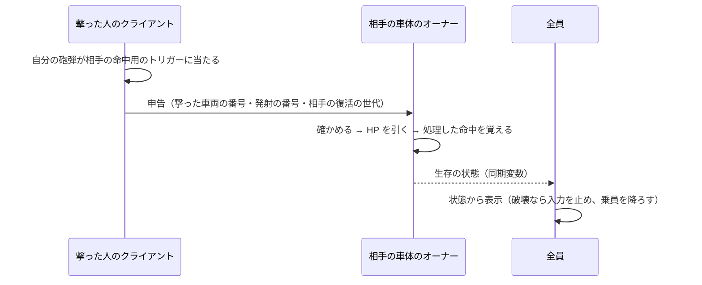

# 仕様書 0.6.0：HP・破壊・復活の同期

- 日付：2026-11-17
- 状態：承認済み
- 承認：2026-11-17、ユーザーがチャットで、版を段階ごとに上げること（戦闘は 0.6.0）、復活は破壊から一定の時間の後に自動で最初の位置へ戻すこと（「おすすめで」）、設計の案（非公開のメモ）の内容を公開の仕様書に写してよいことを決めた。同じ日に「指示書に従って実装を進めてください」と指示した。設計の案のとおりの所は承認済みとする。
  - 命中の見分け方（撃った人のプレイヤー ID と発射の番号）は、0.5.0 の仕様書の 1.2 で決めた。
  - 2026-11-17、下書きの 6 節（設計の案で決めていない 3 項目）を、ユーザーがチャットで次のとおり決めた。1 節に入れた。既定値：「4 発で破壊・5 秒で復活」（1.5）。破壊の演出：「0.7.0 に回す」（1.3）。HP の見せ方：「車両の上に HP のバー」（1.7）。
- 関連 Issue：なし（チャットの指示が入口）

## 0. バージョンと制約

- 版：0.6.0（0.5.0 の武器を前提にする）
- プロトコル版：車体の同期は形式 1、武器の同期は形式 1 のまま。生存の状態の同期を新しく足し、形式 1 にする。命中の申告（引数つきのネットワークのイベント）も新しく足す
- データ版：設定アセットの `schemaVersion` を 6 に上げる。版 5 までの設定は、値と参照を保ったまま、足した HP・復活の項目を既定値で補って版 6 に移す（ADR 0008）
- ライセンス：MIT（ADR 0005）
- 制約：
  - 0.5.0 と同じ環境
  - プロジェクトのレイヤーと衝突の設定は変えない
  - 外部のダメージシステムとのアダプターは作らない（被弾の受付の入口まで）

- 関係する ADR：0008・0009

## 1. 内容

0.5.0 の命中の検出に申告をつなぎ、HP を減らし、0 になったら破壊、一定の時間の後に最初の位置で復活させる。HP・生死・復活の世代を、全員の画面で同じにする。

### 1.1 置き場所と送る状態

- ルートに、生存の状態の Udon（`YakimaTankLife`、Manual）を足す。車体の領域なので、車体のオーナーが書く（所有権の移動が車体と同時に済む）。
- 車体の同期に HP を混ぜない。姿勢は毎秒 10 回、HP は変わったときだけで、送る頻度が違う。車体の同期の形式 1 も変えずに済む。

| 同期変数 | 型 | 内容 |
|---|---|---|
| 形式 `syncFormat` | byte | 1。違う値の状態は使わない |
| HP | int | 0 以下で破壊。生死は HP から出す（別の変数にしない） |
| 復活の世代 | int | 復活のたびに 1 進める |
| 処理した命中 | int[]・int[] | 撃った車両（シーンの車両の番号）ごとに、最後に処理した（撃った人のプレイヤー ID・発射の番号）。同じ命中を 2 回数えないため（0.5.0 の 1.2） |

- 処理した命中を HP と同じ同期に入れる。オーナーが代わっても、同じ命中を 2 回数えないため。
- 送るのは変わったときだけ。
- 受けるとき：形式・HP の範囲（0〜最大）・世代が負でない・配列の長さ・送った時刻が新しいことを確かめる。

### 1.2 命中の申告

- 送り方：相手の `YakimaTankLife` へ、オーナー宛ての引数つきのネットワークのイベント（`[NetworkCallable]`）。
- 申告の中身：撃った車両の番号（一覧の順番）・発射の番号・相手の復活の世代。プレイヤー ID は送らない（送った人は `NetworkCalling.CallingPlayer` で分かる）。ダメージの量と武器の種類は送らない。
- 相手の復活の世代は、撃った側が命中を判定した時点で見えていた値を付ける。発射のときに全車両の復活の世代を覚える仕組みは作らない。
- 命中用のトリガーの Udon（`YakimaTankHitbox`）に、`YakimaTankLife` への接続を足す。

受けた側（オーナー）が確かめること。1 つでも外れたら使わず、数える。

1. 自分がこの車両のオーナー。
2. 送った人が、撃った車両の `Weapon` の今のオーナー。
3. 撃った車両の番号が一覧の範囲の内で、自分自身ではない。
4. 申告に付いた復活の世代が、自分の今の復活の世代と同じ。
5. HP が 0 より大きい。
6. 前に処理した命中の重複でない：撃った車両ごとに覚えた（プレイヤー ID・発射の番号）と比べ、同じ人で番号が以下なら重複。
7. 発射の番号が負でない。

- 4 は「復活の前の世代に対する申告」を捨てる。弾を捨てるのではない。復活の前に撃たれ、復活の後に当たった弾は、判定した時点の世代が今と同じなので有効。
- ダメージの量は、受けた側が、撃った車両の武器の設定から求める（届いた数値は使わない）。
- 申告が届く前に相手のオーナーが代わると、その命中は消える（送り直さない）。VRChat で起きる頻度を見て、要れば直す。
- 確かめる処理は、引数を受ける入口（`_AcceptHit`）に分け、PlayMode はそこへ直接入れる。ClientSim は、オーナー宛てのイベントをいつも自分で実行し、送った人も自分になるため。
- 1 秒あたりの申告の回数の上限は、`[NetworkCallable]` の属性で決める。装填の時間（既定 3 秒）で撃つ数より十分に多い値にする（1.8 で確かめて決める）。

### 1.3 破壊と復活

状態は「使える → 破壊 → 復活待ち → 使える」。どのクライアントも、同期変数から同じ状態にする。

- 破壊（HP が 0 以下になった）：
  - 車体のオーナー：走行の入力を止め、停止中のブレーキにする。
  - 武器のオーナー：射撃を止める。
  - 座っている人：自分のクライアントで降りる。乗車の判定は無効。
  - 全員：破壊の見た目は 0.7.0 で作る（この版は、動かない・撃てない・乗れないだけ）。
- 復活：車体のオーナーが、設定の待ち時間の後に行う。
  - 復活の世代を進め、HP を最大に戻し、処理した命中をそのまま残し、車体を最初の位置に戻す。車体の戻しは、今の `_ApplySettingsAndReset` の中身を使い回す（車体の世代が進み、ほかの人の画面で補間せずに置かれる）。
  - 武器のオーナーは、復活の世代が変わったのを見て、自分の領域（角度・装填）を初期値に戻す。ほかの領域を直接書かない。
  - 「Editor の最初の位置に戻す」と「ゲームの中の復活」は入口を分け、中の初期化だけを共用する。
- 待ち時間はオーナーだけが数える。待っている間にオーナーが代わると、新しいオーナーが最初から数え直す。

### 1.4 例外の扱い

| 起きること | 扱い |
|---|---|
| 途中参加 | 同期変数から HP・生死・復活の世代を受ける。破壊の見た目と発射は出さない |
| 同時の被弾 | オーナーが順に処理する。破壊の後の申告は 5 で捨てる |
| 復活の前の世代に対する命中の申告 | 4 で捨てる |
| 復活の前に撃ち、復活の後に当たった弾 | 有効 |
| 同じ命中の重複 | 6 で捨てる |
| 発射の表示が欠けた発射の命中 | 有効。表示と命中は別 |
| 車体のオーナーが代わる | 新しいオーナーが、同期変数の HP と処理した命中を引き継ぐ |
| 撃った人の武器の所有権が代わる | 飛んでいる砲弾は申告しない（0.5.0）。届いた古い申告は 2 で捨てる |
| 撃った車両が先に破壊される | 飛んでいる砲弾の命中は有効（相打ちがある） |

### 1.5 設定とセットアップ

足す設定（設定の版 6、区分「HP・復活」。既定値は仮の値）：

| 項目 | 既定値 | 範囲 | 反映 |
|---|---|---|---|
| 最大 HP | 100 | 1 以上 | Play 中に反映できる（HP は次の復活で最大になる） |
| 1 発のダメージ（撃った車両の武器の設定） | 25（4 発で破壊） | 0 以上 | Play 中に反映できる |
| 復活の待ち時間（秒） | 5 | 0 以上 | Play 中に反映できる |

- HP は整数で送る。設定は小数で持ち、四捨五入する。

- 生成：ルートに生存の状態の Udon（Manual）。命中用のトリガーに `YakimaTankLife` の参照。座席・車両・武器から `YakimaTankLife` への参照。車体の同期から武器への参照（撃った車両の武器のオーナーとダメージを、一覧から引くため）。HP のバー。
- 検証：値が範囲外なら Error。
- 生成の後の確かめ：ルートの同期の Udon がそろって Manual（車両・車体の同期・生存の状態）。参照。
- Play 中の再適用：HP・復活の値も書く。
- ウィンドウ：「HP・復活」の区分。

### 1.6 シーンの Network ID

- ルートの Udon が 1 つ増え、0.5.0 までにビルドしたシーンでは、記録した型と合わなくなる。0.3.0 の 1.11（型の古い ID を外す）がそのまま効くことを確かめる（1.8）。

### 1.7 HP のバー

- 生成で、車両の上（モデルの上端より 0.6 m 上）に HP のバーを置く。素材を同梱しない（Unity の箱と、出力先のフォルダに作る単色の材質）。
- 各クライアントが、同期変数の HP から長さを決め、自分の頭の方へ向ける（どの向きからも見える）。破壊の間は 0。
- 同期しない見た目で、ゲームの処理を動かさない。デバッグ UI は変えない。

### 1.8 実装の最初に確かめること

| 確かめること | 方法 | 違ったとき |
|---|---|---|
| `[NetworkCallable]` の関数が UdonSharp でコンパイルでき、ClientSim で呼べる。1 秒あたりの回数の上限の決め方 | 開発用の一時的な確かめ・PlayMode | 申告を同期変数で送る案などを相談する |
| ルートの Udon が 1 つ増えたとき、0.3.0 の 1.11 がそのまま効く | 開発ワールドの更新とローカルビルド | 1.11 の処理を広げる。足りなければ相談する |

### やらないこと（この版）

- 命中の申告の送り直し、所有権の移動のための新しい引き継ぎの仕組み
- 発射のときに全車両の復活の世代を覚える仕組み
- 装甲・部位ごとのダメージ、外部のダメージシステムとのアダプター
- 二人乗り

## 2. 仕組みへの影響

- `architecture.md`：生存の状態、命中の申告の流れ、破壊と復活の状態遷移（`diagrams/` に 1 枚）。
- `diagrams/generated-prefab.md`：ルートの生存の状態の Udon。
- `prototype-plan.md`：段階 5 の状態。

## 3. テスト

| 種類 | 何を保証するか |
|---|---|
| EditMode（TDD） | 申告の確かめ（1〜7 の各項目で使わない・すべて通れば使う）、重複の判定（同じ人で番号が以下なら重複、別の人なら重複でない）、HP の引き算と破壊、復活の世代、受けた生存の状態の有効の判定、復活の待ち時間 |
| EditMode | 生成：ルートの生存の状態の Udon（Manual）と参照。設定：版 5 から版 6 への移行、範囲。Network ID：ルートの型が変わった古い ID が外れる |
| PlayMode（ClientSim・Udon VM） | 同じ命中を 2 回入れても HP が 1 回分だけ減る。復活の前の世代に対する申告を使わない。復活の前に撃ち、復活の後に当たった弾は使う。送った人が武器のオーナーでない申告を使わない。オーナー以外は HP を書かない。破壊で入力が止まり、乗員が降りる。復活で車体・武器・HP が初期値に戻り、世代が進む。オーナーが代わっても HP と処理した命中が残る。自分の砲弾が相手に当たると申告が届いて HP が減る（ClientSim では自分あて）。0.1.0〜0.5.0 の PlayMode が通る |
| 開発環境 | 開発用のモデルで上の PlayMode。開発ワールドの更新を 2 回。ローカルビルド（Network ID） |

## 4. 文書に書くこと

- README・CHANGELOG・版 0.6.0。Docs/ の図と表

## 5. ユーザーに確認してもらうこと

- 撃って HP が減り、破壊・復活が全員の画面で合うか。途中参加。相打ち。運転手が抜けた後の HP
- オーナーが代わる前後の命中が消える頻度
- 申告の回数の上限に当たらないか

## 6. 承認待ちの項目

なし（下書きの 6 節にあった 3 項目は、2026-11-17 に決めて 1 節に入れた）。
