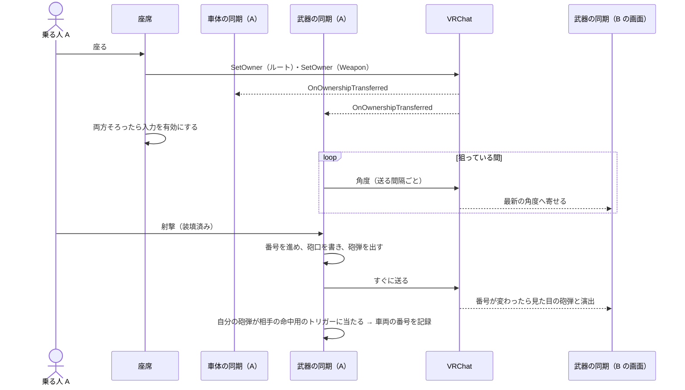

# 仕様書 0.5.0：砲塔・装填・発射の同期

- 日付：2026-11-17
- 状態：下書き（1 節のうち設計の案のとおりの所は承認済み。6 節の答えを待つ）
- 承認：2026-11-17、ユーザーがチャットで、版を段階ごとに上げること（武器は 0.5.0）、弾数は無限で装填だけにすること（「おすすめで」）、設計の案（非公開のメモ）の内容を公開の仕様書に写してよいことを決めた。同じ日に「指示書に従って実装を進めてください」と指示した。設計の案のとおりの所は承認済みとする。
  - 6 節は、設計の案で決めていない、または設計の案にない判断。答えを受けて 1 節に入れるまで、承認済みにしない。
  - 命中の見分け方と、所有権が移ったときの引き継ぎ（6 節の 1）は、設計の案で未決とした所。承認済みの範囲に入れない。
- 関連 Issue：なし（チャットの指示が入口）

## 0. バージョンと制約

- 版：0.5.0（0.4.0 の接触を前提にする）
- プロトコル版：車体の同期は形式 1 のまま。武器の同期を新しく足し、形式 1 にする（同期変数 `syncFormat`）
- データ版：設定アセットの `schemaVersion` を 5 に上げる。版 4 までの設定は、値と参照を保ったまま、足した砲塔・武器の項目を既定値で補って版 5 に移す（ADR 0008）
- ライセンス：MIT（ADR 0005）
- 制約：
  - 0.4.0 と同じ環境
  - プロジェクトのレイヤーと衝突の設定は変えない
  - 0.5.0 は命中の検出まで。命中の申告、HP への反映、`YakimaTankLife` への接続、ダメージの設定は 0.6.0
  - 0.6.0 の部品（`YakimaTankLife`）を先に参照しない。そのための仮の部品や抽象も作らない

- 関係する ADR：0008・0009

## 1. 内容

1 人乗りの戦車で、砲塔と砲身を回して狙い、装填して撃てるようにする。砲塔の角度・装填・発射をほかの人の画面に同期し、撃った人のクライアントが、自分の砲弾の当たった車両を知るところまで作る。

### 1.1 置き場所と所有権

- ルートの子に `Weapon` を足し、武器の同期の Udon（`YakimaTankWeaponSync`、Manual）を置く。砲塔と砲身の Transform を参照して角度を書く。軸と最初の姿勢は生成で解く（元のモデルは変えない）。
- 所有権の領域は 2 つ：車体（ルート）と武器（`Weapon`）。所有権は GameObject の単位なので、将来、武器の領域だけを砲手に渡せる。
- 座席：座ったら、ルートと `Weapon` の両方の所有権を取る。両方そろってから入力を有効にする（0.3.0 の「オーナーになったら入力を有効にする」の条件を「両方」にする）。3 秒の待ちは 1 つで足りる。
- 座ったまま、どちらかの所有権がほかの人へ移ったら降ろす（0.3.0 と同じ）。
- 降りても所有権は持ち続ける。砲塔は最後の角度のまま。
- オーナーが抜けると、VRChat が 2 つの GameObject の新しいオーナーを別々に決める。同じ人とは限らない。それぞれが自分の領域だけを引き継ぐ。誰も座っていない間は、それで困らない。

### 1.2 送る状態

| 同期変数 | 型 | 内容 |
|---|---|---|
| 形式 `syncFormat` | byte | 1。違う値の状態は使わない |
| 砲塔のヨー・砲身のピッチ | float・float | 車体から見た角度（度）。最初の姿勢が 0 |
| 装填済み | bool | 装填の残り時間は送らない。数えるのはオーナーだけ |
| 発射の番号 | int | 撃つたびに 1 進める。ほかの人の画面の発射の表示に使う。所有権が移ったときの続け方は 6 節の 1 |
| 発射の位置・向き | Vector3・Vector3 | 撃ったときの砲口（ワールド）。弾速と重力は設定の値 |

- 弾数は持たない（無限。装填だけ）。
- 装填の引き継ぎ：装填中に武器の所有権が移ったら、新しいオーナーが装填の時間を最初から数え直す。装填済みなら、その状態を引き継ぐ。残り時間は同期しない。
- 送るとき：角度が変わっている間は、車体と同じ送る間隔で。撃ったとき・装填が終わったとき・所有権を取ったときは、すぐに。止まっている間は送らない（最後の状態は VRChat が途中で入った人に渡す）。
- 受けるとき：形式・有限・角度の範囲（設定の動ける範囲の内）・送った時刻が前に使った状態より新しいことを確かめる。使わなかった数を数える。
  - 車体のような「送った人の保留」は、先に作らない。
  - 送った時刻の比べは、重複と逆順を減らすだけ。前のオーナーの状態を必ず外せるわけではない。所有権が移る前後では、砲塔の角度と発射の表示が一時的にずれることを許す。
  - 許すのは表示だけ。HP に効く命中の見分けは 6 節の 1 で決め、表示のずれを理由に同じ命中を 2 回数えることは許さない。
- 受ける処理は、`OnDeserialization` から呼ぶ入口（0.3.0 の `_AcceptState` と同じ形）に分け、テストから直接入れられるようにする。
- 1 回の大きさは 45 バイト前後の見込み。

### 1.3 角度と照準

- オーナー：入力から砲塔のヨーと砲身のピッチを、設定の回る速さで、設定の動ける範囲の中で動かす。入力から角度への変え方は 6 節の 2。
- オーナー以外：最新の角度へ、設定の回る速さで寄せるだけ。履歴と先読みは作らない。命中を判定するのは撃った側だけなので、ほかの人の画面の角度は見た目。
- 座席は砲塔の子（今の生成のまま）。砲塔が回ると座った人も回る。頭と手の基準に回転が返って回り続けないことを、6 節の 2 で決める。

### 1.4 装填と発射

- オーナーだけが装填の時間を数える。装填済みで、射撃の入力が押されたら撃つ（押し続けても、装填が終わるたびに 1 発ずつ撃つ）。
- 撃つ：発射の番号を 1 進め、砲口の位置と向きを書いて、すぐに送る。装填済みを外し、装填の時間を数え始める。
- 撃てるのは、車体と武器の両方の所有権を持ち、自分が座っているときだけ。
- 装填の時間は、設定の送る間隔より長くする（検証で Error）。ただし、これで毎発の表示が保証されるわけではない（1.5）。

### 1.5 発射の表示

- 受けた発射の番号が、覚えている番号と違い、送った時刻が前に使った状態より新しければ、その位置と向きから見た目の砲弾と、最小の演出（6 節の 4）を出す。最初に受けた状態（途中参加）では、番号を覚えるだけで出さない。
- Manual の実際の送信は、設定の送る間隔より遅れることがある。通信が詰まると、複数の発射が最新の 1 発の状態にまとまり、ほかの人の画面で発射の表示が欠ける。これは許す。欠けを防ぐためのネットワークのイベントや、発射の履歴は足さない。
- 発射の表示が欠けることと、命中の判定は別。表示が欠けた発射でも、命中は撃った側が判定する。

### 1.6 砲弾

- 同期しない。各クライアントが、あらかじめ作った砲弾（`Weapon` の下に数個。使い回す）を使い、弾速・重力・寿命の設定で動かす。前の位置から次の位置へ光線で当たりを見る。
- 命中を数えるのは、撃った人のクライアントの砲弾だけ。ほかの人の画面の砲弾は見た目で、当たったら消えるだけ。
- 武器の所有権を失ったら、飛んでいる自分の砲弾は命中を数えずに消す。
- 光線が当たるもの：ワールドの物（トリガーでないコライダー）で止まる。ほかの車両の命中用のトリガーで止まり、命中にする。自分の車両の中・乗車の判定・ほかのトリガー・プレイヤーは通り抜ける。車両の物理の形（`Walkthrough`）は見ない（オーナー以外の画面では無効で、画面によって当たり方が変わるため）。
- 0.5.0 は命中の検出まで：撃った人のクライアントで、当たった車両の番号（シーンの車両の一覧の順番）と、当たった数を武器の同期の Udon に記録する（テストで読める値）。申告と HP は 0.6.0。

### 1.7 命中の判定先

- 命中用のトリガーを生成する：車体の箱（ルートの下。車体のコライダーと同じ大きさ）と、砲塔の箱（砲塔の下。砲塔のメッシュの範囲。砲塔と一緒に回る）。どちらもいつも有効。置くレイヤーは 6 節の 5。
- トリガーに小さな Udon（`YakimaTankHitbox`、同期しない）を付ける。乗車の判定（`YakimaTankBoarding`）と同じ形。0.5.0 では、その車両の車体の同期の Udon を指す。当たった車両の番号は、そこから分かる。
- 乗車の判定の箱は使い回さない。車体の幅のまま砲塔の高さまである箱なので、砲塔の横の空間に当たるため。
- 撃った側は、相手の「表示の姿勢」に当てる。見えている所に当たる。

### 1.8 シーンの車両の番号

- シーンの車両の一覧が、始まるときに各車両へ、一覧の中の番号を知らせる（今の `_SetRegistry` に番号を足す）。車体の同期の Udon が持つ。
- 番号はどのクライアントでも同じ（0.3.0 の 1.8）。Prefab に焼かない。

### 1.9 設定とセットアップ

足す設定（設定の版 5、区分「砲塔・武器」。値は 6 節の 3）：

| 項目 | 反映 |
|---|---|
| 砲塔の回る速さ（度/秒） | Play 中に反映できる |
| 砲身の回る速さ（度/秒） | Play 中に反映できる |
| 砲身の上下の範囲（度、下限・上限） | Play 中に反映できる |
| 弾速（m/s）・重力（m/s²）・寿命（秒） | Play 中に反映できる |
| 装填の時間（秒） | Play 中に反映できる |

- 砲塔の左右は全周（範囲を設けない）。
- 検証：値が範囲外なら Error。装填の時間が同期の送る間隔以下なら Error。砲塔・砲身の対応がないときは 6 節の 6。「砲身は記録だけ」の Warning はなくす。
- 生成：`Weapon` と武器の同期の Udon（Manual）、砲弾、命中用のトリガー 2 つと `YakimaTankHitbox`。砲身の範囲から砲口（砲身の前の端）を求める。2 回目以降も重ねず、GUID と中のオブジェクトを保つ。
- 生成の後の確かめ：`Weapon` に同期の Udon が 1 つで Manual。参照（砲塔・砲身・座席・車体の同期）がそろう。命中用のトリガーが 2 つで、それぞれ車体の同期の Udon を指す。保存した Prefab を読み直して確かめる。
- Play 中の再適用：砲塔・武器の値も書く。角度と装填は変えない。
- ウィンドウ：「砲塔・武器」の区分を足す。未実装の表示から「砲塔の操作・射撃」を外し、「命中のダメージ・HP」にする。

### 1.10 実装の最初に確かめること

| 確かめること | 方法 | 違ったとき |
|---|---|---|
| 2 つの GameObject の所有権を続けて取ったとき、どちらの通知（`OnOwnershipTransferred`）も来る | ClientSim の PlayMode。VRChat ではユーザーが見る | 来ない方は、座席が所有権を確かめ直す（待ちの確かめのときに `Networking.IsOwner` を見る）。それでも足りなければ相談する |
| ビルド済みの開発シーンで、`Weapon` に Network ID が付き、ビルドが通る | 開発ワールドの更新とローカルビルド | 0.3.0 の 1.11 と同じに、型の合わない ID を外す処理を広げる。足りなければ相談する |
| 砲塔の子の座席で、砲塔を回したときの視点 | ClientSim で分かる範囲（Desktop の視点の向き） | 6 節の 2 の決め方を見直す。相談する |

### やらないこと（この版）

- 命中の申告・HP・破壊・復活・ダメージの設定（0.6.0）
- 砲塔の角度の履歴と先読み、武器の「送った人の保留」
- 弾数、装填の残り時間の同期、砲弾の同期、武器の種類の引数
- 発射の表示の欠けを防ぐためのネットワークのイベントと発射の履歴
- 二人乗り（砲手）の所有権の移動
- 音・見た目の作り込み（最小の演出だけ。作り込みは 0.7.0 以降に別に相談する）

## 2. 仕組みへの影響

- `architecture.md`：全体構成と実行中の部品に、武器の領域・砲弾・命中用のトリガーを足す。主要な流れに「狙って撃つ」と「2 つの所有権」を足す。共通の部品の表。
- `diagrams/generated-prefab.md`：`Weapon`・砲弾・命中用のトリガー。
- `diagrams/vehicle-ownership-states.md`：待ちの状態を「両方の所有権」にする。
- `prototype-plan.md`：段階 4 の状態。

部品（名前は仮）：

| 部品 | 場所 | 用途 |
|---|---|---|
| `YakimaTankWeaponSync` | Runtime（`Weapon`、Manual） | 武器の所有権、角度・装填・発射の状態、送る・受ける、表示、砲弾の管理、命中の記録。計算は静的な関数 |
| `YakimaTankShell` | Runtime（`Weapon` の下、同期しない） | 砲弾 1 つの動きと当たり。撃った人のものだけが命中を数える |
| `YakimaTankHitbox` | Runtime（命中用のトリガー、同期しない） | 当たった車両を知らせる（0.5.0 は車体の同期の Udon を指す） |
| `YakimaTankSeat` | Runtime | 2 つの所有権を取り、そろってから入力を有効にする |
| `YakimaTankVehicleRegistry` | Runtime | 各車両へ番号を知らせる |
| 設定・検証・生成・再適用・ウィンドウ | Editor | 砲塔・武器の項目、設定の版 5 |

## 3. テスト

| 種類 | 何を保証するか |
|---|---|
| EditMode（TDD） | 角度：入力から回る速さと動ける範囲で角度が動く（6 節の 2 の決め方）。オーナー以外は最新の角度へ回る速さで寄せる。装填：装填済みで射撃の入力があると撃ち、番号が 1 進み装填済みが外れる。装填の時間で装填済みになる。押し続けても装填ごとに 1 発。発射の表示：番号が違い時刻が新しい状態で 1 回出す。同じ番号・古い時刻・最初の状態では出さない。有効の判定：形式違い・非有限・範囲外の角度・古い時刻を使わない。弾道：弾速と重力で進み、寿命で消える。光線の当たりの選び方（ワールドで止まる・ほかの車両の命中用のトリガーで命中・自分の車両と乗車の判定は通り抜ける）。発射の番号の続け方（6 節の 1） |
| EditMode | 生成：`Weapon` に同期の Udon が 1 つで Manual、参照がそろう、命中用のトリガーが 2 つ（車体・砲塔）で車体の同期を指す、砲弾。2 回生成しても重ならない。設定：版 4 の設定を読み込むと版 5 に移り、値と参照を保つ。範囲外と、装填の時間が送る間隔以下なら Error。砲身がなければ Error |
| PlayMode（ClientSim・Udon VM） | 所有権が片方だけ来た間は撃てない（入力が無効）。両方来たら撃てる。座ったまま武器の所有権だけがほかの人へ移ると降ろされる。撃つと番号が進み、砲口の位置と向きが同期変数に入り、すぐに送る要求が出る。`_AcceptState` に入れた状態：番号が進むと見た目の砲弾が 1 回出る、同じ番号を 2 回入れても出ない、最初の状態では出ない。装填中に所有権が移ると、新しいオーナーが装填を数え直す。装填済みなら引き継ぐ。自分の砲弾が相手の命中用のトリガーに当たると、当たった車両の番号が記録される。自分の車両と乗車の判定は通り抜け、壁で止まる。武器の所有権を失うと、飛んでいる自分の砲弾は数えずに消える。砲塔の子の座席に座ったまま砲塔を回しても、入力が回り続けない（6 節の 2）。0.1.0〜0.4.0 の PlayMode が通る |
| 開発環境 | 開発用のモデルの最終の生成 Prefab で上の PlayMode。開発ワールドの更新を 2 回。ローカルビルド（`Weapon` の Network ID） |

- PR までに通す検証：C#・UdonSharp のコンパイル、生成、EditMode・PlayMode、開発ワールドの更新 2 回、ローカルビルド。
- 除外・未確認：別のクライアントとの実際の表示のずれ・欠け、所有権がそろうまでの時間、座ったアバターの見え方、PC VR の視点は、VRChat で人が確かめる。ClientSim の合格を、複数クライアントの合格と扱わない。

## 4. 文書に書くこと

- README（ルートとパッケージ）：砲塔の操作と射撃（Desktop・VR）、命中はまだ HP に効かないこと。「最近の更新」に 0.5.0
- CHANGELOG：`0.5.0` の節。設定の版 5、砲身の対応が要ること、前に生成した車両は「生成」をやり直すと武器が入ること
- Docs/：2 節の図と表

## 5. ユーザーに確認してもらうこと

- 走りながら狙えるか。砲塔・砲身の回る速さと範囲の体感
- ほかの人の画面で、砲塔と発射がおおよそ合うか（欠けと一時的なずれは許す。どのくらい起きるかを見る）
- 砲弾が相手の車両で止まるか。自分の車両では止まらないか
- 途中参加で過去の発射が出ないか
- 座ったアバターの見え方（ほかの人の画面）。PC VR の視点（回り続けない・酔わない）

## 6. 承認待ちの項目

答えを受けて 1 節に入れる。

1. **命中の見分け方と、所有権が移ったときの引き継ぎ**（設計の案で未決）
   - 案 A（おすすめ）：命中は「撃った人のプレイヤー ID」と「発射の番号」の組で見分ける。
     - 発射の番号は武器の同期変数（1.2）。新しいオーナーは、受けた番号と、自分が前にその武器で撃った最後の番号の、大きい方から続ける。同じ人の番号は必ず増え、プレイヤー ID はインスタンスの中で使い回されないので、組は重ならない。古い番号から引き継いでも、前のオーナーと組が重ならない（プレイヤー ID が違う）。
     - 0.6.0 で、撃たれた側は、撃った車両ごとに、最後に処理した（プレイヤー ID・番号）を同期変数に覚える。同じ人で番号が以下なら重複。送った人は `NetworkCalling.CallingPlayer` で分かるので、申告にプレイヤー ID を入れない。申告を受け付けるのは撃った車両の武器の今のオーナーからだけなので、1 つの撃った車両について、覚えるのは 1 組で足りる。
     - 0.5.0 で作るのは、「大きい方から続ける」と、自分が撃った最後の番号を覚えることだけ。同期変数は足さない。
     - 残る穴：同じ人の後の弾の命中が先に届くと、前の弾の命中は重複として捨てられる（飛ぶ時間が装填の時間より長いときだけ起きる。1 回だけで、捨て続けはしない）。
   - 案 B：権限の世代を同期変数に足す（所有権を取るたびに進める）。命中は（世代・番号）。古い世代から引き継いだ 2 人が同じ世代になる穴があり、プレイヤー ID と組にしないと塞げない。A より状態が多い。
   - 案 C：A に加えて、撃たれた側が最後の番号の下の 32 発分の印も覚え、前後して届いた命中も受ける。状態が int 1 つ増える。
2. **入力から角度への変え方**（座席は砲塔の子なので、砲塔が回ると頭と手も回る）
   - 案 A（おすすめ）：座席は砲塔の子のまま。頭と手は、車体ではなく座席から見た値で測る（座席が回っても、入力が回転に返らない。左手の走行も同じ）。
     - Desktop：頭の左右の向き（座席から見た角度）で砲塔を回す。30 度（仮）ずらすと最大の速さ、正面に戻すと止まる。上下は、頭の上下の向きを砲身の目標の角度にする。
     - VR：右手のねじり・前後の量（今の −1〜1）を、砲塔・砲身を回す速さの割合にする。
     - 共通操作値の砲の左右・上下の意味が、Desktop で「車体から見た頭の向き」から「座席から見た頭の向き」に変わる。座った人は砲塔と一緒に回る（VR で酔わないかは確かめる）。
   - 案 B：座席を車体に置き直し、砲塔と一緒に回さない。Desktop は頭の向き（車体から見た角度）へ砲塔と砲身が向く（目標の角度）。VR は右手の量で回す速さ。入力の意味は変えない。座ったアバターは砲塔と一緒に回らない。座ったまま後ろを向けるかで、後ろを狙えるかが決まる（VRChat で確かめる）。
3. **既定値**
   - 案 A（おすすめ。カジュアル）：砲塔 30 度/秒、砲身 15 度/秒、砲身の範囲 −10〜+20 度、弾速 200 m/s、重力 9.81 m/s²、寿命 3 秒（600 m ほど）、装填 3 秒。
   - 案 B（実物寄り）：砲塔 10 度/秒、砲身 5 度/秒、砲身の範囲 −8〜+15 度、弾速 780 m/s、重力 9.81 m/s²、寿命 2 秒、装填 6 秒。
4. **発射の最小の演出の素材**
   - 案 A（おすすめ）：素材は同梱しない。砲弾は Unity の球を明るい色にした見た目、発射は砲口で短く光る（ライトと小さな球を 0.1 秒）。音は設定に AudioClip の欄を作り、空なら鳴らさない。
   - 案 B：0.5.0 では見た目の砲弾だけにし、閃光と音は 0.7.0 で作る。
5. **命中用のトリガーの置くレイヤー**
   - 案 A（おすすめ）：`Default` のトリガー（乗車の判定と同じ）。プロジェクトのレイヤーの設定を変えない。光線は、自分の車両の中・`YakimaTankHitbox` のないトリガー・`Walkthrough`・プレイヤーを飛ばす（1.6）。
   - 案 B：専用のレイヤーを作る。プロジェクトのレイヤーの設定を変えることになるので、この案件の制約（0 節）に反する。
6. **砲塔・砲身の対応がないとき**（今は砲塔がなければ Warning で、座席を車体に置く。砲身は記録だけ）
   - 案 A（おすすめ）：砲塔か砲身の対応がなければ、検証で Error（武器を作れない）。今ある設定で砲身を選んでいなければ、選び直しが要る。
   - 案 B：武器を作らずに生成する（Warning）。座席は車体の所有権だけで入力を有効にする。分岐が増える。
