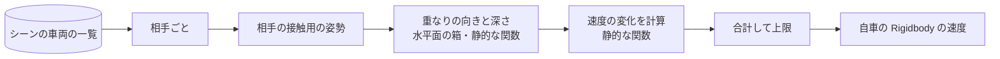
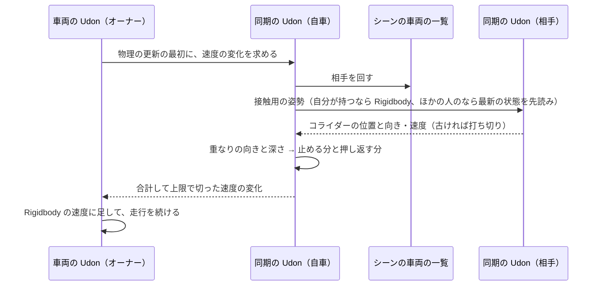

# 仕様書 0.4.0：車両同士の簡易衝突

- 日付：2026-11-17
- 状態：承認済み（6 節を除く）
- 承認：方式の方針は [ADR 0009](../05_Decisions/project/0009-driver-owned-custom-vehicle-sync.md) と [SPEC_2026-11-13_車両物理同期と簡易衝突.md](SPEC_2026-11-13_車両物理同期と簡易衝突.md) で承認済み。この仕様書は、その 1.3（壁・地面と車両間の衝突）を、0.3.0 の同期の上で実装できる形にしたもの。
  - 2026-11-17、ユーザーがチャットで、接触の計算の案（自分が寄る分は自分で消し、相手が寄る分は、深さに比例した上限つきの加速だけで受ける）を「おすすめで」と採用した。同じ日に、版を段階ごとに上げること（接触は 0.4.0）と、設計の案（非公開のメモ）の内容を公開の仕様書に写してよいことも決めた。
  - 2026-11-17、ユーザーがチャットで「指示書に従って実装を進めてください」と指示した。設計の案のとおりの所（1 節）は承認済みとする。
  - 2026-11-17、1.8 の確かめで、`Physics.ComputePenetration` が無効なコライダーとは計算できないと分かった。設計の案の「違ったとき」のとおり、水平面の箱同士の重なりを静的な関数で求める形に 1.3 を直した。
  - 2026-11-17、実装の途中で、止まった車両が押しても動かないと分かった。ユーザーがチャットで次を選び、1.5 と 3 節を直した。押される間だけ車輪の張り付きを外す（「押される間だけ外す」）。横から押しても動かないままにする（「横は動かないまま」）。戦車どうしで押せるかは今の設定の釣り合いで決まり、既定値では押せないことを文書で案内する（「既定値のまま、文書で案内」）。
  - 設計の案にない細部（6 節）は承認待ち。仮の値として実装し、PR で確かめてもらう。
- 関連 Issue：なし（チャットの指示が入口）

## 0. バージョンと制約

- 版：0.4.0（0.3.0 の車体の同期を前提にする）
- プロトコル版：同期の形式 1 のまま。同期変数もネットワークのイベントも足さない
- データ版：設定アセットの `schemaVersion` を 4 に上げる。版 3 までの設定は、値と参照を保ったまま、足した接触の 3 項目を既定値で補って版 4 に移す（ADR 0008）
- ライセンス：MIT（ADR 0005）
- 制約：
  - 0.3.0 と同じ環境（Unity 2022.3 / VRChat Worlds SDK 3.10.0 以降 / UdonSharp。確認は 2022.3.22f1・3.10.6、Windows PC）
  - プロジェクトのレイヤーと衝突の設定、0.3.0 の `Physics.IgnoreCollision` の組み合わせは変えない
  - 同時に走る戦車は 4 台程度で確かめる。台数の上限は設けない

- 関係する ADR：0008・0009

## 1. 内容

車両同士の通常の衝突は、0.3.0 のまま外しておく（オーナー以外の画面では物理の形が無効、同じオーナーの車両同士は `Physics.IgnoreCollision`）。その上に、各オーナーが自車の速度だけを直す簡易衝突を足す（ADR 0009）。ぶつかると止まり、無人の車両はゆっくり押せる。相手の Rigidbody は動かさず、位置も直接動かさない。



### 1.1 動かす場所

- 車両の Udon の物理の更新（`FixedUpdate`）の最初、オーナーの確認の後で、同期の Udon に速度の変化を 1 回求め、自車の Rigidbody の速度に足す。
- 走行は角速度と転輪のトルクを書き、接触は速度だけを書くので、上書きし合わない。接地していないと走行の処理は途中で抜けるので、その前に置く。
- 新しい Udon は足さない。相手の履歴を持つ同期の Udon に置く。相手はシーンの車両の一覧（0.3.0 の 1.8）から回す。一覧がなければ接触しない（0.3.0 と同じく Warning のログが出る）。

### 1.2 相手の接触用の姿勢

| 相手 | 姿勢と速度 |
|---|---|
| 自分が持つ車両 | その Rigidbody の今の位置・回転・速度 |
| ほかの人の車両（最新の状態に停止の印がある） | その状態の位置と回転。進めない。速度は 0 |
| ほかの人の車両（停止の印がなく、送った時刻から 1 秒以内） | 最新の有効な状態を、今の時刻まで速度と角速度で進めた位置と回転（0.3.0 の先読みの関数。上限は設定の先読みの上限）。速度はその状態の値 |
| ほかの人の車両（停止の印がなく、送った時刻から 1 秒より古い） | 接触を計算しない（打ち切り）。数える（1.7） |
| 履歴がない・一覧にない・始まっていない | 計算しない |

- 表示の Transform は動かさない。表示は送る間隔の 2 倍ほど前の姿勢、接触は今の時刻に近づけた姿勢で、2 つは一致しない。10 m/s なら 2 m ほど違って見える。体感は VRChat で確かめる（5 節）。
- 相手の車体のコライダーの位置と向きは、相手のルートから見たコライダーの位置と向き（始まるときに覚える）を、接触用の姿勢に掛けて求める。自車も同じに、Rigidbody の位置と回転から求める。
- 1 秒は固定の値で、設定にしない。

### 1.3 重なりの向きと深さ

- 自車の車体の箱と相手の車体の箱を、上の姿勢に置いたとして、水平面での重なりを静的な関数で求める。`Physics.ComputePenetration` は、無効なコライダー（オーナー以外の画面の相手）とは計算できないため使わない（1.8）。どの組も同じ関数で求める。
  - 高さは、箱の上下の範囲が重なるかだけを見る。重ならなければ計算しない。
  - 水平の向きの候補は、2 つの箱の前後と左右の軸を水平面に写したもの（4 つ）。各候補の向きで、2 つの箱の幅（傾いた箱も、その向きに写した幅）と中心の間の距離から重なりを求め、1 つでも離れていれば重ならない。
  - いちばん浅い候補の向きを n（相手から自車へ向かう向き）、その重なりを d とする。
- n は初めから水平なので、上下に押すことはない。力は重心に掛け、回転を足さない。跳ね上がり・乗り上げ・激しい回転を出さないため。
- 判定の形は生成済みの車体の箱（BoxCollider）。新しい形の設定は足さない。同期の Udon に、車体の BoxCollider の参照を足す（今は物理の形の配列だけで、どれが車体か分からない）。

### 1.4 速度の変化

重なった相手ごとに、1.3 の n と d を使う。

```text
自分が寄る速さ = max(0, −(自車の速度 · n) − max(0, −(相手の速度 · n)))
速度の変化    = n × ( min(寄る速さ, 寄る速さ × 止める速さ × dt)
                    + min(押し返す強さ × d, 押す加速の上限) × dt )
```

- 自分が相手へ寄る分だけを、自分の側で消す。相手が逃げる速さまでは寄れる（押して進める）。
- 相手が寄って来る分は、速度に直接写さない。深さに比例した、上限つきの加速だけで受ける。遅れた相手の速度をそのまま写すと、ぶつけられた側が相手の速さで飛ばされ、遅れの分だけ反動が増えるため。
- 位置は直接動かさない。壁は通常の物理が受けるので、壁の向こうへ押し出す経路がない。
- 複数の相手の分は合計する。押し返しの分は、相手ごとの加速を足した大きさを「押す加速の上限」で切ってから dt を掛ける。止める分は切らない。
- dt は物理の刻み幅（`Time.fixedDeltaTime`）。
- 計算は同期の Udon の静的な関数に分け、EditMode でテストする（0.3.0 と同じ形）。

### 1.5 駐車の保持

今ある設定（停止中のブレーキ・ブレーキ）で決まる。新しい設定は足さない。

- 押される間だけ車輪の張り付きを外す：WheelCollider は、駆動のトルクが 0 の車輪を、低速ではブレーキのトルクに関係なくその場に張り付かせる。そのため車両の Udon は、駆動していない（駆動のトルクが 0）とき、押す加速の前後の分が自車の今のブレーキの減速（ブレーキのトルクの合計 ÷ 転輪の半径の平均 ÷ 質量）を超えている間だけ、車輪のブレーキを外し、転輪 1 つあたり 1 N·m の駆動のトルクを押す向きに掛けて張り付きを外す。代わりに、その減速を前後の速度に掛ける（速度を 0 へ向けて減らし、0 を越えない）。超えなくなったら、車輪のブレーキに戻す。計算は車両の Udon の静的な関数に分ける。
- 無人の車両：停止中のブレーキの減速（既定値で 2.5 m/s² ほど）を超えて押されれば動く。
- 有人でブレーキ：ブレーキの減速（既定値で 7.5 m/s² ほど）が押す加速の上限（5）より大きいので、動かない。
- 横から押しても動かない：張り付きを外しても、タイヤの横の摩擦で受ける。横は張り付きを外す判定に入れない。
- 戦車どうしで押せるか：押し返しは、両方の車両に同じ深さから掛かる。押し続けるには、押す側の駆動の加速が、押される側のブレーキの減速より大きい必要がある。既定値では駆動が全開で 1.5 m/s²、停止中のブレーキが 2.5 m/s² なので、全開で当てても止まった戦車は動かない（当てた側が止まる）。押せるようにしたいときは、停止中のブレーキのトルクを駆動のトルクより小さくする（README で案内する）。既定値は変えない。
- 受けた状態の相手（オーナー以外の画面の相手）に押されるときは、相手の速度が届いた状態のまま進むので、上の釣り合いに関わらず、押す加速がブレーキの減速を超えれば動く。
- 押す側の駆動の加速（既定値で 1.5 m/s² ほど）は押す加速の上限より小さいので、相手を突き抜けない。

（減速の値は、既定のトルクを転輪の半径 0.4 m・質量 20 t で割った目安。モデルで変わる。）

（注: 設計の案では「停止中のブレーキの減速が押す加速の上限より小さいので、無人の車両は押せば動く」と見込んでいた。2026-11-17、実装の途中で、止まった車両は停止中のブレーキを 0 にしても押す加速 10 m/s² では動かないと分かった（1 ステップの速度の変化が 0.2 m/s ほどを超えるとはがれ、はがれると抵抗がなく止まらない）。わずかな駆動のトルクがあれば張り付かなかった。ユーザーがチャットで「押される間だけ外す」「横は動かないまま」「既定値のまま、文書で案内」を選び、上のとおりにした。）

### 1.6 設定とセットアップ

足す設定（設定の版 4）：

| 区分 | 項目 | 既定値 | 範囲 | 反映 |
|---|---|---|---|---|
| 接触 | 止める速さ（1/秒） | 10（寄る速さを 0.1 秒ほどで消す） | 0 以上 | Play 中に反映できる |
| 接触 | 押し返す強さ（1/秒²） | 20（深さ 0.25 m で上限に届く） | 0 以上 | Play 中に反映できる |
| 接触 | 押す加速の上限（m/s²） | 5（1.5 の駐車の保持を決める） | 0 以上 | Play 中に反映できる |

- 既定値は仮の値。VRChat での確認（5 節）で調整する。範囲は 6 節。
- 生成：同期の Udon に、車体の BoxCollider の参照と接触の値を書く。2 回目以降も重ねず、GUID と中のオブジェクトを保つ（0.1.0 と同じ）。
- 検証：接触の値が範囲外なら Error。
- 生成の後の確かめ：同期の Udon の車体のコライダーの参照が、生成した車体の BoxCollider を指す。保存した Prefab を読み直して、参照と接触の値が入っていることを確かめる。
- Play 中の再適用：接触の値も同期の Udon に書く。
- ウィンドウ：「接触（Play 中に再適用できる）」の区分を足す。未実装の表示から「車両同士の衝突」を外す。

### 1.7 デバッグ UI

- オーナーの画面に 1 行足す：`Contact n  Stale m`。n は直前の物理の更新で重なっていた相手の数、m は 1.2 で打ち切った相手の数。
- オーナー以外の画面では出さない（接触を計算しないため）。
- 文字の欄は 7 行のままで足りる。

### 1.8 実装の最初に確かめること

次の 2 つは、Unity の振る舞いに頼る。実装の最初に確かめる。

| 確かめること | 方法 | 違ったとき |
|---|---|---|
| `Physics.ComputePenetration` が、無効なコライダーと、`IgnoreCollision` した組でも計算できる | 開発用の一時的な PlayMode と、3 節の PlayMode | 水平面の箱同士の重なりを自分で計算する（静的な関数。高さは箱の上下の重なりで見る） |
| 1.4 の計算で、低速の押し合いが落ち着く（めり込みが増え続けない・振動しない） | 3 節の PlayMode（同じオーナーの 2 台、受けた相手） | 仮の値を直し、理由をこの仕様書に残す。式を変えるなら相談する |

- 結果（2026-11-17、1 つめ）：`IgnoreCollision` した組（両方有効）は計算できた。片方が無効なら、置く姿勢を変えても、両方が無効でも、いつも「重なりなし」を返した。「違ったとき」のとおり、水平面の箱の重なりを静的な関数で求める（1.3）。
- 結果（2026-11-17、2 つめ）：同じオーナーの 2 台を秒速 2 メートルで当てると、当てた側が相手の手前で止まり、めり込みは増え続けず、振動しなかった（3 節の PlayMode）。止まった車両が押しても動かないことが別に分かった（1.5）。

### やらないこと（この版）

- 接触のための同期変数・ネットワークのイベント、位置を直接動かす補正、接触用の別の形の設定
- 相手の Rigidbody を動かすこと、衝突で所有権を移すこと（ADR 0009）
- 回転を足す補正、乗り上げ
- 遅れを人工的に入れた自動テスト（VRChat で人が確かめる）
- 砲塔・射撃・HP（次の版から）

## 2. 仕組みへの影響

- `Docs/03_Architecture/architecture.md`：実行中の部品の図と説明に、接触（一覧 → 同期の Udon → 車両の速度）を足し、「車両同士はすり抜ける」を直す。主要な流れに接触の流れを足す。共通の部品の表（同期・車両・デバッグ UI・実行時の値）を直す。
- `Docs/03_Architecture/diagrams/generated-prefab.md`：同期の Udon が車体の BoxCollider を参照することを足す。
- `Docs/03_Architecture/prototype-plan.md`：段階 3 の仕様書と状態。

部品：

| 部品 | 場所 | 変えること |
|---|---|---|
| `YakimaTankVehicleSync` | Runtime（ルート） | 接触用の姿勢を出す入口、相手ごとの重なりと速度の変化、車体の BoxCollider の参照、接触の値、デバッグ UI の数。計算は静的な関数 |
| `YakimaTankVehicle` | Runtime（ルート） | 物理の更新の最初に、同期の Udon の速度の変化を足す |
| `YakimaTankDebugPanel` | Runtime | 接触の行 |
| 設定・検証・生成・再適用・ウィンドウ | Editor | 接触の 3 項目、設定の版 4、参照の確かめ |



## 3. テスト

| 種類 | 何を保証するか |
|---|---|
| EditMode（TDD） | 速度の変化：自分が寄る分だけを消し、相手が寄って来る速さは写さない。相手が逃げる速さまでは寄れる（逃げる速さより遅く寄るなら消さない）。離れる向きの速度では止める分を出さない。止める分は寄る速さを超えない。押し返しは深さに比例し、上限で止まる。複数の相手の押し返しの合計は上限で切り、止める分は切らない。張り付きを外す判定（1.5）：ブレーキの減速はブレーキのトルクを転輪の半径と質量で割った値。駆動していない車両は、押す加速の前後の分がブレーキの減速を超えると外し、超えなければ・駆動していれば外さない。ブレーキの代わりの減速は、速度を 0 へ向けて減らし 0 を越えない。水平面の箱の重なり：前後・左右に重なった箱は、いちばん浅い向きと深さを、相手から自車へ向かう水平の向きで返す。90 度と 45 度回した相手も、その向きで重なりを求め、角どうしが離れていれば重ならない。水平面で離れている箱と、上下の範囲が重ならない箱は重ならない。同じ傾きの斜面の上でも、重なりの向きは水平。接触用の姿勢：停止の印の状態は古くても使い、進めず速度は 0。停止の印のない状態は 1 秒以内なら速度で進め（先読みの上限まで）、1 秒より古ければ打ち切る。状態がなければ計算しない |
| EditMode | 生成：同期の Udon の車体のコライダーの参照が車体の BoxCollider を指し、接触の値が入る。2 回生成しても重ならない。設定：版 3 の設定を読み込むと版 4 に移り、値と参照を保って、足した接触の項目は既定値になる。接触の値の既定値は仮の値で、範囲外なら Error。デバッグ UI の文字：オーナーは接触の行を出し、オーナー以外は出さない |
| PlayMode（ClientSim・Udon VM） | 同じオーナーの 2 台：秒速 2 メートルで正面と横から当てると、当てた側が相手の手前で止まり（すり抜けない）、めり込みが 0.5 m を超えず、最後の 2 秒で増え続けず、相手は 0.5 m 以上動かず、当てた側の車体の高さは 0.1 m 以上変わらない（0.3.0 の「すり抜ける」テストを書き換える）。受けた相手：`_AcceptState` で入れた停止の状態の相手（オーナー以外で物理の形が無効）に秒速 2 メートルで当たると手前で止まり、デバッグ UI の接触の数に入る。1 秒より古い停止の印のない状態の相手には当たらずに通り抜け、打ち切った数に入る。無人の車両：受けた相手が秒速 0.5 メートルで寄ってくると押されて動き、ブレーキを踏んでいると 0.1 m より動かない。壁際：受けた相手に押されても、後ろの壁を越えない。同じオーナーの 2 台を全開で押す：停止中のブレーキを駆動の半分にすると止まった車両を押せ（6 秒で 1 m より多く）、既定値（停止中のブレーキが駆動より強い）では押せない（0.05 m より動かない）。どちらもめり込みは 0.5 m を超えない。再適用で接触の値が同期の Udon に入る。0.1.0〜0.3.0 の PlayMode が通る |
| 開発環境 | 開発用のモデルの最終の生成 Prefab で上の PlayMode。開発ワールドの更新を 2 回（2 回目は変更なし）。アップロード用の UdonSharp コンパイル。ローカルビルド |

- PR までに通す検証：C#・UdonSharp のコンパイル、生成、EditMode・PlayMode、開発ワールドの更新 2 回、ローカルビルド。最終の入力に対応する要求 ID と結果を残す。
- 除外・未確認：別のクライアントとの実際の押し合い、遅れと欠落があるときの落ち着き方、表示の姿勢と接触用の姿勢の違いの見え方は、VRChat で人が確かめる（5 節）。ClientSim の合格を、複数クライアントの合格と扱わない。

## 4. 文書に書くこと

- README（ルートとパッケージ）：車両同士が当たって止まること。止まった車両を押せるのは、押す側の駆動が押される側の停止中のブレーキより強いときだけで、既定値では押せないこと（押したければ停止中のブレーキのトルクを駆動のトルクより小さくする）。横からは押せないこと。「最近の更新」に 0.4.0
- CHANGELOG：`0.4.0` の節。設定アセットは開いたときに版 4 へ移ること、前に生成した車両は「生成」をやり直すと接触が入ること
- AGENTS.md：なし
- Docs/：2 節の図と表、[方針の仕様書](SPEC_2026-11-13_車両物理同期と簡易衝突.md) の 6 節への注、[0.3.0 の仕様書](SPEC_2026-11-13_車体の同期と所有権.md) への注（同じオーナーの 2 台のテストの期待が変わった）、ADR 0009 の未決事項への注（接触の調整値の開始値）、仕様書の一覧

## 5. ユーザーに確認してもらうこと

- Unity の Play（ClientSim、Desktop）：2 台を置き、乗って低速で当てると止まるか。既定値では止まった車両を押せず、停止中のブレーキのトルクを駆動のトルクより小さくすると押せるか（Play 中の調整で試せる）。デバッグ UI の `Contact` の数が当たっている間だけ増えるか
- VRChat のローカルテスト・アップロードしたワールド（4 台）：
  - 正面・横擦り・壁への押し付け・密集・斜面で、跳ね上がり・乗り上げ・振動・めり込みが増え続けることがないか
  - 停止中のブレーキを駆動より弱くした設定で、無人の車両を低速で押せるか。乗ってブレーキを踏むと押されないか。押せない既定値の体感で困らないか
  - 横から当てたときに、押された側が横へ滑らず、当てた側が止まるか
  - 表示の位置と当たる位置の違いの体感（相手が速いほど、見た目より手前で当たる）
  - 接触中の乗り換え・退出・途中参加
- 調整値（止める速さ・押し返す強さ・押す加速の上限）の体感
- （注: 2026-11-26 に、ユーザーが VRChat で確かめ、期待と違う所はなかったと伝えた。項目ごとの結果は記録していない）

## 6. 承認待ちの項目

設計の案にない細部。仮の値として実装する。違えば値を直す。

1. 水平面の重なりの求め方（1.3）：向きの候補は、2 つの箱の前後と左右の軸を水平面に写した 4 つだけ。傾いた箱を水平面に写した形の辺の向きは候補にしない（簡易の判定。斜面で角どうしが近いと、わずかに離れていても重なりとみなすことがある）。高さは上下の範囲が重なるかだけを見て、上下には押さない。
2. 接触の値の範囲：3 項目とも「0 以上」（上限なし）。0 にするとその分の補正がなくなる（止める速さを 0 にすると、寄る分を消さない）。
3. 計算を省く前の確かめ：車体の箱を囲む球同士が離れていれば、重なりを求めない（結果は変わらず、Udon の呼び出しを減らすため）。
4. 張り付きを外すときの駆動のトルク（1.5）：転輪 1 つあたり 1 N·m。車体を動かす力にはならない大きさで、テスト用のモデルと開発用のモデルで張り付きが外れることを PlayMode で確かめた。

（1.5 の「押される間だけ外す」「横は動かないまま」「既定値のまま、文書で案内」は、2026-11-17 にユーザーが選んだので承認済み。）
