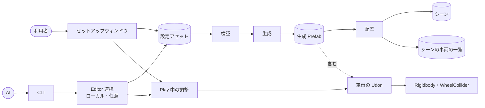
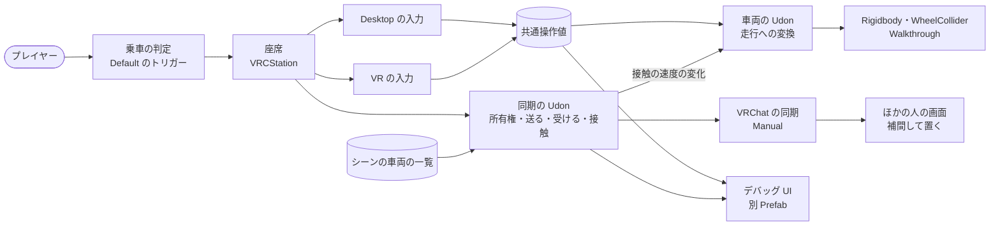
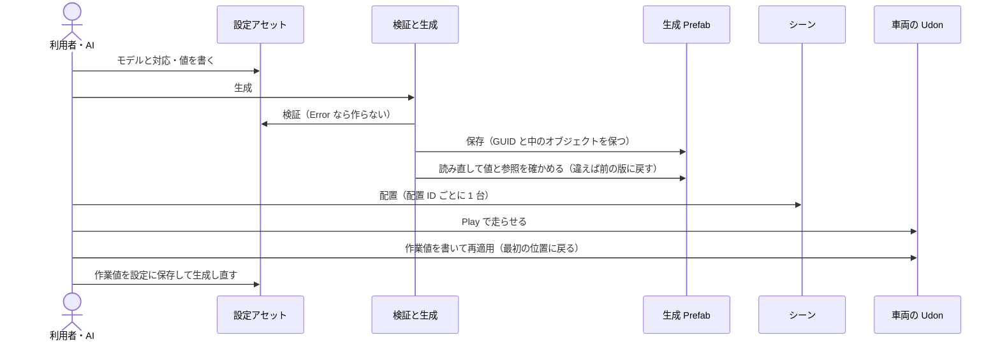
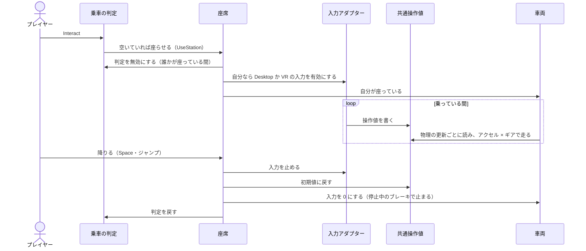
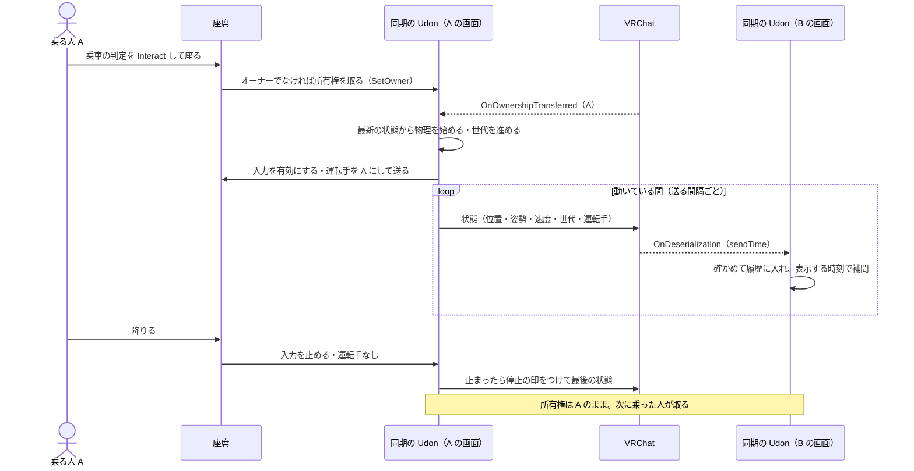
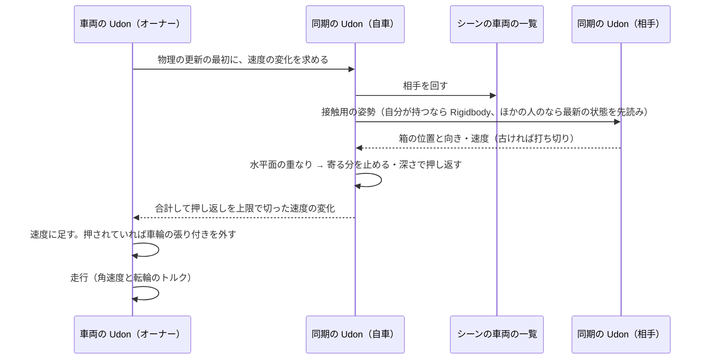
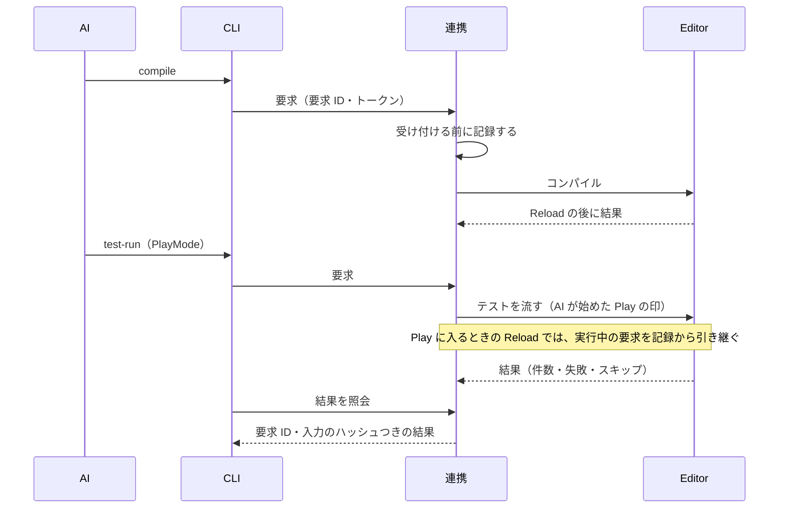

# 仕組み

<!-- 仕組みを変えた PR の中で、ここも直す。図と実装が違ったら実装が正。1 図 20 ノードまで。 -->

## 全体構成

設定アセットが正本（ADR 0008）。セットアップウィンドウと AI の連携は同じ検証・生成・配置を使い、生成物から設定を逆算しない。

- 連携は開発用のローカルの追加機能で、パッケージには入らない。連携がなくても、ウィンドウだけで同じことができる。
- 車両の Udon は実行中に設定アセットを読まない（Udon から ScriptableObject は読めない）。値は生成のときに書き、Play 中は Editor から書き直す。

### 実行中の部品

乗車と入力は、生成 Prefab の中の Udon で閉じる。入力の方法と車両の動きは、共通操作値で分ける。運転手が車両のオーナーになり、オーナーだけが物理を計算して、車体の状態を同期の Udon で送る（ADR 0009）。

- 車両は、オーナーの画面で、自分が座っている間だけ物理の更新ごとに共通操作値を読む。座っていない間は `SetDriveInput` を直接使える。オーナー以外の画面では、走行の入力も物理の更新もしない。
- オーナー以外の画面では、車体を kinematic にして物理の形（車体のコライダーと WheelCollider）を無効にし、受けた状態を表示する時刻の前後から補間して置く。
- 車両同士の通常の物理の当たりは外す（オーナー以外の画面では相手の物理の形が無効、同じ人が持つ車両同士はシーンの車両の一覧から `Physics.IgnoreCollision`）。その上で、各オーナーが物理の更新の最初に、自分の車両の速度だけを直す（簡易衝突。ADR 0009）。相手の車両も位置も直接は動かさず、接触のための同期変数やイベントはない。
- 接触に使う相手の姿勢は、自分が持つ車両なら Rigidbody の今の値、ほかの人の車両なら最新の有効な状態を今の時刻まで進めた値（表示の補間とは別）。止まった印のない状態が 1 秒より古ければ、その相手とは計算しない。重なりは、水平面での車体の箱どうしの重なり（静的な関数）。
- 押されている車両は、押す加速がブレーキの減速より大きい間だけ、車輪の張り付きを外し（ブレーキを外して、わずかな駆動のトルク）、ブレーキの減速を速度に掛ける。WheelCollider は、駆動していない車輪を低速でその場に張り付かせるため。
- 車体のコライダーと WheelCollider は `Walkthrough` レイヤーで、プレイヤーと当たらない。元のモデルのトリガーでないコライダーは、生成 Prefab の中で無効にする。

## 主要な流れ

### 設定から走行まで

### 乗車から降車まで

### 乗車から所有権・同期まで

- 3 秒たっても所有権が来ないとき、座ったまま所有権がほかの人へ移ったときは、座席から降ろす。
- 新しいオーナーの状態が所有権の移動の通知より先に届いたら、送った人ごとに保留し、その人へ所有権が移ったときに使う（状態遷移は [diagrams/vehicle-ownership-states.md](diagrams/vehicle-ownership-states.md)）。

### 車両同士の接触

- 自分が寄る分だけを自分で消し、相手が寄って来る分は深さに比例した上限つきの加速だけで受ける。遅れて届いた相手の速度を写すと、反動が遅れの分だけ増えるため。
- 押し返しは両方の車両に同じ深さから掛かるので、戦車どうしで押せるのは、押す側の駆動の加速が押される側のブレーキの減速より大きいときだけ（既定値では押せない）。

### 連携でのコンパイルからテストまで

## 共通の部品

| 部品 | 場所 | 用途 |
|---|---|---|
| `YakimaTankVehicle` | Runtime | 走行・制動・旋回・再適用。自分が座っている間は共通操作値から走る（UdonSharp）。オーナーの画面でだけ物理を計算する。物理の更新の最初に接触の速度の変化を足し、押されている間は車輪の張り付きを外す（判定は静的な関数） |
| `YakimaTankVehicleSync` | Runtime | 車体の同期（ルート、Manual）。所有権の切り替え、送る状態の採取と送る間隔、受けた状態の確かめ・保留・履歴・補間・先読み、物理の形の有効・無効、同じ人の車両同士の通常の当たりを外す。車両同士の簡易衝突（接触用の姿勢・水平面の重なり・速度の変化）。計算は静的な関数 |
| `YakimaTankVehicleRegistry` | Runtime | シーンの車両の一覧（同期しない）。始まるときに各車両へ自分を知らせる |
| `YakimaTankControlState` | Runtime | 共通操作値（ハンドル・アクセル・ギアなど）。入力が書き、車両とデバッグ UI が読む |
| `YakimaTankSeat` | Runtime | 座席（VRCStation と同じ GameObject）。出入りで乗車の判定と入力を切り替え、降りたら初期値に戻す。座ったら所有権を取り、来たら入力を有効にする。降りる入力（今はジャンプ）を受けて降ろす（VRCStation の標準の降り方は止める） |
| `YakimaTankBoarding` | Runtime | 乗車の判定の Interact |
| `YakimaTankDesktopInput` | Runtime | Desktop の入力（W・S・A・D、視点、左クリック）。変換は静的な関数 |
| `YakimaTankVRInput` | Runtime | VR の入力（左手で走行、右手で砲と射撃）。変換は静的な関数 |
| `YakimaTankDebugPanel` | Runtime | デバッグ UI。共通操作値を箱の大きさで、同期と接触の状態を UI の文字で見せる。別 Prefab |
| `YakimaTankSetupSettings` | Editor | 設定アセット（正本）。読み込むときに今の版へ移す |
| `YakimaTankSetupValidator` | Editor | 設定の検証（Error・Warning）。`Walkthrough` レイヤー・砲塔・元のモデルのコライダー・砲塔と砲身を除いた車体のメッシュも見る |
| `YakimaTankSettingsWriter` | Editor | 階層パスで設定を書く。解決できなければ何も書かない |
| `YakimaTankSetupService` | Editor | 生成（座席・乗車の判定・入力・レイヤーを含む）。ウィンドウと連携が共用する |
| `YakimaTankScenePlacement` | Editor | シーンへの配置。車両は生成 Prefab のインスタンスで見分け、その車両を指すデバッグ UI を 1 枚まで許す。ほかの手の変更があれば変えずに止める（UdonSharp が書く上書きは除く）。配置のたびにシーンの車両の一覧を作り直す |
| `YakimaTankSceneRegistry` | Editor | シーンの車両の一覧を作り直す・実際の車両と合っているかを確かめる。車両の中を指す型の古い Network ID（0.2.0 でビルドしたシーン）を外す。VRChat SDK のビルドの前に、古い ID を外してから確かめ、一覧が合わなければ止める（`YakimaTankRegistryBuildCheck`） |
| `YakimaTankDebugPanelPlacement` | Editor | 入れ物にデバッグ UI を 1 枚置く（開発ワールドの更新が配置の後に呼ぶ） |
| `YakimaTankDebugPanelBuilder` | Editor | パッケージのデバッグ UI の Prefab を作る（作り直すときも使う） |
| `YakimaTankPlayTuning` | Editor | Play 中の再適用・出し直し・作業値の保存。車両・座席・VR の入力に書く。出し直したら、前の車両を表示していたデバッグ UI を新しい車両につなぎ直す |
| `YakimaTankWorkingValues` | Editor | Play 中の作業値。作った元の設定と組にし、設定が替われば作り直す |
| `YakimaTankRuntimeValues` | Editor | 設定と、値を受ける Udon（車両・座席・VR の入力・同期と接触）で同じ名前の値 |
| `YakimaTankModelPaths` | Editor | モデルの中の階層パス（同じ名前の兄弟は番号つき。名前の中の `\` `/` `[` `]` はエスケープ） |
| `YakimaTankBounds` | Editor | メッシュの範囲（SkinnedMeshRenderer はルートのボーンの座標）。車体・砲塔自身にメッシュがなければ、子から砲塔・砲身の階層を除いて求める |
| `YakimaTankSetupMath` | Editor | 転輪の半径・位置、サスペンションの自動の値 |
| `YakimaTankModelInspector` | Editor | モデルを読むだけで、階層・範囲・軸・名前からの候補を返す（連携の `inspect-model`） |
| `TestWorkspace` | Tests/Editor | テストの一時フォルダと、立方体と円柱のモデル |
| `YakimaTankDriveTestBase` | Tests/Runtime | 走行・乗降・同期・接触の判定（PlayMode・ClientSim）。生成物ごとに派生させる。乗降と同期のテストと、ほかの人の車両との接触のテストだけ ClientSim を始める。受ける状態は `_AcceptState` に直接入れ、送る要求にはテストが OnPreSerialization・OnPostSerialization で応える |

## これからの設計

これから足す機能の段階と境界の案は [prototype-plan.md](prototype-plan.md)。この文書は今の実装だけを描く。

## そのほかの図

| 図 | ファイル |
|---|---|
| 生成 Prefab のデータ構造 | [diagrams/generated-prefab.md](diagrams/generated-prefab.md) |
| 連携の要求の状態遷移 | [diagrams/request-states.md](diagrams/request-states.md) |
| 車両の所有権の状態遷移 | [diagrams/vehicle-ownership-states.md](diagrams/vehicle-ownership-states.md) |
