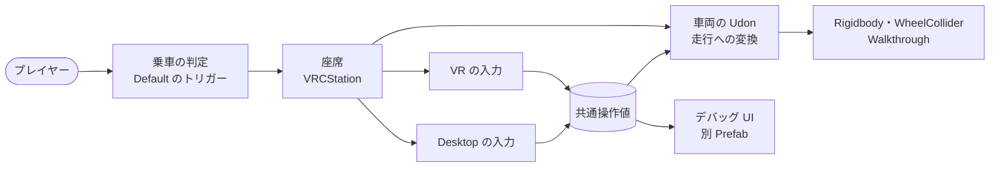
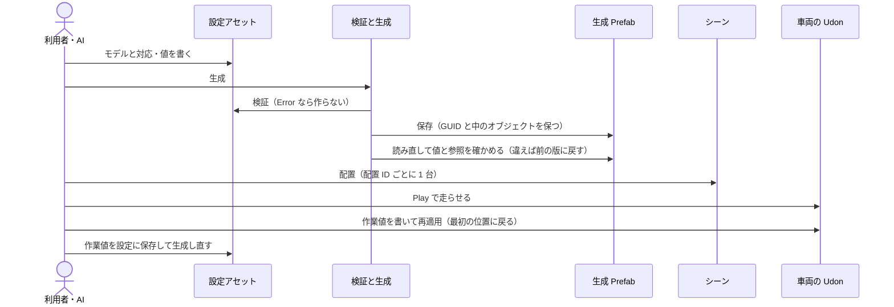
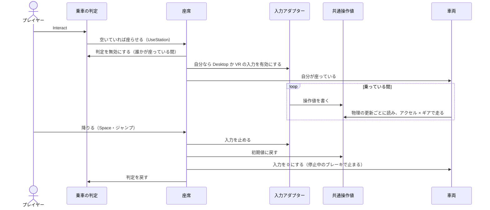
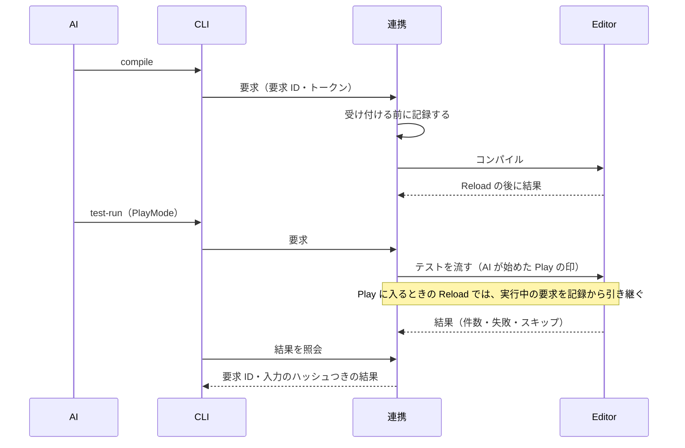

# 仕組み

<!-- 仕組みを変えた PR の中で、ここも直す。図と実装が違ったら実装が正。1 図 20 ノードまで。 -->

## 全体構成

設定アセットが正本（ADR 0008）。セットアップウィンドウと AI の連携は同じ検証・生成・配置を使い、生成物から設定を逆算しない。

- 連携は開発用のローカルの追加機能で、パッケージには入らない。連携がなくても、ウィンドウだけで同じことができる。
- 車両の Udon は実行中に設定アセットを読まない（Udon から ScriptableObject は読めない）。値は生成のときに書き、Play 中は Editor から書き直す。

### 実行中の部品

乗車と入力は、生成 Prefab の中の Udon で閉じる。入力の方法と車両の動きは、共通操作値で分ける。この版は同期しない（各自の画面だけ）。

- 車両は、自分が座っている間だけ物理の更新ごとに共通操作値を読む。座っていない間は `SetDriveInput` を直接使える。
- 車体のコライダーと WheelCollider は `Walkthrough` レイヤーで、プレイヤーと当たらない。元のモデルのトリガーでないコライダーは、生成 Prefab の中で無効にする。

## 主要な流れ

### 設定から走行まで

### 乗車から降車まで

### 連携でのコンパイルからテストまで

## 共通の部品

| 部品 | 場所 | 用途 |
|---|---|---|
| `YakimaTankVehicle` | Runtime | 走行・制動・旋回・再適用。自分が座っている間は共通操作値から走る（UdonSharp） |
| `YakimaTankControlState` | Runtime | 共通操作値（ハンドル・アクセル・ギアなど）。入力が書き、車両とデバッグ UI が読む |
| `YakimaTankSeat` | Runtime | 座席（VRCStation と同じ GameObject）。出入りで乗車の判定と入力を切り替え、降りたら初期値に戻す |
| `YakimaTankBoarding` | Runtime | 乗車の判定の Interact |
| `YakimaTankDesktopInput` | Runtime | Desktop の入力（W・S・A・D、視点、左クリック）。変換は静的な関数 |
| `YakimaTankVRInput` | Runtime | VR の入力（左手で走行、右手で砲と射撃）。変換は静的な関数 |
| `YakimaTankDebugPanel` | Runtime | デバッグ UI。共通操作値を箱の大きさで見せる。別 Prefab |
| `YakimaTankSetupSettings` | Editor | 設定アセット（正本）。読み込むときに今の版へ移す |
| `YakimaTankSetupValidator` | Editor | 設定の検証（Error・Warning）。`Walkthrough` レイヤー・砲塔・元のモデルのコライダー・砲塔と砲身を除いた車体のメッシュも見る |
| `YakimaTankSettingsWriter` | Editor | 階層パスで設定を書く。解決できなければ何も書かない |
| `YakimaTankSetupService` | Editor | 生成（座席・乗車の判定・入力・レイヤーを含む）。ウィンドウと連携が共用する |
| `YakimaTankScenePlacement` | Editor | シーンへの配置。車両は生成 Prefab のインスタンスで見分け、その車両を指すデバッグ UI を 1 枚まで許す。ほかの手の変更があれば変えずに止める |
| `YakimaTankDebugPanelPlacement` | Editor | 入れ物にデバッグ UI を 1 枚置く（開発ワールドの更新が配置の後に呼ぶ） |
| `YakimaTankDebugPanelBuilder` | Editor | パッケージのデバッグ UI の Prefab を作る（作り直すときも使う） |
| `YakimaTankPlayTuning` | Editor | Play 中の再適用・出し直し・作業値の保存。車両・座席・VR の入力に書く。出し直したら、前の車両を表示していたデバッグ UI を新しい車両につなぎ直す |
| `YakimaTankWorkingValues` | Editor | Play 中の作業値。作った元の設定と組にし、設定が替われば作り直す |
| `YakimaTankRuntimeValues` | Editor | 設定と、値を受ける Udon（車両・座席・VR の入力）で同じ名前の値 |
| `YakimaTankModelPaths` | Editor | モデルの中の階層パス（同じ名前の兄弟は番号つき。名前の中の `\` `/` `[` `]` はエスケープ） |
| `YakimaTankBounds` | Editor | メッシュの範囲（SkinnedMeshRenderer はルートのボーンの座標）。車体・砲塔自身にメッシュがなければ、子から砲塔・砲身の階層を除いて求める |
| `YakimaTankSetupMath` | Editor | 転輪の半径・位置、サスペンションの自動の値 |
| `YakimaTankModelInspector` | Editor | モデルを読むだけで、階層・範囲・軸・名前からの候補を返す（連携の `inspect-model`） |
| `TestWorkspace` | Tests/Editor | テストの一時フォルダと、立方体と円柱のモデル |
| `YakimaTankDriveTestBase` | Tests/Runtime | 走行と乗降の判定（PlayMode・ClientSim）。生成物ごとに派生させる。乗降のテストだけ ClientSim を始める |

## これからの設計

これから足す機能の段階と境界の案は [prototype-plan.md](prototype-plan.md)。この文書は今の実装だけを描く。

## そのほかの図

| 図 | ファイル |
|---|---|
| 生成 Prefab のデータ構造 | [diagrams/generated-prefab.md](diagrams/generated-prefab.md) |
| 連携の要求の状態遷移 | [diagrams/request-states.md](diagrams/request-states.md) |
