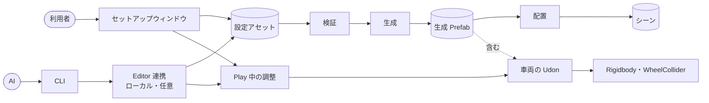
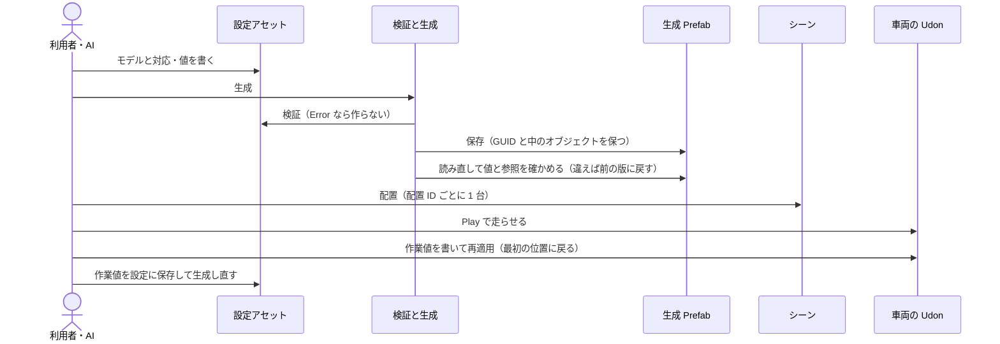
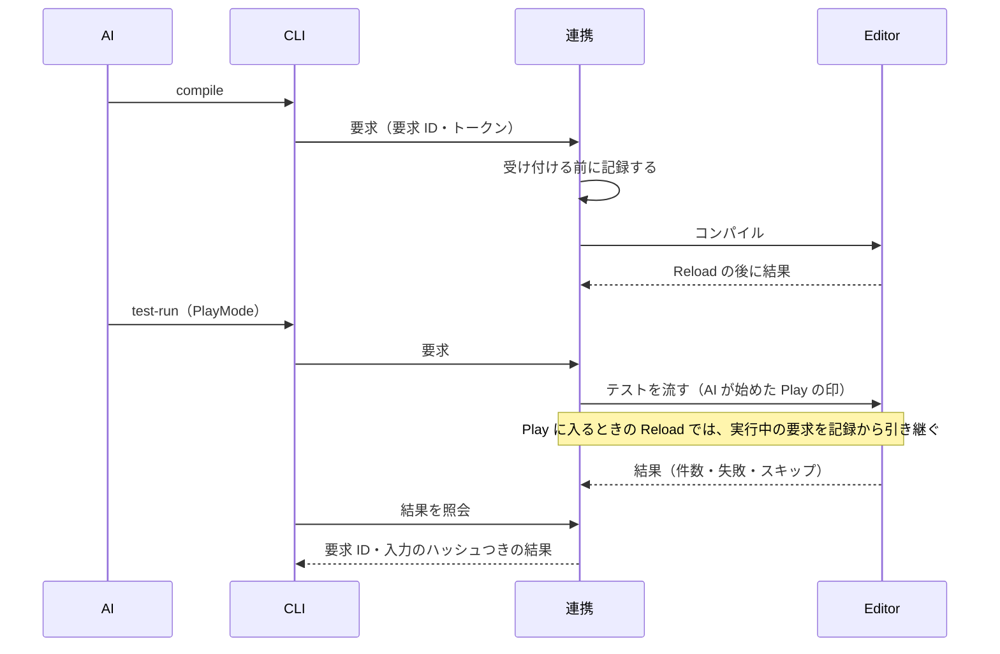

# 仕組み

<!-- 仕組みを変えた PR の中で、ここも直す。図と実装が違ったら実装が正。1 図 20 ノードまで。 -->

## 全体構成

設定アセットが正本（ADR 0008）。セットアップウィンドウと AI の連携は同じ検証・生成・配置を使い、生成物から設定を逆算しない。

- 連携は開発用のローカルの追加機能で、パッケージには入らない。連携がなくても、ウィンドウだけで同じことができる。
- 車両の Udon は実行中に設定アセットを読まない（Udon から ScriptableObject は読めない）。値は生成のときに書き、Play 中は Editor から書き直す。

## 主要な流れ

### 設定から走行まで

### 連携でのコンパイルからテストまで

## 共通の部品

| 部品 | 場所 | 用途 |
|---|---|---|
| `YakimaTankVehicle` | Runtime | 走行・制動・旋回・再適用（UdonSharp） |
| `YakimaTankSetupSettings` | Editor | 設定アセット（正本） |
| `YakimaTankSetupValidator` | Editor | 設定の検証（Error・Warning） |
| `YakimaTankSettingsWriter` | Editor | 階層パスで設定を書く。解決できなければ何も書かない |
| `YakimaTankSetupService` | Editor | 生成。ウィンドウと連携が共用する |
| `YakimaTankScenePlacement` | Editor | シーンへの配置。手の変更があれば変えずに止める |
| `YakimaTankPlayTuning` | Editor | Play 中の再適用・出し直し・作業値の保存 |
| `YakimaTankWorkingValues` | Editor | Play 中の作業値。作った元の設定と組にし、設定が替われば作り直す |
| `YakimaTankRuntimeValues` | Editor | 設定と車両の Udon で同じ名前の走行の値 |
| `YakimaTankModelPaths` | Editor | モデルの中の階層パス（同じ名前の兄弟は番号つき。名前の中の `\` `/` `[` `]` はエスケープ） |
| `YakimaTankBounds` | Editor | メッシュの範囲（SkinnedMeshRenderer はルートのボーンの座標） |
| `YakimaTankSetupMath` | Editor | 転輪の半径・位置、サスペンションの自動の値 |
| `YakimaTankModelInspector` | Editor | モデルを読むだけで、階層・範囲・軸・名前からの候補を返す（連携の `inspect-model`） |
| `TestWorkspace` | Tests/Editor | テストの一時フォルダと、立方体と円柱のモデル |
| `YakimaTankDriveTestBase` | Tests/Runtime | 走行の判定（PlayMode・ClientSim）。生成物ごとに派生させる |

## そのほかの図

| 図 | ファイル |
|---|---|
| 生成 Prefab のデータ構造 | [diagrams/generated-prefab.md](diagrams/generated-prefab.md) |
| 連携の要求の状態遷移 | [diagrams/request-states.md](diagrams/request-states.md) |
