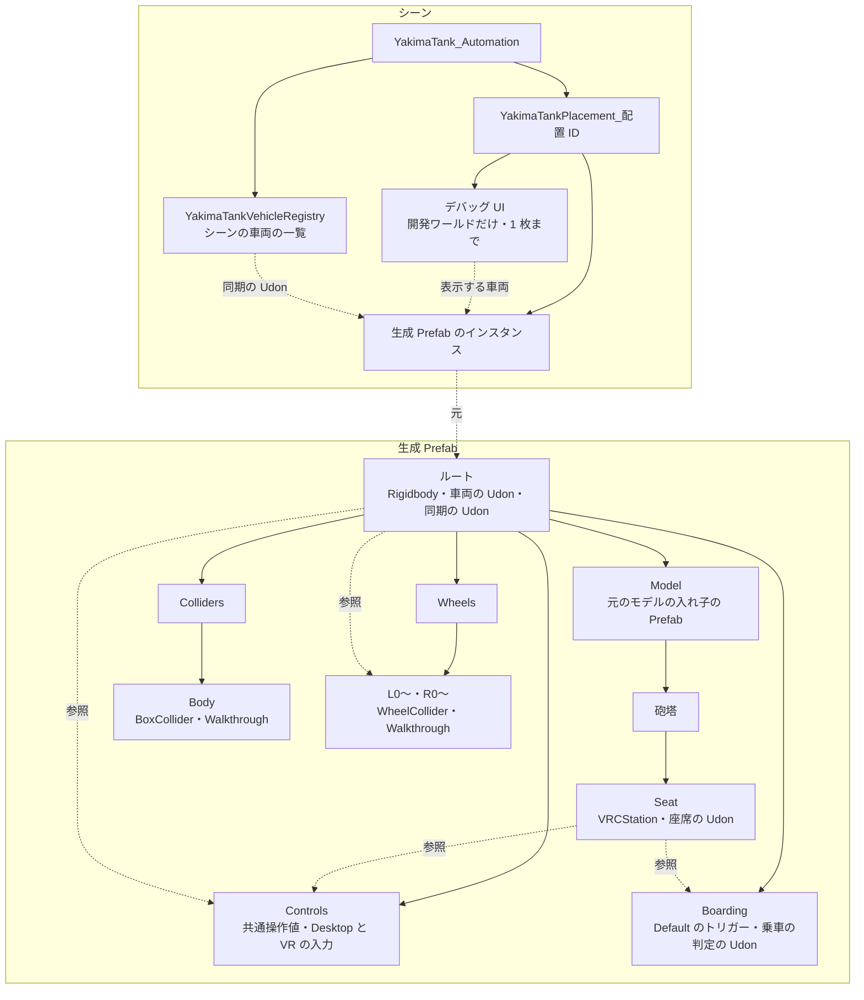

# 生成 Prefab のデータ構造

生成 Prefab の中と、シーンに置いたときの入れ物。名前は実装の定数（`YakimaTankSetupService`・`YakimaTankScenePlacement`・`YakimaTankSceneRegistry`）。

- 車両の Udon は、ルートの Rigidbody・左右の WheelCollider・共通操作値・同期の Udon を参照する。座席は、乗車の判定・入力・共通操作値・車両・同期の Udon を参照する。同期の Udon は、車両・座席・Rigidbody と、物理の形（車体のコライダーと全部の WheelCollider）を参照する。参照は Prefab の中で閉じる。
- ルートの車両の Udon と同期の Udon は、どちらも Manual（同じ GameObject で同期の方式を混ぜない）。座席は別の GameObject。
- 元のモデルは入れ子の Prefab のまま置き、モデルのルートの回転（FBX の軸の変換など）を保って、向きの補正を上から掛ける。元のモデルのトリガーでないコライダーは、Prefab の中で無効にする（元のアセットは変えない）。
- 座席は砲塔の子（砲塔の対応がなければ車体の子）。向きは車体にそろえ、砲塔の範囲の上面の中央に、設定のずらしを足した所に置く。
- 車体のコライダーと WheelCollider は `Walkthrough`、乗車の判定は `Default` のトリガー。乗車の判定の箱は、前後・左右が車体のコライダーより、上下がモデル全体より、各面 5 cm 外（Interact の光線が車体のコライダーより先に判定に当たるように）。
- 生成し直しても、GUID と中のオブジェクト（WheelCollider・BoxCollider・座席・乗車の判定・同期の Udon を含む各 Udon）は保つ。元のモデルを差し替えるときは、座席を先に避けて新しい砲塔の子へ移す。転輪の数が変われば、番号の大きい方を足し引きする。
- 入れ物は配置 ID ごとに 1 つで、中は車両 1 台と、その車両を指すデバッグ UI 1 枚まで。入れ物の位置と向きは設定アセットに保存する。
- シーンの車両の一覧は、管理用のルートの下に 1 つ。配置とウィンドウの「シーンの車両一覧を更新」で作り直す。手で置いた車両も入る。順番はシーンの中の車両の番号（どのクライアントでも同じ）。
