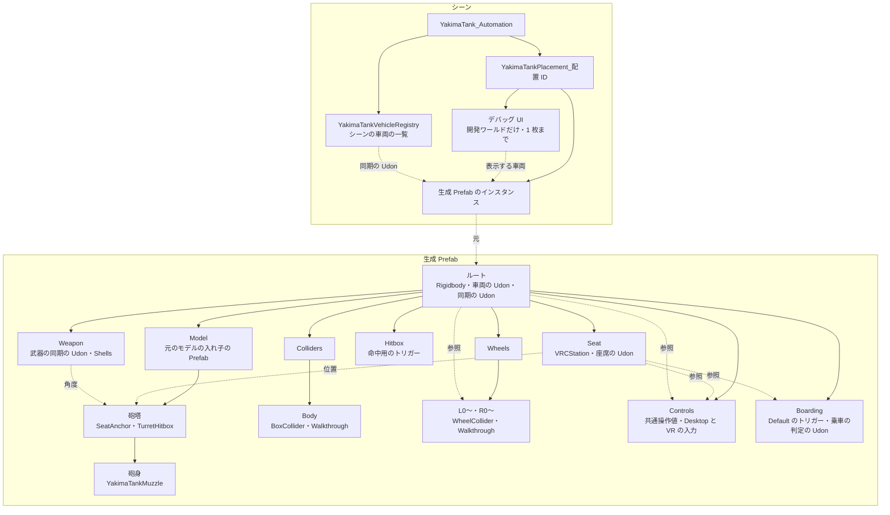

# 生成 Prefab のデータ構造

生成 Prefab の中と、シーンに置いたときの入れ物。名前は実装の定数（`YakimaTankSetupService`・`YakimaTankScenePlacement`・`YakimaTankSceneRegistry`）。

- 車両の Udon は、ルートの Rigidbody・左右の WheelCollider・共通操作値・同期の Udon を参照する。座席は、乗車の判定・入力・共通操作値・車両・同期の Udon を参照する。同期の Udon は、車両・座席・Rigidbody と、物理の形（車体のコライダーと全部の WheelCollider）と、接触に使う車体のコライダー（BoxCollider）を参照する。参照は Prefab の中で閉じる。
- ルートの車両の Udon と同期の Udon は、どちらも Manual（同じ GameObject で同期の方式を混ぜない）。座席は別の GameObject。
- 元のモデルは入れ子の Prefab のまま置き、モデルのルートの回転（FBX の軸の変換など）を保って、向きの補正を上から掛ける。元のモデルのトリガーでないコライダーは、Prefab の中で無効にする（元のアセットは変えない）。
- 座席はルートの下（0.5.0 から。0.4.0 までは砲塔の子）。砲塔の下の位置の参照（`SeatAnchor`。砲塔の範囲の上面の中央、砲塔が 0 度のとき向きは車体）に、設定のずらしを足した所へ、毎フレーム位置だけ合わせる。向きは車体のまま。
- 武器（`Weapon`）はルートの子で、車体とは別の所有権の領域。武器の同期の Udon（Manual）と、使い回す砲弾（`Shells/Shell0〜`。見えない球、同期しない）。砲塔と砲身の角度を書く。砲口（`YakimaTankMuzzle`）は砲身の下で、元のモデルの砲口の印（名前に Muzzle）か、砲身のメッシュの前の端に置く。
- 命中用のトリガー：車体の箱（ルートの下の `Hitbox`）と、砲塔の箱（砲塔の下の `TurretHitbox`。砲塔の下にメッシュがなければルートの下で、車体の箱をモデルの上端まで伸ばした箱）。どちらも `Default` のトリガーで、車体の同期の Udon を指す。
- 車体のコライダーと WheelCollider は `Walkthrough`、乗車の判定は `Default` のトリガー。乗車の判定の箱は、前後・左右が車体のコライダーより、上下がモデル全体より、各面 5 cm 外（Interact の光線が車体のコライダーより先に判定に当たるように）。
- 生成し直しても、GUID と中のオブジェクト（WheelCollider・BoxCollider・座席・乗車の判定・同期の Udon を含む各 Udon）は保つ。元のモデルを差し替えるときは、座席（ルートの下）はそのまま使い、位置の参照・砲塔の箱・砲口は新しいモデルの砲塔と砲身の下に作り直す。転輪の数が変われば、番号の大きい方を足し引きする。
- 入れ物は配置 ID ごとに 1 つで、中は車両 1 台と、その車両を指すデバッグ UI 1 枚まで。入れ物の位置と向きは設定アセットに保存する。
- シーンの車両の一覧は、管理用のルートの下に 1 つ。配置とウィンドウの「シーンの車両一覧を更新」で作り直す。手で置いた車両も入る。順番はシーンの中の車両の番号（どのクライアントでも同じ）。
