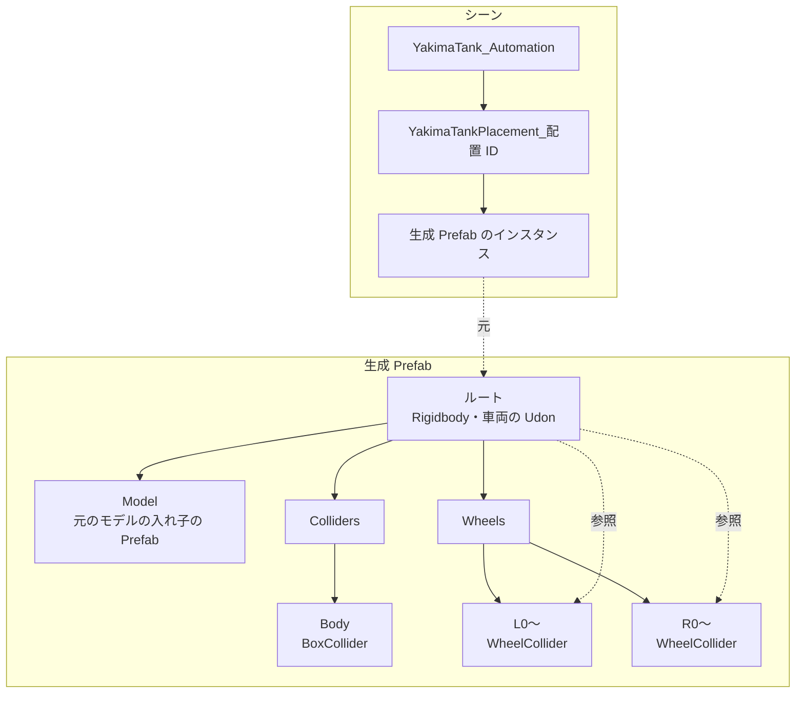

# 生成 Prefab のデータ構造

生成 Prefab の中と、シーンに置いたときの入れ物。名前は実装の定数（`YakimaTankSetupService`・`YakimaTankScenePlacement`）。

- 車両の Udon は、ルートの Rigidbody と左右の WheelCollider を参照する。参照は Prefab の中で閉じる。
- 元のモデルは入れ子の Prefab のまま置き、モデルのルートの回転（FBX の軸の変換など）を保って、向きの補正を上から掛ける。
- 生成し直しても、GUID と中のオブジェクト（WheelCollider・BoxCollider・車両の Udon）は保つ。転輪の数が変われば、番号の大きい方を足し引きする。
- 入れ物は配置 ID ごとに 1 つで、中は車両 1 台。入れ物の位置と向きは設定アセットに保存する。
