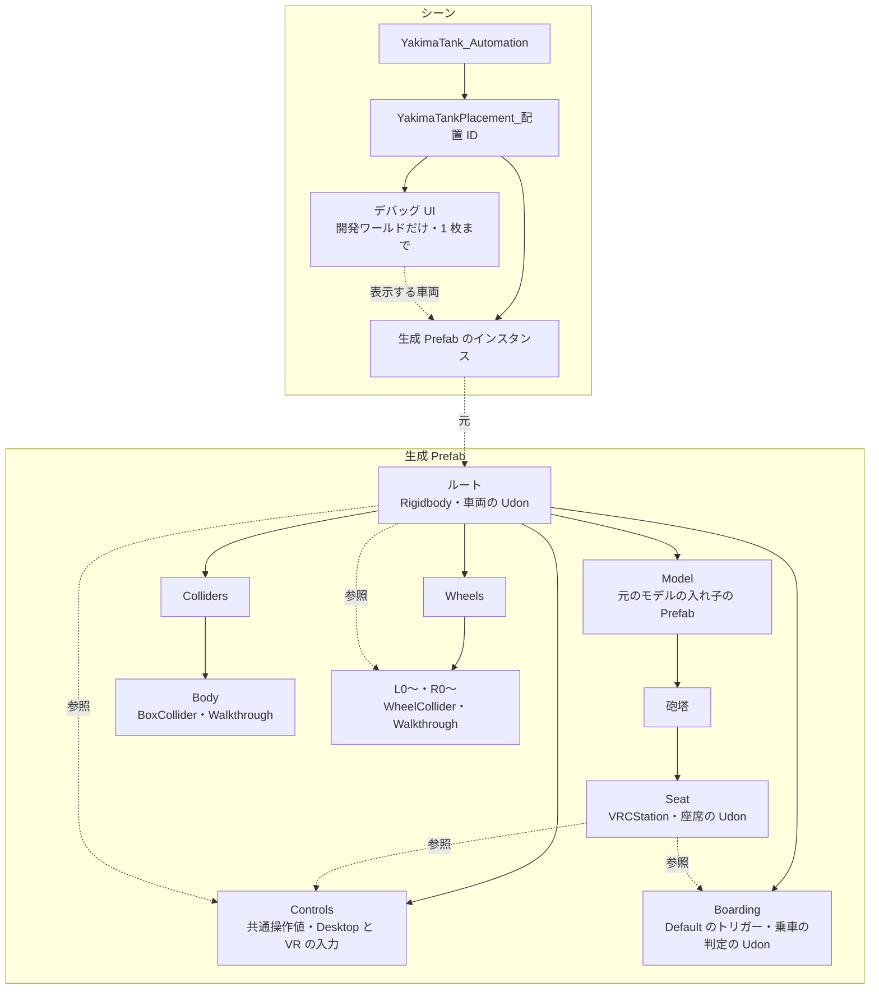

# 生成 Prefab のデータ構造

生成 Prefab の中と、シーンに置いたときの入れ物。名前は実装の定数（`YakimaTankSetupService`・`YakimaTankScenePlacement`）。

- 車両の Udon は、ルートの Rigidbody・左右の WheelCollider・共通操作値を参照する。座席は、乗車の判定・入力・共通操作値・車両を参照する。参照は Prefab の中で閉じる。
- 元のモデルは入れ子の Prefab のまま置き、モデルのルートの回転（FBX の軸の変換など）を保って、向きの補正を上から掛ける。元のモデルのトリガーでないコライダーは、Prefab の中で無効にする（元のアセットは変えない）。
- 座席は砲塔の子（砲塔の対応がなければ車体の子）。向きは車体にそろえ、砲塔の範囲の上面の中央に、設定のずらしを足した所に置く。
- 車体のコライダーと WheelCollider は `Walkthrough`、乗車の判定は `Default` のトリガー。
- 生成し直しても、GUID と中のオブジェクト（WheelCollider・BoxCollider・座席・乗車の判定・各 Udon）は保つ。元のモデルを差し替えるときは、座席を先に避けて新しい砲塔の子へ移す。転輪の数が変われば、番号の大きい方を足し引きする。
- 入れ物は配置 ID ごとに 1 つで、中は車両 1 台と、その車両を指すデバッグ UI 1 枚まで。入れ物の位置と向きは設定アセットに保存する。
