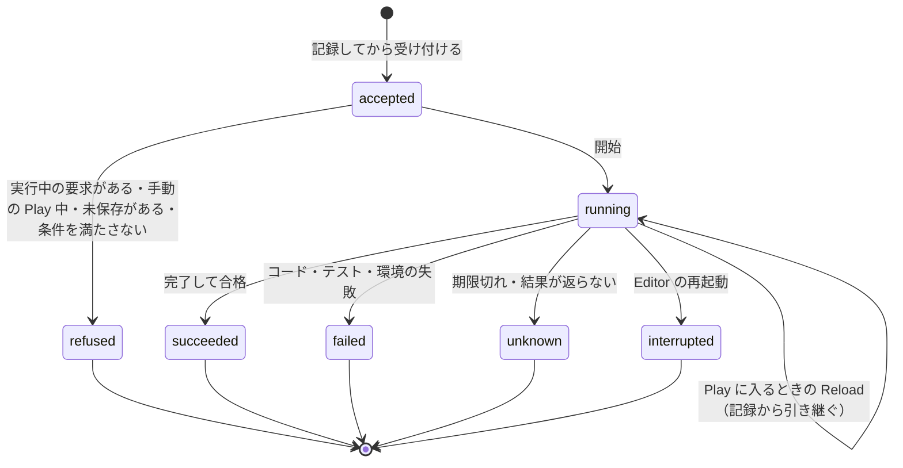

# 連携の要求の状態遷移

Editor 連携（開発用のローカルの追加機能）が要求 ID ごとに記録する状態。記録は受け付ける前に書き、Reload と Editor の再起動をまたいで照会できる。

- 同じ要求 ID の再送は実行し直さず、記録を返す。同じ ID で中身が違えば断る。
- `unknown` と `interrupted` の後は、開始要求を送り直さない。記録と入力のハッシュを確かめてから、新しい要求 ID で始める。
- 成功に数えるのは `succeeded` だけ。テスト 0 件は `failed` にする。
