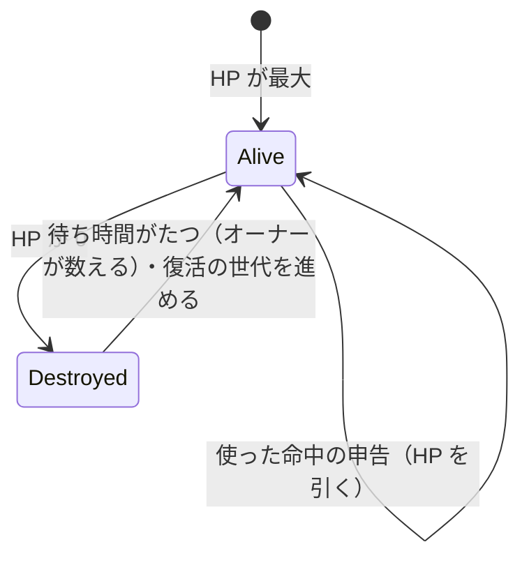

# 車両の生存の状態の遷移

ある 1 人の画面から見た車両の生存の状態（仕様書 0.6.0 の 1.3）。`YakimaTankLife` が切り替える。どのクライアントも、同期変数（HP・復活の世代）から同じ状態にする。

| 状態 | 走行 | 射撃 | 乗車 | HP のバー |
|---|---|---|---|---|
| Alive | 座っている人の入力で走る | 撃てる | 空いていれば乗れる | 最大 HP に対する割合 |
| Destroyed | 入力を止め、停止中のブレーキ | 撃てない | 乗車の判定は無効。座っている人は自分のクライアントで降りる | 0 |

- 「破壊」と「復活待ち」は同じ間（HP が 0 の間）で、オーナーが待ち時間を数える。待っている間にオーナーが代わると、新しいオーナーが最初から数え直す。
- 復活はオーナーだけが行う。復活の世代を進め、HP を最大に戻し、車体を最初の位置へ戻す（Editor の「最初の位置に戻す」と、中の初期化だけを共用する。車体の世代が進み、ほかの人の画面で補間せずに置かれる）。処理した命中はそのまま残す。
- 武器のオーナーは、復活の世代が変わったのを見て、自分の領域（砲塔と砲身の角度・装填）を初期値に戻す。ほかの人の画面の砲塔は、武器の同期で戻る。
- 飛んでいる砲弾は消さない。復活の前に撃ち、復活の後に当たった弾も有効（当たったと判定した時点の世代は今の世代）。撃った車両が先に破壊されても、その車両の飛んでいる砲弾の命中は有効（相打ちがある）。
- 破壊の見た目はまだない（0.7.0）。
- 命中の申告と確かめは [architecture.md](../architecture.md) の「命中から破壊・復活まで」。
