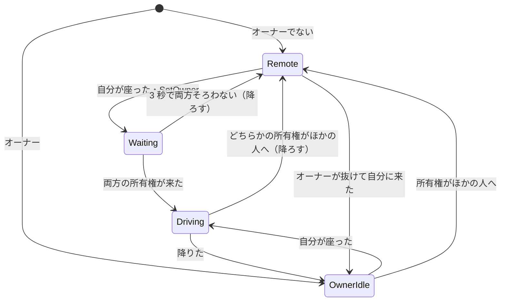

# 車両の所有権の状態遷移

ある 1 人の画面から見た車両の状態（仕様書 0.3.0 の 2 節）。`YakimaTankVehicleSync` と `YakimaTankSeat` が切り替える。0.5.0 から、所有権は車体（ルート）と武器（`Weapon`）の 2 つで、座ると両方を取る。

| 状態 | 車体 | 物理の形 | 入力 |
|---|---|---|---|
| Remote | kinematic。受けた状態を補間して置く | 無効 | 無効 |
| Waiting | Remote と同じ（車体が先に来れば OwnerIdle と同じ） | 無効 | 無効（両方の所有権を待つ。撃てない） |
| Driving | Rigidbody で計算し、送る | 有効 | 有効（走る・狙う・撃つ） |
| OwnerIdle | Rigidbody で計算し、止まったら停止の印で 1 回送る | 有効 | 無効（停止中のブレーキ） |

- オーナーになったとき（Remote から）は、最新の有効な状態の位置・姿勢・速度から物理を始め、世代を進めてすぐに送る。保留はすべて捨てる。
- 待つ間は、片方だけ来ても降ろさない（もう片方がまだ移っていないのか、ほかの人へ移ったのかを、通知だけでは見分けられないため）。
- 破壊されると（0.6.0）、座っている人は自分のクライアントで降りる（Driving → OwnerIdle）。破壊の間は乗れない。生存の状態の遷移は [vehicle-life-states.md](vehicle-life-states.md)。
- 武器の所有権だけを持つ・車体の所有権だけを持つ状態もある（オーナーが抜けると、VRChat が 2 つの新しいオーナーを別々に決める）。誰も座っていない間は、それぞれが自分の領域だけを引き継ぐ。
- Remote の間に、まだオーナーでない人の状態が届いたら、送った人ごとに保留する。所有権が移ったら、新しいオーナーの保留を使うか捨て、ほかの人の保留は残す。
