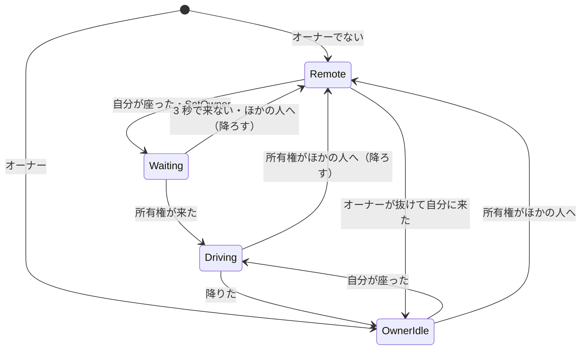

# 車両の所有権の状態遷移

ある 1 人の画面から見た車両の状態（仕様書 0.3.0 の 2 節）。`YakimaTankVehicleSync` と `YakimaTankSeat` が切り替える。

| 状態 | 車体 | 物理の形 | 入力 |
|---|---|---|---|
| Remote | kinematic。受けた状態を補間して置く | 無効 | 無効 |
| Waiting | Remote と同じ | 無効 | 無効（所有権を待つ） |
| Driving | Rigidbody で計算し、送る | 有効 | 有効 |
| OwnerIdle | Rigidbody で計算し、止まったら停止の印で 1 回送る | 有効 | 無効（停止中のブレーキ） |

- オーナーになったとき（Remote から）は、最新の有効な状態の位置・姿勢・速度から物理を始め、世代を進めてすぐに送る。保留はすべて捨てる。
- Remote の間に、まだオーナーでない人の状態が届いたら、送った人ごとに保留する。所有権が移ったら、新しいオーナーの保留を使うか捨て、ほかの人の保留は残す。
