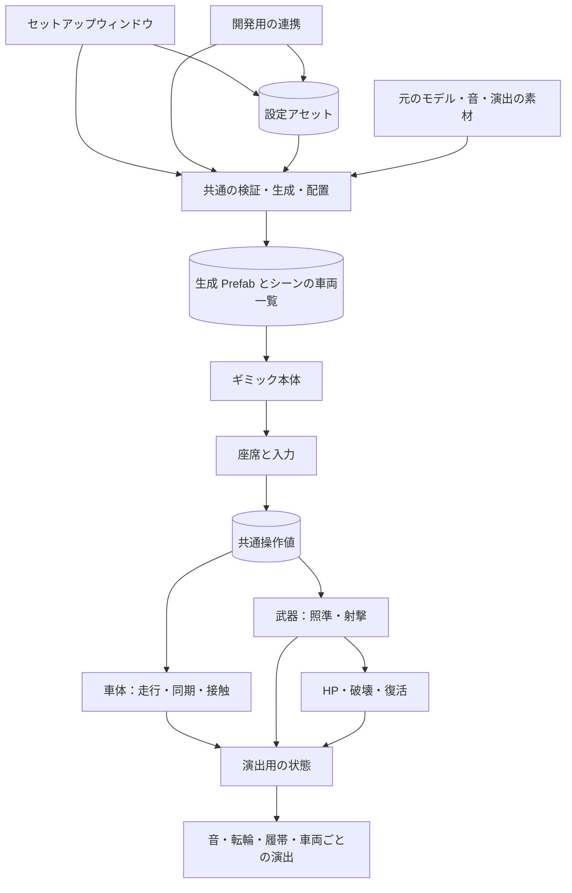

# プロトタイプまでの全体設計（案）

- 状態：提案（2026-11-13）。実装の指示ではない。決まったことは ADR と仕様書にあり、そちらが正
- 今の仕組みは [architecture.md](architecture.md)。段階を実装したら architecture.md を直し、この文書の「状態」を更新する

## 1. 到達点

**今の設定・生成の基盤に、操作 → 車体の同期 → 車両同士の接触 → 武器 → 戦闘 → 演出の順で足す。どの段階でも、セットアップウィンドウから同じ車両を作り直せるようにする。**

- プロトタイプ：セットアップ → 1 人での乗降・走行 → 砲塔・射撃 → HP・破壊・復活 → 4 台程度での同期と基本の演出までを一通り遊べ、設定を変えて生成し直し、別のモデルでも試せる状態。
- 正式公開の 1.0.0 とは別に判断する（配布の整備と品質の仕上げは別）。
- 対象：Windows の Desktop と PC VR。4 台は試験の規模で、製品の上限ではない。
- 後回し：Android、複数人の乗車、リアルな駆動系、手でつかむレバー・ハンドル、高度な装甲・音・足回り、外部のダメージシステムとの相互ダメージ（つなぐ口だけ用意する）。

## 2. 段階

各段階で、Runtime・設定・検証・生成・Play 中の調整・テストを縦にそろえる。Runtime を全部作ってから Editor を追い付かせる順番にはしない。段階の番号は製品の版ではない。

| 段階 | 成果 | 次へ進む確認 | 仕様書 | 状態 |
|---|---|---|---|---|
| 0：基盤 | 設定・非破壊の生成・配置・Play 中の調整・最小の走行 | — | [0.1.0](../02_Specifications/SPEC_2026-11-13_セットアップと開発ワールド自動更新.md) | 実装済み（PR #1） |
| 1：乗って操作する | 座席・乗車の判定・Desktop と VR の入力・共通操作値・デバッグ UI | 乗降で入力が残らない。走行と生成し直しが保たれる。VRChat で 1 人で走れる | [0.2.0](../02_Specifications/SPEC_2026-11-13_乗降と走行操作.md) | 承認済み・未実装 |
| 2：複数人で同じ車両を見る | 車体の独自同期・所有権・シーンの車両の一覧。車両同士はすり抜け | VRChat の 2 つのクライアントで同じ位置。途中参加・乗り換え・退出・停止の復元 | [0.3.0](../02_Specifications/SPEC_2026-11-13_車体の同期と所有権.md) | 承認済み・未実装 |
| 3：4 台で接触する | 簡易衝突・無人の車両を押す・壁を優先・欠落で打ち切る | 通常の衝突と二重にならない。壁際・密集・遅れで反動が増えない | [方針](../02_Specifications/SPEC_2026-11-13_車両物理同期と簡易衝突.md) | 方針だけ承認 |
| 4：狙って撃つ | 砲塔・砲身、主砲 1 系統・装填・弾道、発射の演出と同期 | 走りながら狙える。二重の発射・命中がない | 未作成 | — |
| 5：戦闘が回る | HP・破壊・復活、乗員と全状態の初期化 | 途中参加・同時の被弾・古い弾・所有者の交代をまたいで食い違わない | 未作成 | — |
| 6：モデルを替えて完成を確かめる | 基本の音・転輪・履帯、モデルごとの演出、Editor の全体 | 別のモデルでも生成・生成し直しができ、4 台で一通り遊べる | 未作成 | — |

- 同期と接触は分けて確かめるが、最初から同じ ADR 0009 の境界で作る。
- 発射の最小の演出は段階 4 で、音や履帯の全体の調整は段階 6 で行う。

## 3. 三つの領域

| 領域 | 役割 | 依存 |
|---|---|---|
| ギミック本体（Runtime） | 乗降・操作・走行・同期・武器・戦闘・演出 | Unity・VRChat・UdonSharp。Editor と開発用の連携には依存しない |
| 製品の Editor | 設定の編集・検証・生成・配置・Play 中の調整 | Runtime を組み立てる。ウィンドウと連携が同じ処理を使う（ADR 0008） |
| 開発環境（ローカル） | 要求の管理・テストの実行・開発ワールドの更新・ローカルビルドと証拠 | 製品の Editor を呼ぶ。製品からは参照しない（ADR 0007） |

図の箱は、1 つの箱に 1 つのスクリプトという意味ではない。続けて計算する所はまとめ、交換したい所と、所有権が違う所を分ける。自作のインターフェイス・汎用のイベントの仕組み・DI は先に作らず、Udon の参照と値の受け渡しを基本にする。Udon の Behaviour 間の呼び出しは重いので、設計の分け方と、実行時の部品の数を同じにしない。

## 4. データの種類と持ち主

| 種類 | 例 | 正本・書く人 |
|---|---|---|
| 設定 | 質量・最高速度・旋回の速さ・弾速・最大 HP・音源 | 設定アセット。生成のときに Runtime に書き込む |
| 操作の要求 | ハンドル・アクセル・ギア・照準の入力・射撃 | 権限のあるローカルの入力アダプター |
| 確定したゲームの状態 | 車体の姿勢と速度・砲塔の角度・弾薬・装填・HP・生死・復活の世代 | 担当するオーナーだけが書く |
| 表示用の状態 | 補間した姿勢・履帯の位相・音量・反動のアニメーション | 各クライアント。ゲームの状態を書き換えない |

- 設定アセット（ScriptableObject）に、実行中の HP や所有者を置かない。
- 操作値を全員に送って、それぞれの画面で物理を再現する使い方はしない（ADR 0009）。

## 5. 機能の単位と境界

名前は候補。今のクラス名を変えるものではない。

| 機能 | 受け持つこと | 後から足すときの境界 |
|---|---|---|
| 座席・操作の権限 | 乗降、ローカルの乗車、運転と砲の権限、入力の有効化 | 複数の座席。1 人のときは同じ人が両方の権限を持つ |
| 入力と共通操作値 | Desktop と VR を共通操作値に変える | 手でつかむレバー・ハンドルを別のアダプターで足す |
| 車両・走行 | 操作値からカジュアルな走行。自車の物理の更新をまとめる | リアルな駆動系・別の接地の方式に替える口 |
| 車体の同期 | 所有権、状態を送る、受けた履歴、補間、接触用の先読み | 走行の中の計算に頼らず、姿勢と速度を受け取る |
| 車両同士の接触 | 相手の有効な状態から、自車だけの補正を出す | HP・武器・履帯の接地から独立 |
| 武器 | 砲塔・砲身、装填、発射の番号、弾道・命中の申告 | 砲手の権限、別の弾種・武器 |
| 生存の状態 | HP、被弾の受付、破壊、復活と全体のリセット | 装甲、外部からのダメージの入口 |
| 演出 | 状態を読んで、音・履帯・転輪・反動を表示する | 車両ごとの音・Animator・足回りの表現 |

- デバッグ UI は、操作値と同期の状態を読むだけの別の Prefab。表示がゲームの処理を動かさない。

### 書き込みがぶつからないようにする

- オーナーの Rigidbody の更新は、車両の物理の更新の順にまとめる。走行と接触の補正が、別々の更新で速度を上書きし合わない。
- オーナー以外では走行と WheelCollider の計算を止め、同期が姿勢を置く。VRCObjectSync は使わない（[方針の仕様書](../02_Specifications/SPEC_2026-11-13_車両物理同期と簡易衝突.md) の 1.2）。
- 砲塔・砲身の操作の軸は武器が受け持つ。反動は別の表示用の軸、Animator は登録した表示の対象だけを動かす。
- HP を確定するのは生存の状態の持ち主だけ。弾・音・アニメーション・外部との連携は HP を直接書かない。
- 破壊・復活・Editor の再適用は、共通の初期化の手順にまとめる。ただし「Editor の最初の位置に戻す」と「ゲームの中の復活」は別の要求として扱う。

## 6. 権限と同期の境界

- 1 人乗りの間は、同じ乗員が車体・武器・生存の状態を受け持つ。受け持つことと同期のデータは分け、将来、武器を砲手に移せる GameObject の境界を用意する。所有権は GameObject の単位なので、部品を分けても同じ GameObject に置いたのでは砲手の分担に使えない。
- 案：車体の領域（ルート）に車体の状態と生存の状態、別の武器の領域に砲塔・弾薬・装填を置く。別の GameObject の所有権の移動は同時に終わるとは限らないので、権限がそろうまで新しい入力と射撃を止める。二人乗りの移動の機能は先に作らない。
- 車体の見え方は 2 つに分ける：表示には受けた履歴から補間した姿勢、車両同士の接触には最新の有効な状態から短く先読みした姿勢。接触の先読みのために表示の Transform を前後させない。
- シーンの車両の一覧：各車両が相手を見つけるための参照の表で、全車を動かす中央の管理者ではない。番号はシーンの中でそろえ、Prefab に焼いた番号を使い回さない。配置 ID（設定ごとの管理用）・Prefab の種類・発射の番号・所有権の世代・復活の世代とは役割を分ける。

### 当たり判定を用途で分ける

| 用途 | 方式 |
|---|---|
| 壁・地面 | オーナーの通常の物理 |
| 車両同士 | 通常の物理を外し、各オーナーが自車だけに簡易な補正を掛ける（段階 3。段階 2 はすり抜け） |
| 乗車 | Interact 用のトリガー |
| 武器の命中 | 車両の物理とは別の判定先にする。今のコライダーを使い回すかは武器の仕様書で決める |

- 車両同士の通常の衝突に加え、WheelCollider が相手を地面として拾う経路も外す。プレイヤー用の `Walkthrough` の設定で、車両同士や命中まで片付いたとは扱わない。ワールドの関係のない衝突の設定を自動で変えない。

## 7. 武器・戦闘（段階 4・5 の方針案）

- 照準：砲塔のヨー・砲身のピッチ・基準の回転・動ける範囲・回る速さ・砲口を設定に持つ。入力 → 照準の要求 → 角度の更新 → 表示の順。軸と最初の姿勢は生成のときに解き、元のモデルは変えない。Desktop は視線を追う目標、VR は手の変位を操縦の量にする案。共通操作値の意味は黙って変えない。座席は砲塔の子なので、砲塔の回転が頭や手の基準に返って回り続けないことを、同じ仕様で決めて PC VR で確かめる。
- 発射と命中：主砲 1 系統・基本の弾種から一連の経路を作る。武器の持ち主が権限・生存・装填・弾数を確かめて発射を確定し、発射の番号と最初の条件を共有して、各クライアントが音と弾道の見た目を出す。命中を申告するのは発射した側の 1 か所だけ。砲弾ごとの物理の同期はしない。
- 発射の見た目のイベントと、途中参加にも要る状態（弾薬・装填・HP）を分ける。ネットワークのイベントは途中参加者に届かないので、今の状態をイベントだけで作らない。
- 生存の状態：「使える → 破壊 → 復活待ち → 復活」を軸に、走行と射撃の禁止・乗員の退出・音と表示・初期化をそろえる。命中の要求は、車両の番号・発射側の権限の世代・発射の番号・相手の復活の世代・武器の種類で見分け、同じ命中を二重に適用しない。
- 外部のダメージシステムとつなぐ口：外の命中の形式を本体の被弾の要求に変えるアダプターを後で足す。HP・生存・車体の所有権はアダプターに移さない。今回作るのは本体の被弾の受付と、つなぐ口の境界まで。

## 8. 演出（段階 6）

- 音・転輪・履帯・サスペンションの表示には、車体の速さ・旋回の速さ・左右の履帯の速さ・エンジンの回転と負荷・接地・砲塔の角度・生死・発射の通知を渡す。全部をネットワークで送るのではなく、必要な状態から各クライアントで出す。
- 今のカジュアルな旋回は左右の転輪の回転差で曲がらないので、表示用の左右の履帯の速さは、前進の速さと旋回の速さ・履帯の間隔から近似する（超信地旋回で左右が逆に動く）。推定した値と、将来の計算した値を区別する。
- 演出の対象・軸・素材・追加の Prefab は設定に記録する。生成 Prefab を手で直して演出を保存する方式にはしない。

## 9. Editor

- 利用者の流れ：設定を選ぶ → モデルの対応 → 機能ごとの値 → 検証 → 生成 → 配置 → Play で試す → 作業値を明示して保存 → 生成し直す。
- 画面は「モデル・対応」「乗降・入力」「走行・足回り」「同期・接触」「砲塔・武器」「HP・復活」「音・見た目」「検証・生成・配置」に分ける案。未実装の機能は、その状態を表示する。画面の作り込みは、本体の仕様がそろってから。
- 今の部品（`YakimaTankSetupSettings`・`YakimaTankSettingsWriter`・`YakimaTankSetupValidator`・`YakimaTankSetupService`・`YakimaTankScenePlacement`・`YakimaTankPlayTuning`・`YakimaTankRuntimeValues`）を入口のまま残し、大きくなった中の処理だけを機能ごとに分ける。ウィンドウに生成の処理を書かず、連携に別の生成の経路を作らない。
- 設定は当面 1 つの設定アセットを入口にする。画面の区分と保存するアセットの分け方を同じにしない。音源や性能を複数の車両で共有したくなったら、そのときにプロファイルへ分ける。
- 生成し直しの約束（ADR 0008 を続ける）：その場で更新して GUID と中のオブジェクトを保つ。元のモデルは変えない。保存した後に読み直して確かめる。配置のときだけの外の参照（シーンの車両一覧など）は、生成が管理する上書きとして記録し、手の変更と区別する。数値の再適用と構造の変更を機能ごとに分ける。Play 中の作業値は自動で保存しない。

## 10. 完成の判定

| 観点 | 完成の条件 |
|---|---|
| 導入 | ウィンドウだけで設定・検証・生成・配置ができる。開発用の連携がなくても製品が使える |
| 操作 | 1 人で、Desktop と PC VR で乗降・走行・照準・射撃ができる |
| 走行・接触 | 壁と地面に当たる。4 台程度で走り、ゆっくり押し合っても安定している |
| 戦闘 | 射撃から HP の減少・破壊・復活まで、全員の画面で状態が合う |
| 同期の例外 | 途中参加・降車・退出・所有者の交代・リセット・遅れと欠落の扱いが決まっている |
| 演出 | 左右の履帯・転輪、エンジンの音、発射・着弾・破壊が最低限分かる |
| 再現性 | 保存した設定から同じ車両を作り直せ、元のモデル・GUID・保つ参照を壊さない |
| 汎用性 | 公開用の単純なモデルと別のモデルで、同じ生成の経路を使える。モデル固有の情報を製品に入れない |
| 性能 | 4 台で、自分の車両とほかの車両の負荷と通信量を測り、調整の根拠がある。数値の目標は各仕様書で決める |

- 自動の確認：純粋な計算・設定の移行・生成・配置の EditMode、Udon VM と ClientSim の PlayMode、C# と UdonSharp のコンパイル、配置の後の確認とローカルビルド。結果は要求 ID とハッシュで示す。
- 人の確認：PC VR の手の操作、砲塔と座席の視点、複数のクライアントでの同期・衝突・命中の体感。ClientSim の合格を、VRChat での合格と読み替えない。

## 11. 今決める境界と、仕様書に残すこと

| この案で決めたい境界 | 各段階の仕様書で決めること |
|---|---|
| 三つの領域（Runtime・製品の Editor・開発環境） | クラスとファイルの分け方 |
| 操作の要求・確定した状態・表示の状態を分ける | フィールドの名前・型・更新の頻度 |
| 車体と武器の権限の領域、HP を確定する 1 か所 | 権限の移し方・同期の形式・失敗と切断からの戻り方 |
| 表示の補間と接触の先読みを分ける | 時間軸・ためる数・調整値 |
| シーンの車両の一覧と、そろった車両の番号 | 配置 ID との対応、手で置いた車両の登録の方法 |
| 今の部品を共用する、機能ごとの生成 | 型・列挙・素材・配列を含む設定の書き込みと移行 |
| 演出用の状態と追加物を設定から作り直す | 音・シェイプキー・Animator の具体的な約束 |
| 本体の被弾の受付と、外部とつなぐアダプターの境界 | 外部のシステムの対象の版・武器・互換のテスト（後回し） |

新しい枠組みだけを先に作る作業は置かない。次は 0.2.0、0.3.0 の順に実装し、VRChat で走行と同期を確かめる。その後に接触・砲塔と武器・戦闘・演出の順に仕様書を書く。
